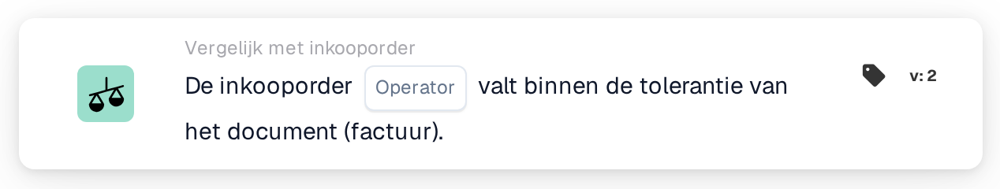

# Volledige match met inkooporder

<figure><figcaption>
Versie 2
</figcaption></figure>

## Doel:

Deze workflowkaart controleert of de gematchte inkooporder als geheel binnen de toleranties met het document overeenkomt. Hoeveelheid, eenheidsprijs en bijkomende kosten van elke gematchte regel worden in één stap gecontroleerd, zodat één kaart kan bepalen of een document zonder handmatige controle kan worden verwerkt.

De inkoopordermatching hoort vóór deze kaart te lopen. Zonder gematchte inkooporder meldt de kaart ontbrekende gegevens.

## Onderdelen van de kaart:

1. **Operator**
   * **Beschrijving:** Of de inkooporder wel of niet volledig met het document hoort overeen te komen.
   * **Opties:**
     * **Is:** Aan de voorwaarde is voldaan als elke controle binnen de tolerantie valt.
     * **Is niet:** Aan de voorwaarde is voldaan als minstens één controle buiten de tolerantie valt.

## Functionaliteit:

* **Voorwaarde-evaluatie:** De kaart doorloopt elke gematchte inkooporderregel (inclusief subregels) en gebruikt de vergelijkingsgegevens die de inkoopordermatching daarvoor heeft opgeslagen:
  * **Hoeveelheid:** De hoeveelheid op het document wordt vergeleken met de hoeveelheid op de inkooporder, binnen de hoeveelheidstolerantie van de regel.
  * **Eenheidsprijs:** De eenheidsprijs op het document wordt vergeleken met de eenheidsprijs op de inkooporder, binnen de eenheidsprijstolerantie van de regel. Heeft de regel in haar vergelijkingsgegevens geen eenheidsprijs, maar alleen in haar algemene matchinginformatie, dan gebruikt de kaart de voor het documenttype geconfigureerde eenheidsprijstolerantie in plaats van de op de regel opgeslagen tolerantie; een procentuele tolerantie wordt dan berekend op basis van de prijs op de inkooporder.
  * **Bijkomende kosten:** Voor elke bijkomende kost van de regel worden het kostentarief, de eenheidsprijs en het bedrag elk binnen hun toleranties met de inkooporder vergeleken.
  * Voor leveringsbonnen, die geen prijzen bevatten, wordt alleen de hoeveelheid vergeleken.
* Alle controles van alle regels worden samengevoegd: de inkooporder komt alleen volledig overeen als elke afzonderlijke controle binnen de tolerantie valt.
* **Actie-uitvoering:**
  * **True-voorwaarde:**\
    Met **Is** valt elke controle binnen de tolerantie, met **Is niet** minstens één niet. De workflow gaat verder.
  * **False-voorwaarde:**\
    Anders stopt de workflow met een niet voldane voorwaarde.
* **Ontbrekende gegevens:** De kaart evalueert de voorwaarde niet en meldt ontbrekende gegevens in het workflowlogboek wanneer het document geen gematchte inkooporder heeft, of wanneer een gematchte regel een deel van de voor haar controles benodigde gegevens mist, bijvoorbeeld een hoeveelheid, een eenheidsprijs, een waarde van een bijkomende kost of de tolerantie van een van deze (inclusief een ontbrekende of onbruikbare eenheidsprijstolerantie op het documenttype, waar die nodig is). Een ontbrekende tolerantie wordt niet behandeld als een tolerantie van 0. Dit geldt ook bij **Is niet**: ontbrekende gegevens worden als ontbrekende gegevens gemeld, niet als afwijking.

## Opzet en configuratie:

* De kaart kan als And-voorwaarde na de inkoopordermatching worden toegevoegd vanuit de categorie **Vergelijk met inkooporder**. Daarna kan de operator (**Is** of **Is niet**) worden geselecteerd. De toleranties zelf worden niet op de kaart ingesteld; ze komen uit de inkoopordermatching en de instellingen van het documenttype.
* Met **Testkaart** in het kaartmenu van de Workflow Builder kan de kaart op een bestaand document worden uitgeprobeerd. Het kaartlogboek somt elke vergelijking van hoeveelheid, eenheidsprijs en kosten op met de waarden van het document en de inkooporder.

## Conclusie:

De workflowkaart "Purchase Order Full Match" vat de inkoopordervergelijking van een document samen in één voorwaarde. Documenten die op elke regel met hun inkooporder overeenkomen, kunnen automatisch doorgaan, terwijl elk verschil buiten de toleranties als niet voldane voorwaarde wordt gemeld en ontbrekende vergelijkingsgegevens als ontbrekende gegevens, nooit als overeenkomst.
