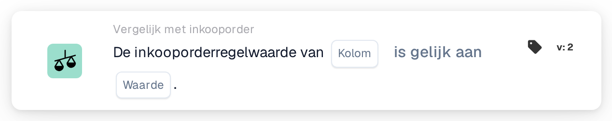

# Waarde van inkooporderregel

<figure><figcaption>
Versie 2
</figcaption></figure>

## Doel:

Deze workflowkaart vergelijkt een kolom van de gematchte inkooporderregels met een vaste waarde. De kaart kan worden gebruikt om een eigenschap van de bestelde regels te controleren die niet op het document staat, bijvoorbeeld een status, een eenheidscode of een leveringsmethode, en het document daarop af te stemmen.

De inkoopordermatching hoort vóór deze kaart te lopen. Zonder gematchte inkooporder meldt de kaart ontbrekende gegevens.

## Onderdelen van de kaart:

1. **Kolom**
   * **Beschrijving:** De kolom van de inkooporderregel waarvan de waarde wordt vergeleken.
2. **Operator**
   * **Beschrijving:** Hoe de waarde van de inkooporderregel wordt vergeleken met de waarde op de kaart. De standaardinstelling is **is gelijk aan**.
   * **Opties:**
     * **is gelijk aan:** De waarde van de regel is gelijk aan de waarde. Bij tekst wordt geen onderscheid gemaakt tussen hoofd- en kleine letters.
     * **Niet gelijk:** De waarde van de regel verschilt van de waarde. Bij tekst tellen hoofd- en kleine letters mee.
     * **Groter dan**, **Groter of gelijk aan**, **Minder dan**, **Kleiner of gelijk aan:** Vooral nuttig voor numerieke kolommen.
     * **Bevat:** De waarde van de regel is precies een van de items in **Waarde**, inclusief hoofd- en kleine letters. Gedeeltelijke overeenkomsten tellen niet mee.
     * **Bevat niet:** De waarde van de regel is geen van de items in **Waarde** (op dezelfde exacte manier vergeleken).
3. **Waarde**
   * **Beschrijving:** De waarde waarmee de waarde van de inkooporderregel wordt vergeleken.
   * **Detail:** Bij **Bevat** en **Bevat niet** kunnen meerdere items worden ingevoerd, gescheiden door komma's. Bij de operatoren voor groter en kleiner wordt een lijst met waarden niet ondersteund.

## Functionaliteit:

* **Voorwaarde-evaluatie:** Voor elke gematchte inkooporderregel (inclusief subregels) leest de kaart de waarde van de geselecteerde kolom en vergelijkt ze die met de operator met **Waarde**. Zijn beide getallen, dan worden ze als getallen vergeleken, anders als tekst.
* Elke vergeleken regel hoort aan de voorwaarde te voldoen; deze kaart heeft geen optie **Elk/Alle**.
* **Actie-uitvoering:**
  * **True-voorwaarde:**\
    Voldoet elke vergeleken regel aan de voorwaarde, dan gaat de workflow verder.
  * **False-voorwaarde:**\
    Voldoet minstens één regel er niet aan, dan stopt de workflow met een niet voldane voorwaarde.
* **Ontbrekende gegevens:** De kaart evalueert de voorwaarde niet en meldt ontbrekende gegevens in het workflowlogboek wanneer **Kolom** of **Waarde** niet is ingesteld, wanneer het document geen gematchte inkooporder heeft of de gegevens ervan niet beschikbaar zijn, wanneer de geselecteerde kolom van een gematchte regel leeg is (een numerieke waarde van 0 geldt ook als leeg), of wanneer er geen enkele regel kon worden vergeleken.
* **Instellingsfout:** Bevat **Waarde** een komma en is een van de operatoren voor groter of kleiner geselecteerd, dan stopt de kaart met een instellingsfout.

## Opzet en configuratie:

* De kaart kan als And-voorwaarde na de inkoopordermatching worden toegevoegd vanuit de categorie **Vergelijk met inkooporder**. Daarna kunnen de **Kolom** van de inkooporderregel, de operator en de **Waarde** worden ingesteld. Voor een controle tegen meerdere toegestane waarden kan **Bevat** met een door komma's gescheiden lijst worden gebruikt.
* Met **Testkaart** in het kaartmenu van de Workflow Builder kan de kaart op een bestaand document worden uitgeprobeerd. Het kaartlogboek somt elke vergeleken regelwaarde op met de operator en de gebruikte waarde.

## Conclusie:

De workflowkaart "Purchase Order Line Value" brengt gegevens van inkooporderregels als eenvoudige voorwaarde in de workflow. Zo kan een workflow reageren op de manier waarop de goederen zijn besteld, ook wanneer die informatie niet op het document zelf staat.
