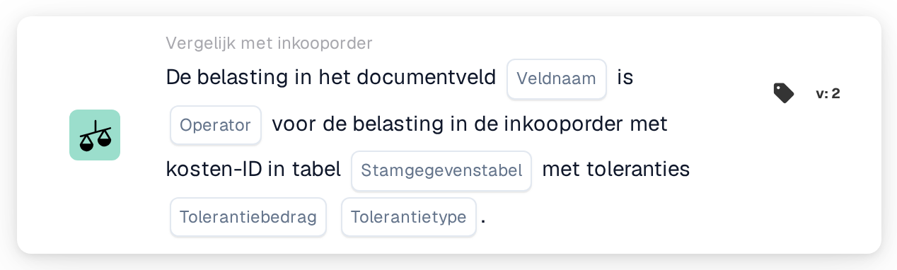

# Belasting in documentveld

<figure><figcaption>
Versie 2
</figcaption></figure>

## **Doel:**

Deze workflow-kaart is ontworpen om te evalueren of de btw-waarde in een documentveld overeenkomt met de btw-waarde in een inkooporder, rekening houdend met toleranties op basis van de charge-ID. De kaart vergelijkt deze twee btw-waarden (een uit het documentveld en een uit de inkooporder) en controleert of ze aan een opgegeven voorwaarde voldoen (bijv. gelijk aan, groter dan, kleiner dan, enz.). Dit helpt ervoor te zorgen dat btw-waarden consistent zijn en afwijkingen voor verdere beoordeling of goedkeuring in inkoopworkflows te markeren.

## **Onderdelen van de kaart:**

1. **Veldnaam**
   * **Beschrijving**: Geeft het documentveld op dat de btw-waarde bevat die met de btw-waarde in de inkooporder wordt vergeleken.
   * **Details**: Dit veld moet exact overeenkomen met de identifier voor de btw-waarde in het document.
2. **Exploitant**
   * **Beschrijving**: Definieert de voorwaarde die wordt toegepast op de vergelijking tussen de btw-waarde van het document en de btw-waarde van de inkooporder.
   * **Opties**:
     * **Is gelijk aan (=)**: Controleert of de btw in het documentveld overeenkomt met de btw in de inkooporder.
     * **Niet gelijk aan (≠)**: Zorgt ervoor dat de btw in het documentveld niet overeenkomt met de btw in de inkooporder.
     * **Groter dan (>)**: Verifieert of de btw in het documentveld groter is dan de btw in de inkooporder.
     * **Groter of gelijk aan (≥)**: Controleert of de btw in het documentveld groter dan of gelijk is aan de btw in de inkooporder.
     * **Kleiner dan (<)**: Verifieert of de btw in het documentveld kleiner is dan de btw in de inkooporder.
     * **Kleiner of gelijk aan (≤)**: Controleert of de btw in het documentveld kleiner dan of gelijk is aan de btw in de inkooporder.
3. **Stamgegevenstabel**
   * **Beschrijving**: De tabel die de inkooporderdetails bevat, waaronder de charge-ID en btw-waarden.
   * **Details**: Deze tabel moet een verwijzing bevatten naar de charge-ID die aan de btw-waarde van de inkooporder is gekoppeld.
4. **Tolerantiebedrag**
   * **Beschrijving**: Het drempelbedrag waarbinnen de btw-waarden mogen variëren. Dit wordt gebruikt om rekening te houden met kleine afwijkingen in btw-berekeningen.
   * **Details**: Het tolerantiebedrag moet een numerieke waarde zijn die het maximaal toegestane verschil tussen de btw-waarden definieert.
5. **Tolerantietype**
   * **Beschrijving**: Geeft het type tolerantie op dat wordt toegepast, ofwel absoluut ofwel op percentage gebaseerd.
   * **Opties**:
     * **Waarde**: De tolerantie is een vaste numerieke waarde.
     * **Percentage**: De tolerantie wordt berekend als een percentage van de btw-waarde.

## **Functionaliteit:**

* **Voorwaarde-evaluatie:** Het systeem evalueert of de btw-waarde in het documentveld aan de opgegeven voorwaarde voldoet wanneer deze wordt vergeleken met de btw-waarde in de inkooporder (met de charge-ID-verwijzing uit de master-data-tabel). Het tolerantiebedrag en -type worden in deze evaluatie meegenomen om kleine verschillen in btw-berekeningen toe te staan.
* **Actie-uitvoering:**
  * **True-voorwaarde**: Als de btw in het documentveld aan de voorwaarde voldoet wanneer deze wordt vergeleken met de btw van de inkooporder (binnen het tolerantiebedrag en -type), gaat de workflow verder.
  * **False-voorwaarde**: Als de btw in het documentveld niet aan de voorwaarde voldoet (ofwel niet binnen het tolerantiebereik, ofwel de vergelijking mislukt), stopt de workflow.

## **Opzet en configuratie:**

* Gebruikers moeten het documentveld selecteren dat de te vergelijken btw-waarde bevat. Vervolgens kiezen ze de operator voor hoe de vergelijking moet worden gemaakt (bijv. equals, greater than). Daarna moeten gebruikers de master-data-tabelverwijzing opgeven en het tolerantiebedrag en -type instellen om rekening te houden met kleine btw-afwijkingen.

## **Voorbeeldscenario:**

* Een factuur vermeldt een btw-bedrag van $100. De bijbehorende inkooporder, gevonden in de master-data-tabel, geeft een btw-waarde van $95 op. Met de operator "Greater Than" vergelijkt het systeem de btw-waarde van het document ($100) met de btw-waarde van de inkooporder ($95) met een tolerantie van $10 (absoluut tolerantietype). Omdat het verschil van $5 binnen het tolerantiebereik valt, gaat de workflow verder zonder waarschuwingen te triggeren.

## **Conclusie:**

De workflow-kaart "Tax in Document Field Comparison" zorgt ervoor dat btw-waarden in documenten overeenkomen met inkooporderdetails, waarbij kleine afwijkingen op basis van opgegeven toleranties worden toegestaan. Door deze controle te automatiseren, kunnen organisaties fouten in btw-berekeningen minimaliseren en inkoopprocessen stroomlijnen, wat de noodzaak van handmatige interventie of goedkeuringen vermindert.
