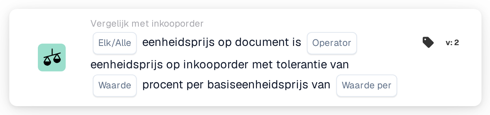

# Eenheidsprijstolerantie per basisprijs

<figure><figcaption>
Versie 2
</figcaption></figure>

## Doel:

Deze workflowkaart vergelijkt de eenheidsprijzen op het document met de eenheidsprijzen op de gematchte inkooporderregels, met een procentuele tolerantie die meegroeit met de prijs op de inkooporder. De tolerantie wordt ingevoerd als percentage per basiseenheidsprijs, zodat duurdere artikelen een grotere procentuele tolerantie krijgen dan goedkopere.

Voor een vaste tolerantie kan de kaart **Any / All Unit Price is** worden gebruikt.

De inkoopordermatching hoort vóór deze kaart te lopen. Zonder gematchte inkooporder meldt de kaart ontbrekende gegevens.

## Onderdelen van de kaart:

1. **Elk/Alle**
   * **Beschrijving:** Hoe de vergelijkingen van de afzonderlijke regels worden samengevoegd tot het resultaat van de kaart.
   * **Opties:**
     * **Elk:** Minstens één regel voldoet aan de vergelijking.
     * **Alle:** Elke vergeleken regel voldoet aan de vergelijking. Is er geen waarde ingesteld, dan gebruikt de kaart **Alle**.
2. **Operator**
   * **Beschrijving:** Hoe de eenheidsprijs op het document wordt vergeleken met de eenheidsprijs op de inkooporder, rekening houdend met de tolerantie.
   * **Opties:**
     * **is gelijk aan:** De prijs op het document ligt binnen het tolerantiebereik rond de prijs op de inkooporder.
     * **Niet gelijk:** De prijs op het document ligt buiten het tolerantiebereik.
     * **Groter dan:** De prijs op het document ligt boven het tolerantiebereik.
     * **Groter of gelijk aan:** De prijs op het document ligt binnen of boven het tolerantiebereik.
     * **Minder dan:** De prijs op het document ligt onder het tolerantiebereik.
     * **Kleiner of gelijk aan:** De prijs op het document ligt binnen of onder het tolerantiebereik.
3. **Waarde**
   * **Beschrijving:** De tolerantie in procent die bij de basiseenheidsprijs geldt.
   * **Detail:** Een getal, bijvoorbeeld `1` voor 1 procent.
4. **Waarde per**
   * **Beschrijving:** De basiseenheidsprijs waarop het tolerantiepercentage betrekking heeft.
   * **Detail:** Een getal groter dan 0, bijvoorbeeld `100`.

## Functionaliteit:

* **Berekening van de tolerantie:** Voor elke regel wordt het tolerantiepercentage geschaald met de verhouding tussen de eenheidsprijs op de inkooporder en de basiseenheidsprijs:\
  tolerantie % = **Waarde** × (eenheidsprijs op de inkooporder ÷ **Waarde per**)\
  Het tolerantiebereik is de eenheidsprijs op de inkooporder plus en min dit percentage.\
  Voorbeeld met **Waarde** 1 en **Waarde per** 100: een prijs op de inkooporder van 50 geeft een tolerantie van 0,5 %, dus het bereik is 49,75 tot 50,25. Een prijs op de inkooporder van 200 geeft 2 %, dus het bereik is 196 tot 204.
* **Voorwaarde-evaluatie:** Voor elke gematchte inkooporderregel wordt de eenheidsprijs op het document vergeleken met de eenheidsprijs van de inkooporderregel, met de operator en het berekende bereik. Gematchte items zonder inkooporderregel worden overgeslagen. De resultaten worden samengevoegd met **Elk/Alle**.
* **Actie-uitvoering:**
  * **True-voorwaarde:**\
    Wordt aan het samengevoegde resultaat voldaan, dan gaat de workflow verder.
  * **False-voorwaarde:**\
    Wordt niet aan het samengevoegde resultaat voldaan, dan stopt de workflow met een niet voldane voorwaarde. Dat is ook het geval wanneer er geen enkele regel kon worden vergeleken.
* **Ontbrekende gegevens:** De kaart evalueert de voorwaarde niet en meldt ontbrekende gegevens in het workflowlogboek wanneer **Waarde** of **Waarde per** niet is ingesteld, wanneer het document geen gematchte inkooporder heeft, of wanneer bij het document of de inkooporder de eenheidsprijs van een vergeleken regel ontbreekt (een lege eenheidsprijs of een numerieke eenheidsprijs van 0 geldt als ontbrekend).
* **Fouten:** De kaart stopt met een fout wanneer **Waarde** of **Waarde per** geen getal is, wanneer een eenheidsprijs niet als getal kan worden gelezen, wanneer **Waarde per** 0 is, of wanneer de berekende tolerantie voor een regel onder 0 % of boven 100 % ligt.

## Opzet en configuratie:

* De kaart kan als And-voorwaarde na de inkoopordermatching worden toegevoegd vanuit de categorie **Vergelijk met inkooporder**. Daarna kunnen **Elk/Alle**, de operator, het tolerantiepercentage in **Waarde** en de basiseenheidsprijs in **Waarde per** worden ingevoerd. De basiseenheidsprijs wordt het best zo gekozen dat de berekende tolerantie voor de prijsklasse van de artikelen tussen 0 % en 100 % blijft.
* Met **Testkaart** in het kaartmenu van de Workflow Builder kan de kaart op een bestaand document worden uitgeprobeerd. Het kaartlogboek toont voor elke regel beide prijzen, de berekende tolerantie in procent en het resulterende bereik.

## Conclusie:

De workflowkaart "Unit Price Tolerance per Base Price" past bij de vergelijking van de eenheidsprijs met de inkooporder een prijsafhankelijke tolerantie toe. Zo is met één kaart een krappe tolerantie voor goedkope artikelen en een ruimere voor dure artikelen mogelijk.
