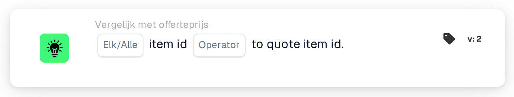

# Vergelijk artikel-ID met offerteartikel-ID

<figure><figcaption>
Versie 2
</figcaption></figure>

## Doel:

Deze workflowkaart vergelijkt het artikelnummer op elke regel van een document met het artikelnummer dat voor hetzelfde leveranciersartikel in de prijstabel voor leveranciersartikelen is opgeslagen. De kaart kan worden gebruikt om regels op te sporen waarop het document een ander artikel noemt dan het artikel waarop de prijsgegevens betrekking hebben. Afhankelijk van het resultaat gaat de workflow verder met de true- of de false-voorwaarde.

## Onderdelen van de kaart:

1. **Elk/Alle**
   * **Beschrijving:** Bepaalt of één regel of elke vergeleken regel van de documenttabel aan de voorwaarde hoort te voldoen.
   * **Opties:**
     * **Elk:** De voorwaarde is waar als minstens één vergeleken regel aan de voorwaarde voldoet.
     * **Alle:** De voorwaarde is alleen waar als elke vergeleken regel aan de voorwaarde voldoet.
2. **Operator**
   * **Beschrijving:** Bepaalt hoe het artikelnummer in de prijstabel voor leveranciersartikelen wordt vergeleken met het artikelnummer op de documentregel.
   * **Opties:**
     * **is gelijk aan:** De artikelnummers zijn gelijk. Artikelnummers die allebei als getal kunnen worden gelezen, worden als getallen vergeleken (zo zijn "007" en "7" gelijk); anders worden ze als tekst vergeleken, zonder onderscheid tussen hoofd- en kleine letters.
     * **Niet gelijk:** De artikelnummers verschillen. Artikelnummers die allebei als getal kunnen worden gelezen, worden als getallen vergeleken; anders worden ze als tekst vergeleken, en daarbij wordt wel onderscheid gemaakt tussen hoofd- en kleine letters.
     * **Groter dan, Groter of gelijk aan, Minder dan, Kleiner of gelijk aan:** Worden ook door de kaart aangeboden. Met deze operatoren worden de artikelnummers altijd als tekst vergeleken, teken voor teken, zodat bijvoorbeeld "10" als kleiner dan "9" geldt.

## Functionaliteit:

* **Voorwaarde-evaluatie:** Voor elke regel in de documenttabel zoekt de kaart de leveranciersartikel-ID van de regel (kolom `SUPPLIER_ITEM_NUMBER`) op in de prijstabel voor leveranciersartikelen en vergelijkt ze het daar opgeslagen artikelnummer met het artikelnummer van de regel (kolom `ITEM_NUMBER`). De resultaten van alle vergeleken regels worden vervolgens samengevoegd met **Elk** of **Alle**.
* **Overgeslagen regels:** Een regel wordt buiten de vergelijking gelaten als de prijstabel voor leveranciersartikelen geen item voor haar leveranciersartikel-ID heeft, of als het item geen artikelnummer heeft. Elke overgeslagen regel wordt in het workflowlogboek vermeld.
* **Geldigheidsdata:** Heeft een item in de prijstabel voor leveranciersartikelen een begin- of einddatum en ligt de documentdatum buiten die periode, dan vermeldt de kaart dit in het workflowlogboek. Deze vermelding verandert het resultaat van de kaart niet.
* **Actie-uitvoering:**
  * **True-voorwaarde:**\
    De artikelnummers voldoen bij elke of alle vergeleken regels aan de geselecteerde operator. De workflow gaat verder met de true-voorwaarde.
  * **False-voorwaarde:**\
    Als niet aan de voorwaarde is voldaan, gaat de workflow verder met de false-voorwaarde, bijvoorbeeld om het document ter handmatige controle door te sturen. De false-voorwaarde wordt ook gebruikt als geen enkele regel kon worden vergeleken, omdat geen regel een artikelnummer in de prijstabel voor leveranciersartikelen had.
* **Ontbrekende gegevens:** Heeft het document geen tabel of meer dan één tabel, of konden er geen regels uit de tabel worden gelezen, dan evalueert de kaart de voorwaarde niet en meldt ze de ontbrekende gegevens in het workflowlogboek. Is er geen optie **Elk/Alle** ingesteld, dan vermeldt de kaart dit in het logboek en gebruikt ze **Alle**.

## Opzet en configuratie:

* De kaart kan worden toegevoegd vanuit de categorie **Vergelijk met offerteprijs**. Daarna kunnen **Elk** of **Alle** en de operator worden geselecteerd. Voor een controle op overeenkomende artikelnummers is **is gelijk aan** of **Niet gelijk** de gebruikelijke keuze. Tot slot wordt de vervolgvoorwaarde (true of false) ingesteld, die de volgende stap in de workflow bepaalt.
* De kaart werkt op documenten met precies één tabel, waarvan de regels de leveranciersartikel-ID en het artikelnummer bevatten.

## Conclusie:

De workflowkaart "Item ID to Quote Item ID" zorgt ervoor dat de artikelen op een document overeenkomen met de artikelen waarop de prijstabel voor leveranciersartikelen betrekking heeft. Regels zonder prijsgegevens worden overgeslagen in plaats van als verschil te worden geteld, zodat het resultaat alleen regels weerspiegelt die daadwerkelijk kunnen worden vergeleken.
