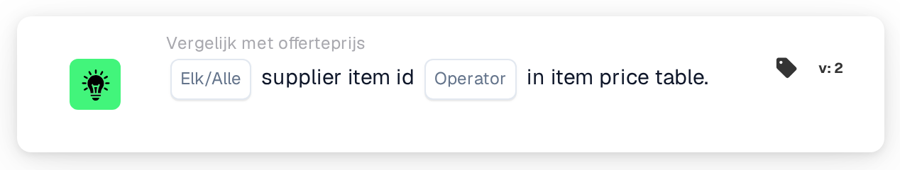

# Leveranciersartikel-ID in artikelprijstabel

<figure><figcaption>
Versie 2
</figcaption></figure>

## Doel:

Deze workflowkaart controleert of de leveranciersartikel-ID's op de regels van een document in de prijstabel voor leveranciersartikelen te vinden zijn. De kaart kan worden gebruikt om na te gaan of DocBits voor de leverancier van het document prijsgegevens heeft voor de artikelen op een offerte, voordat andere offertevergelijkingen worden uitgevoerd, of om documenten met onbekende artikelen naar een handmatige controle te sturen. Afhankelijk van het resultaat gaat de workflow verder met de true- of de false-voorwaarde.

## Onderdelen van de kaart:

1. **Elk/Alle**
   * **Beschrijving:** Bepaalt of één regel of elke regel van de documenttabel aan de voorwaarde hoort te voldoen.
   * **Opties:**
     * **Elk:** De voorwaarde is waar als minstens één regel aan de voorwaarde voldoet.
     * **Alle:** De voorwaarde is alleen waar als elke regel aan de voorwaarde voldoet.
2. **Operator**
   * **Beschrijving:** Bepaalt of de leveranciersartikel-ID wel of niet in de prijstabel voor leveranciersartikelen hoort voor te komen.
   * **Opties:**
     * **Is:** Een regel voldoet aan de voorwaarde als haar leveranciersartikel-ID in de prijstabel voor leveranciersartikelen staat.
     * **Is niet:** Een regel voldoet aan de voorwaarde als haar leveranciersartikel-ID niet in de prijstabel voor leveranciersartikelen staat.

## Functionaliteit:

* **Voorwaarde-evaluatie:** De kaart leest de leveranciersartikel-ID (kolom `SUPPLIER_ITEM_NUMBER`) van elke regel in de documenttabel en controleert of de prijstabel voor leveranciersartikelen daarvoor een item bevat. De resultaten van alle regels worden vervolgens samengevoegd met **Elk** of **Alle**.
* **Geldigheidsdata:** Heeft een item in de prijstabel voor leveranciersartikelen een begin- of einddatum en ligt de documentdatum buiten die periode, dan vermeldt de kaart dit in het workflowlogboek. Deze vermelding verandert het resultaat van de kaart niet.
* **Actie-uitvoering:**
  * **True-voorwaarde:**\
    Met **Is** staan de leveranciersartikel-ID's (elk of alle, zoals geselecteerd) in de prijstabel voor leveranciersartikelen, met **Is niet** staan ze er niet in. De workflow gaat verder met de true-voorwaarde, bijvoorbeeld om door te gaan met de prijsvergelijking.
  * **False-voorwaarde:**\
    Als niet aan de voorwaarde is voldaan, gaat de workflow verder met de false-voorwaarde, bijvoorbeeld om het document ter handmatige controle door te sturen.
* **Ontbrekende gegevens:** Heeft het document geen tabel of meer dan één tabel, konden er geen regels uit de tabel worden gelezen, of heeft het document helemaal geen prijsgegevens van leveranciersartikelen, dan evalueert de kaart de voorwaarde niet en meldt ze de ontbrekende gegevens in het workflowlogboek. Is er geen optie **Elk/Alle** ingesteld, dan vermeldt de kaart dit in het logboek en gebruikt ze **Alle**.
* **Fouten:** De kaart eindigt met een fout als een regel van de tabel geen kolom `SUPPLIER_ITEM_NUMBER` heeft. Is er geen operator ingesteld, dan meldt de kaart een instellingsfout.

## Opzet en configuratie:

* De kaart kan worden toegevoegd vanuit de categorie **Vergelijk met offerteprijs**. Daarna kunnen **Elk** of **Alle** en de operator (**Is** of **Is niet**) worden geselecteerd. Tot slot wordt de vervolgvoorwaarde (true of false) ingesteld, die de volgende stap in de workflow bepaalt.
* De kaart werkt op documenten met precies één tabel, waarvan de regels de leveranciersartikel-ID bevatten.

## Conclusie:

De workflowkaart "Supplier Item ID in Item Price Table" laat zien of de artikelen op een document bekend zijn in de prijstabel voor leveranciersartikelen. De kaart kan dienen als eerste controle in een offerteworkflow, zodat de latere vergelijkingen van prijs, artikelnummer en maateenheid alleen worden uitgevoerd voor documenten waarvan de artikelen prijsgegevens hebben.
