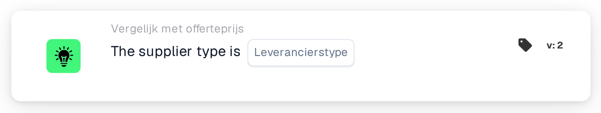

# Leverancierstype

<figure><figcaption>
Versie 2
</figcaption></figure>

## Doel:

Deze workflowkaart controleert het leverancierstype van de artikelen in de prijsgegevens van leveranciersartikelen van een document, bijvoorbeeld of het om contractartikelen of beheerde artikelen gaat. De kaart kan worden gebruikt om verschillende goedkeuringsregels toe te passen, afhankelijk van hoe de artikelen van de leverancier worden beheerd. Afhankelijk van het resultaat gaat de workflow verder met de true- of de false-voorwaarde.

## Onderdelen van de kaart:

1. **Leverancierstype**
   * **Beschrijving:** Het leverancierstype waartegen het document wordt gecontroleerd.
   * **Opties:**
     * **Contract:** Komt overeen met items waarvan de beheerklasse "contract" is.
     * **Managed:** Komt overeen met items waarvan de beheerklasse "managed" is.
     * **NonManaged:** Komt overeen met items waarvan de beheerklasse "unmanaged" is.

## Functionaliteit:

* **Voorwaarde-evaluatie:** De kaart leest het leverancierstype (beheerklasse) van elk item in de prijsgegevens van leveranciersartikelen van het document en vergelijkt het met het op de kaart geselecteerde leverancierstype. Bij de vergelijking wordt geen onderscheid gemaakt tussen hoofd- en kleine letters.
* **Actie-uitvoering:**
  * **True-voorwaarde:**\
    Elk item in de prijsgegevens van leveranciersartikelen heeft het geselecteerde leverancierstype. De workflow gaat verder met de true-voorwaarde, bijvoorbeeld om de regels voor dit leverancierstype toe te passen.
  * **False-voorwaarde:**\
    Heeft minstens één item een ander leverancierstype of geen beheerklasse, dan gaat de workflow verder met de false-voorwaarde.
* **Ontbrekende gegevens:** Is er op de kaart geen leverancierstype geselecteerd of heeft het document geen prijsgegevens van leveranciersartikelen, dan evalueert de kaart de voorwaarde niet en meldt ze de ontbrekende gegevens in het workflowlogboek.

## Opzet en configuratie:

* De kaart kan worden toegevoegd vanuit de categorie **Vergelijk met offerteprijs**. Daarna kan het leverancierstype in het veld **Leverancierstype** worden geselecteerd. Tot slot wordt de vervolgvoorwaarde (true of false) ingesteld, die de volgende stap in de workflow bepaalt.

## Conclusie:

Met de workflowkaart "Supplier Type" kan een offerteworkflow vertakken op het leverancierstype van de artikelen, zodat contractartikelen, beheerde en niet-beheerde artikelen elk met hun eigen regels kunnen worden behandeld.
