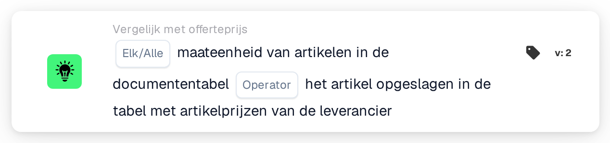
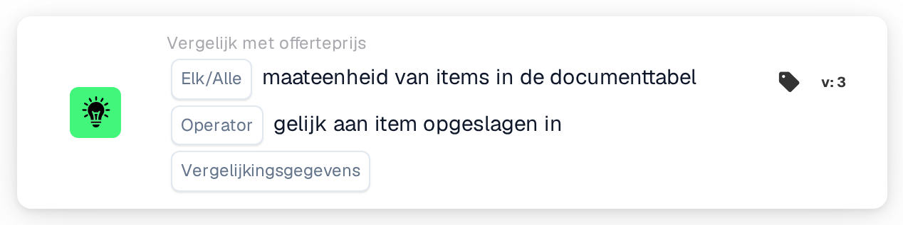

# Maateenheid

<figure><figcaption>
Versie 2
</figcaption></figure>

<figure><figcaption>
Versie 3
</figcaption></figure>

## Doel:

Deze workflowkaart vergelijkt de maateenheid van de artikelen in de documenttabel met de maateenheid die elders voor dezelfde artikelen is opgeslagen. In versie 2 wordt altijd vergeleken met de prijstabel voor leveranciersartikelen. Versie 3 voegt een keuze toe tussen de prijstabel voor leveranciersartikelen en de regelitems van de gematchte inkooporder. De kaart kan worden gebruikt om regels op te sporen waarop een artikel in een andere eenheid wordt geoffreerd of gefactureerd dan verwacht. Afhankelijk van het resultaat gaat de workflow verder met de true- of de false-voorwaarde.

## Onderdelen van de kaart:

1. **Elk/Alle**
   * **Beschrijving:** Bepaalt of één regel of elke vergeleken regel van de documenttabel aan de voorwaarde hoort te voldoen.
   * **Opties:**
     * **Elk:** De voorwaarde is waar als minstens één vergeleken regel aan de voorwaarde voldoet.
     * **Alle:** De voorwaarde is alleen waar als elke vergeleken regel aan de voorwaarde voldoet.
2. **Operator**
   * **Beschrijving:** Bepaalt of de maateenheden gelijk of verschillend horen te zijn.
   * **Opties:**
     * **is gelijk aan:** De maateenheid op de documentregel is gelijk aan de opgeslagen maateenheid.
     * **Niet gelijk:** De maateenheid op de documentregel verschilt van de opgeslagen maateenheid.
3. **Vergelijkingsgegevens** (alleen versie 3)
   * **Beschrijving:** De bron waarmee de maateenheid van het document wordt vergeleken.
   * **Opties:**
     * **geciteerde leverancier artikelprijs:** De maateenheid die voor het leveranciersartikel in de prijstabel voor leveranciersartikelen is opgeslagen, zoals in versie 2.
     * **inkooporderregelartikel:** De maateenheid van de gematchte inkooporderregel.

## Functionaliteit:

* **Voorwaarde-evaluatie:** De kaart leest de maateenheid (kolom `UNIT`) van de regels in de eerste documenttabel en vergelijkt deze met de geselecteerde bron. Bij de vergelijking wordt geen onderscheid gemaakt tussen hoofd- en kleine letters. De resultaten van alle vergeleken regels worden vervolgens samengevoegd met **Elk** of **Alle**.
  * **geciteerde leverancier artikelprijs:** Alleen regels die aan een item van de gematchte offertegegevens zijn gekoppeld, worden vergeleken. Voor elk van deze regels wordt de maateenheid gebruikt die voor het bijbehorende leveranciersartikel is opgeslagen.
  * **inkooporderregelartikel** (versie 3): Alleen regels die aan een inkooporderregel zijn gematcht, worden vergeleken. De maateenheid van de inkooporderregel wordt eerst vertaald met de opzoektabel voor maateenheden (van de EDI-eenheid naar de M3-eenheid). Aan beide zijden worden enkele schrijfwijzen als gelijk behandeld: "each" als "ea", en "lbs" en "lbp" als "lb".
* **Overgeslagen regels:** Een regel wordt buiten de vergelijking gelaten als de bron er geen maateenheid voor heeft. Elke overgeslagen regel wordt in het workflowlogboek vermeld.
* **Actie-uitvoering:**
  * **True-voorwaarde:**\
    De maateenheden voldoen bij elke of alle vergeleken regels aan de geselecteerde operator. De workflow gaat verder met de true-voorwaarde.
  * **False-voorwaarde:**\
    Als niet aan de voorwaarde is voldaan, gaat de workflow verder met de false-voorwaarde, bijvoorbeeld om het document ter handmatige controle door te sturen. De false-voorwaarde wordt ook gebruikt als geen enkele regel aan de geselecteerde bron kon worden gekoppeld, en in versie 3 als er geen optie **Vergelijkingsgegevens** is geselecteerd, omdat er dan geen regel wordt vergeleken.
* **Ontbrekende gegevens:** De kaart evalueert de voorwaarde niet en meldt de ontbrekende gegevens in het workflowlogboek als:
  * het document geen tabel heeft,
  * **geciteerde leverancier artikelprijs** (of versie 2) wordt gebruikt en het document geen gematchte offertegegevens of geen prijsgegevens van leveranciersartikelen heeft,
  * **inkooporderregelartikel** is geselecteerd en het document geen gematchte inkooporder heeft,
  * een vergeleken regel op het document een lege maateenheid heeft,
  * geen enkele regel kon worden vergeleken, omdat elke regel is overgeslagen.

  Is er geen optie **Elk/Alle** ingesteld, dan vermeldt de kaart dit in het logboek en gebruikt ze **Alle**.
* **Fouten:** Is bij **inkooporderregelartikel** een inkooporderregel opgesplitst in subregels met verschillende maateenheden, dan eindigt de kaart met een fout.

## Opzet en configuratie:

* De kaart kan worden toegevoegd vanuit de categorie **Vergelijk met offerteprijs**. Daarna kunnen **Elk** of **Alle** en de operator worden geselecteerd. In versie 3 kan in het veld **Vergelijkingsgegevens** ook de bron worden geselecteerd waarmee wordt vergeleken. Tot slot wordt de vervolgvoorwaarde (true of false) ingesteld, die de volgende stap in de workflow bepaalt.
* De documenttabel hoort een kolom `UNIT` te bevatten. Voor de vergelijking met regelitems van de inkooporder hoort de opzoektabel voor maateenheden de koppelingen te bevatten tussen de eenheden die op documenten en op inkooporders worden gebruikt.

## Conclusie:

De workflowkaart "Unit of Measure" zorgt ervoor dat artikelen in de verwachte eenheid worden geoffreerd of gefactureerd. Regels zonder opgeslagen maateenheid worden overgeslagen in plaats van als verschil te worden geteld, en versie 3 breidt de controle uit van de prijstabel voor leveranciersartikelen naar inkooporderregels.
