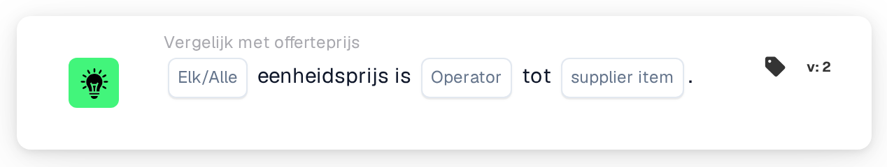

# Vergelijk eenheidsprijs met prijs van leveranciersartikel

<figure><figcaption>
Versie 2
</figcaption></figure>

## Doel:

Deze workflowkaart vergelijkt de eenheidsprijs op elke regel van een document met een prijs uit de prijstabel voor leveranciersartikelen: de beheerde prijs of de laatst betaalde prijs voor hetzelfde leveranciersartikel. De kaart kan worden gebruikt om te controleren of een geoffreerde prijs overeenkomt met de bekende prijs, daarboven ligt of daaronder blijft, voordat het document wordt goedgekeurd. Afhankelijk van het resultaat gaat de workflow verder met de true- of de false-voorwaarde.

## Onderdelen van de kaart:

1. **Elk/Alle**
   * **Beschrijving:** Bepaalt of één regel of elke vergeleken regel van de documenttabel aan de voorwaarde hoort te voldoen.
   * **Opties:**
     * **Elk:** De voorwaarde is waar als minstens één vergeleken regel aan de voorwaarde voldoet.
     * **Alle:** De voorwaarde is alleen waar als elke vergeleken regel aan de voorwaarde voldoet.
2. **Operator**
   * **Beschrijving:** Bepaalt hoe de eenheidsprijs op het document wordt vergeleken met de geselecteerde prijs van het leveranciersartikel.
   * **Opties:**
     * **is gelijk aan:** De eenheidsprijs is gelijk aan de prijs van het leveranciersartikel.
     * **Niet gelijk:** De eenheidsprijs verschilt van de prijs van het leveranciersartikel.
     * **Groter dan:** De eenheidsprijs is hoger dan de prijs van het leveranciersartikel.
     * **Groter of gelijk aan:** De eenheidsprijs is hoger dan of gelijk aan de prijs van het leveranciersartikel.
     * **Minder dan:** De eenheidsprijs is lager dan de prijs van het leveranciersartikel.
     * **Kleiner of gelijk aan:** De eenheidsprijs is lager dan of gelijk aan de prijs van het leveranciersartikel.
3. **supplier item**
   * **Beschrijving:** De prijs uit de prijstabel voor leveranciersartikelen waarmee de eenheidsprijs wordt vergeleken.
   * **Opties:**
     * **ManagedPrice:** De beheerde prijs die voor het leveranciersartikel is opgeslagen.
     * **LastPrice:** De laatst betaalde prijs voor het leveranciersartikel.

## Functionaliteit:

* **Voorwaarde-evaluatie:** Voor elke regel in de documenttabel zoekt de kaart de leveranciersartikel-ID van de regel (kolom `SUPPLIER_ITEM_NUMBER`) op in de prijstabel voor leveranciersartikelen en vergelijkt ze de eenheidsprijs van de regel (kolom `UNIT_PRICE`) met de geselecteerde prijs. Beide prijzen worden als getallen vergeleken. De resultaten van alle vergeleken regels worden vervolgens samengevoegd met **Elk** of **Alle**.
* **Overgeslagen regels:** Een regel wordt buiten de vergelijking gelaten als haar eenheidsprijs leeg is of niet als getal kan worden gelezen, of als er voor haar leveranciersartikel geen prijs van het geselecteerde soort is opgeslagen, bijvoorbeeld omdat het leveranciersartikel niet in de prijstabel voor leveranciersartikelen staat. Elke overgeslagen regel wordt in het workflowlogboek vermeld, samen met de zijde die geen prijs had.
* **Actie-uitvoering:**
  * **True-voorwaarde:**\
    De eenheidsprijzen voldoen bij elke of alle vergeleken regels aan de geselecteerde operator. De workflow gaat verder met de true-voorwaarde, bijvoorbeeld om het document goed te keuren.
  * **False-voorwaarde:**\
    Als niet aan de voorwaarde is voldaan, gaat de workflow verder met de false-voorwaarde, bijvoorbeeld om het document ter prijscontrole door te sturen.
* **Ontbrekende gegevens:** De kaart evalueert de voorwaarde niet en meldt de ontbrekende gegevens in het workflowlogboek als:
  * er op de kaart geen prijs van het leveranciersartikel is geselecteerd,
  * het document geen gematchte offertegegevens heeft,
  * het document geen tabel of meer dan één tabel heeft, of er geen regels uit de tabel konden worden gelezen,
  * geen enkele regel kon worden vergeleken, omdat elke regel is overgeslagen.

  Is er geen optie **Elk/Alle** ingesteld, dan vermeldt de kaart dit in het logboek en gebruikt ze **Alle**.
* **Fouten:** Heeft een regel van de tabel geen kolom `SUPPLIER_ITEM_NUMBER` of geen kolom `UNIT_PRICE`, dan eindigt de kaart met een fout.

## Opzet en configuratie:

* De kaart kan worden toegevoegd vanuit de categorie **Vergelijk met offerteprijs**. Daarna kunnen **Elk** of **Alle**, de operator en in het veld **supplier item** de prijs waarmee wordt vergeleken worden geselecteerd. Tot slot wordt de vervolgvoorwaarde (true of false) ingesteld, die de volgende stap in de workflow bepaalt.
* De kaart werkt op documenten met precies één tabel, waarvan de regels de leveranciersartikel-ID en de eenheidsprijs bevatten.

## Conclusie:

De workflowkaart "Unit Price to Supplier Item Price" controleert geoffreerde prijzen tegen de beheerde prijs of de laatst betaalde prijs. Regels zonder prijs aan een van beide zijden worden overgeslagen, zodat één onvolledige regel niet over het resultaat beslist, en een document zonder enige vergelijkbare regel wordt als ontbrekende gegevens gemeld.
