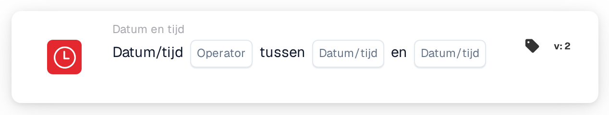

# Datum of tijd

<figure><figcaption>
Versie 2
</figcaption></figure>

## Doel:

Deze workflowkaart controleert of de huidige datum en tijd binnen of buiten een op de kaart ingesteld tijdvenster liggen. De kaart kan worden gebruikt om stappen te beperken tot bepaalde uren, bijvoorbeeld tot werktijden of een gepland onderhoudsvenster.

## Onderdelen van de kaart:

1. **Operator**
   * **Opties:**
     * **Is:** De huidige datum en tijd liggen binnen het tijdvenster.
     * **Is niet:** De huidige datum en tijd liggen buiten het tijdvenster.
2. **Eerste datum/tijd**
   * **Beschrijving:** Het ene uiteinde van het tijdvenster, als datum en tijd of alleen als tijd.
3. **Tweede datum/tijd**
   * **Beschrijving:** Het andere uiteinde van het tijdvenster.

## Functionaliteit:

* **Voorwaarde-evaluatie:** Wanneer de workflow de kaart bereikt, neemt de kaart de huidige datum en tijd in UTC en controleert of die tussen de twee waarden op de kaart liggen. De vroegste waarde wordt als begin gebruikt, dus de volgorde van de twee velden maakt niet uit.
  * Een waarde met alleen een tijd (bijvoorbeeld `09:00`) wordt gebruikt met de datum van vandaag, zodat het tijdvenster zich elke dag herhaalt.
  * Begin en einde horen bij het tijdvenster: precies op de begin- of eindtijd is **Is** waar.
  * Een tijdvenster over middernacht kan alleen met tijden worden ingevoerd, bijvoorbeeld `22:00` tot `04:00`. De kaart controleert dan elke dag op de tijd van 22:00 tot 04:00, inclusief de exacte begin- en eindtijd.
  * Met volledige datums op twee verschillende dagen (bijvoorbeeld `2026-11-01 22:00` tot `2026-11-02 04:00`) controleert de kaart de hele periode van het eerste tot het tweede tijdstip, inclusief begin en einde.
* **Actie-uitvoering:**
  * **True-voorwaarde:**\
    Als aan de voorwaarde is voldaan, gaat de workflow verder met de volgende kaarten.
  * **False-voorwaarde:**\
    Als er niet aan is voldaan, stopt de workflow met een niet voldane voorwaarde.
* **Ontbrekende gegevens:** Als een van de twee waarden op de kaart ontbreekt, evalueert de kaart de voorwaarde niet en meldt ze de ontbrekende invoer in het workflowlogboek.

## Opzet en configuratie:

* De kaart kan als And-voorwaarde worden toegevoegd vanuit de categorie **Datum en tijd**. Daarna worden de twee waarden en de operator ingesteld. Alle tijden horen in UTC te worden ingevoerd.
* **Voorbeeld:** Met **Is**, `09:00` en `17:00` is aan de kaart voldaan wanneer de workflow op een willekeurige dag tussen 09:00 en 17:00 UTC wordt uitgevoerd.

## Conclusie:

De workflowkaart "Date or Time" maakt van het tijdstip van de uitvoering een workflowvoorwaarde. Stappen kunnen worden beperkt tot vaste uren of één gepland tijdvenster zonder de workflow telkens te wijzigen.
