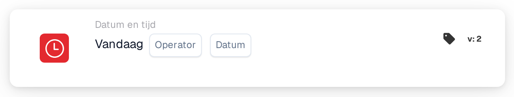

# Vandaag

<figure><figcaption>
Versie 2
</figcaption></figure>

## Doel:

Deze workflowkaart vergelijkt de datum van vandaag met een datum die op de kaart is ingesteld. De kaart kan worden gebruikt voor regels die pas vanaf of slechts tot een bepaalde datum horen te gelden, bijvoorbeeld een proceswijziging vanaf een geplande startdatum.

## Onderdelen van de kaart:

1. **Operator**
   * **Beschrijving:** Hoe de datum van vandaag wordt vergeleken met de datum op de kaart.
   * **Opties:**
     * **Is gelijk aan:** Vandaag is de datum op de kaart.
     * **Niet gelijk:** Vandaag is een willekeurige andere dag.
     * **Groter dan:** Vandaag ligt na de datum op de kaart.
     * **Groter of gelijk aan:** Vandaag is de datum op de kaart of later.
     * **Minder dan:** Vandaag ligt vóór de datum op de kaart.
     * **Kleiner of gelijk aan:** Vandaag is de datum op de kaart of eerder.
2. **Datum**
   * **Beschrijving:** De datum waarmee vandaag wordt vergeleken.

## Functionaliteit:

* **Voorwaarde-evaluatie:** Wanneer de workflow de kaart bereikt, neemt de kaart de huidige datum in UTC en vergelijkt die met de operator met de datum op de kaart. Alleen de datums worden vergeleken; tijdstippen worden genegeerd. De datums op het document spelen geen rol.
* **Actie-uitvoering:**
  * **True-voorwaarde:**\
    Als de vergelijking waar is, gaat de workflow verder met de volgende kaarten.
  * **False-voorwaarde:**\
    Als ze niet waar is, stopt de workflow met een niet voldane voorwaarde.
* **Ontbrekende gegevens:** Als er op de kaart geen datum is ingesteld, evalueert de kaart de voorwaarde niet en meldt ze de ontbrekende invoer in het workflowlogboek.

## Opzet en configuratie:

* De kaart kan als And-voorwaarde worden toegevoegd vanuit de categorie **Datum en tijd**. Daarna worden een operator en een datum geselecteerd.
* **Voorbeeld:** Met **Groter of gelijk aan** en `2026-11-01` is aan de kaart voldaan vanaf 1 november 2026 (UTC) en niet op 31 oktober 2026.
* Omdat de datum in UTC wordt genomen, kan die rond middernacht afwijken van de lokale datum: in Europa ziet de kaart kort na middernacht nog de vorige dag, in Amerika ziet ze 's avonds al de volgende dag.

## Conclusie:

De workflowkaart "Today" maakt van de kalenderdatum een workflowvoorwaarde. Datumgebaseerde regels, zoals een start- of einddatum voor een proces, kunnen eenmalig worden ingesteld en gaan automatisch in.
