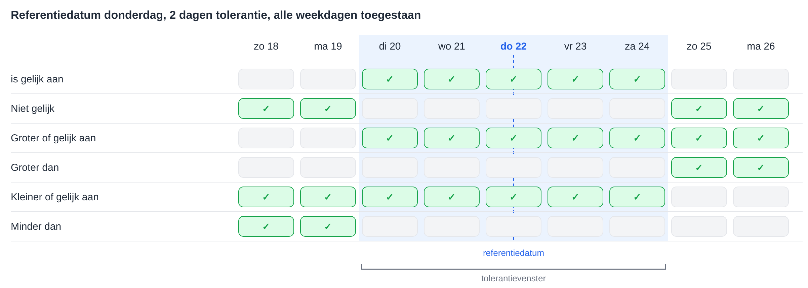
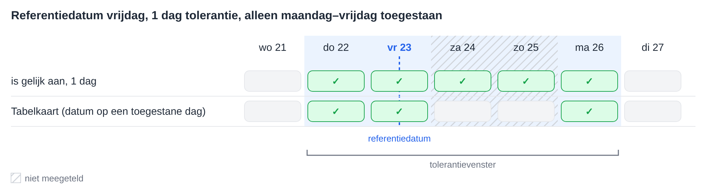
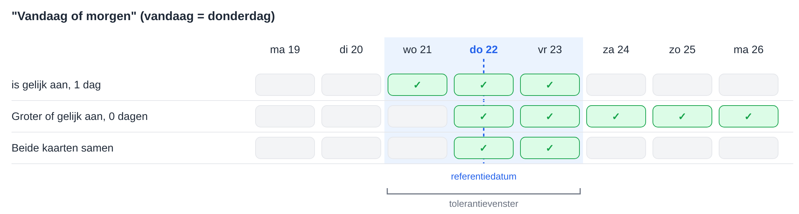

# Datumtoleranties

Verschillende workflowkaarten vergelijken een datum met een referentiedatum en accepteren een tolerantie van een aantal dagen. Ze berekenen de tolerantie allemaal op dezelfde manier. Deze pagina legt die berekening uit, wat elke operator betekent, hoe de **Toegestane tolerantiedagen** werken en hoe twee kaarten kunnen worden gecombineerd voor bereiken zoals "vandaag of morgen".

De kaarten die deze berekening gebruiken:

* [Table Date to Current Date](table/table-date-to-current-date.md) – een datum in een documenttabel vergeleken met de huidige datum.
* [Promised delivery date for line items in table with promised delivery date](compare-with-purchase-order/promised-delivery-date-for-line-items-in-table-with-promised-delivery-date/README.md) – beloofde leverdata van regelitems vergeleken met de huidige datum.
* [Promised Delivery Date on Purchase Order](compare-with-purchase-order/promised-delivery-date-on-purchase-order.md) – leverdata van regelitems vergeleken met de leverdatum op de inkooporder.

## Het tolerantievenster

Vanaf de referentiedatum wordt de tolerantie terug en vooruit geteld. Het resultaat is een **tolerantievenster**: van de begindatum tot en met de einddatum, beide inbegrepen.

* Met een tolerantie van **0 dagen** bestaat het venster alleen uit de referentiedatum zelf.
* Met een tolerantie van **2 dagen** reikt het venster van 2 dagen vóór tot 2 dagen na de referentiedatum.
* De **huidige datum** is de datum op de DocBits-servers, die in **UTC** draaien.

Elke operator vergelijkt de datum met dit venster:

| Operator | Waar wanneer de datum … |
|---|---|
| **is gelijk aan** | binnen het venster ligt |
| **Niet gelijk** | buiten het venster ligt |
| **Groter of gelijk aan** | op of na het **begin** van het venster ligt |
| **Groter dan** | na het **einde** van het venster ligt |
| **Kleiner of gelijk aan** | op of vóór het **einde** van het venster ligt |
| **Minder dan** | vóór het **begin** van het venster ligt |

De tolerantie verruimt ook **Groter of gelijk aan** en **Kleiner of gelijk aan**: met 2 dagen accepteert **Groter of gelijk aan** al een datum die 2 dagen vóór de referentiedatum ligt.

<figure><figcaption>
Referentiedatum donderdag 22, 2 dagen tolerantie: het venster loopt van dinsdag 20 tot en met zaterdag 24.
</figcaption></figure>

## Toegestane tolerantiedagen

Kaarten met **Toegestane tolerantiedagen** tellen bij de berekening van het venster alleen de geselecteerde weekdagen mee. Weekdagen die niet zijn geselecteerd, worden bij het tellen overgeslagen, maar blijven binnen het venster.

**Voorbeeld:** referentiedatum vrijdag, 1 dag tolerantie, alleen maandag tot en met vrijdag geselecteerd. Terugtellen komt uit op donderdag. Vooruittellen slaat zaterdag en zondag over en komt uit op maandag. Het venster is **donderdag tot en met maandag**.

**Table Date to Current Date** voegt nog een controle toe: de datum in de tabel hoort ook op een van de geselecteerde weekdagen te vallen. Een zaterdag binnen het venster wordt door deze kaart daarom niet geaccepteerd. De twee andere kaarten hebben deze extra controle niet.

<figure><figcaption>
Alleen maandag tot en met vrijdag worden meegeteld, dus 1 dag na vrijdag is maandag.
</figcaption></figure>

## Voorbeeld: vandaag of morgen

Eén kaart kan niet precies "vandaag of morgen" accepteren, omdat het venster altijd evenveel dagen in beide richtingen reikt. Twee kaarten na elkaar kunnen dat wel:

1. **is gelijk aan** met **1 dag** tolerantie accepteert gisteren, vandaag en morgen.
2. **Groter of gelijk aan** met **0 dagen** tolerantie accepteert vandaag en elke latere dag.

Alleen data die door beide kaarten komen, blijven over: **vandaag en morgen**.

<figure><figcaption>
Vandaag is donderdag 22: samen accepteren de twee kaarten donderdag 22 en vrijdag 23.
</figcaption></figure>

Op dezelfde manier kunnen andere bereiken worden opgebouwd:

| Bereik | Eerste kaart | Tweede kaart |
|---|---|---|
| Vandaag of morgen | **is gelijk aan**, 1 dag | **Groter of gelijk aan**, 0 dagen |
| Gisteren of vandaag | **is gelijk aan**, 1 dag | **Kleiner of gelijk aan**, 0 dagen |
| Vandaag tot 3 dagen vooruit | **is gelijk aan**, 3 dagen | **Groter of gelijk aan**, 0 dagen |
| Niet vandaag | **Niet gelijk**, 0 dagen | – |
| Vanaf overmorgen | **Groter dan**, 1 dag | – |

Zijn alleen maandag tot en met vrijdag als **Toegestane tolerantiedagen** geselecteerd, dan is "morgen" op een vrijdag de maandag daarna.

## Conclusie

Alle datumkaarten met een tolerantie gebruiken één venster rond de referentiedatum. Wie weet waar het venster begint en eindigt, ziet duidelijk wat elke operator accepteert, en twee kaarten samen kunnen bereiken afdekken die één kaart niet kan afdekken.
