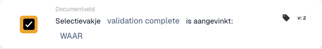

# Het selectievakje is aangevinkt

## Wanneer en waar gebruikt u deze kaart?

Gebruik deze voorwaarde als een vervolghandeling afhangt van een selectievakje op het document. Laat een factuur bijvoorbeeld pas verder verwerken nadat de controlevlag is aangevinkt.

Voeg de kaart in de workflow-editor toe onder **En… → Documentveld**. De kaart vergelijkt de veldwaarde wanneer de workflow wordt uitgevoerd; ze bewaakt niet continu een ERP-veld en wijzigt het selectievakje niet.

## Voorwaarden vooraf

Het documenttype moet een booleaans veld voor dit selectievakje bevatten. Gebruik de exacte technische veldnaam. Dit voorbeeld gebruikt `validation_complete`; vervang deze door het overeenkomstige veld in uw organisatie.

## De kaart configureren

1. Kies **Selectievakje … is aangevinkt** onder **Documentveld**.
2. Voer `validation_complete` in bij **Veldnaam** en bevestig de waarde.
3. Kies **WAAR** bij **Booleaans** om een aangevinkt selectievakje te vereisen. Kies **Onwaar** om te controleren of het niet is aangevinkt.

## Praktisch voorbeeld: doorgaan na controle

**Wanneer gebruiken:** een factuur vereist een voorafgaande controle en het proces legt de voltooiing vast in `validation_complete`.

**Waar plaatsen:** bij de voorwaarden onder **En…**, vóór de vervolghandeling die u onder **Dan…** configureert. Configureer deze handeling en de gebeurtenis die de workflow start afzonderlijk.

**Voorbeeldconfiguratie:** veld `validation_complete`, vergelijking **WAAR** (`true`), kaartversie 2.

<figure><figcaption>
Voorbeeld met versie 2: validation complete vergeleken met WAAR.
</figcaption></figure>

De verwachte resultaten voor deze configuratie zijn:

| Veldwaarde op het document | Resultaat van de voorwaarde |
| --- | --- |
| Bestaand, aangevinkt selectievakje (`true`) | Aan de voorwaarde is voldaan. |
| Bestaand, niet-aangevinkt selectievakje (`false`) | Aan de voorwaarde is niet voldaan. |
| Bestaand selectievakje met een lege waarde (`None`) | Wordt behandeld als niet aangevinkt; aan de voorwaarde is niet voldaan. |
| Het veld ontbreekt op het document | `NOT_FOUND_IN_DOCUMENT`; dit verschilt van een bestaand, niet-aangevinkt selectievakje. |

Als u **Onwaar** kiest, voldoet een bestaand, niet-aangevinkt selectievakje aan de voorwaarde en een aangevinkt selectievakje niet. Een ontbrekend veld geeft nog steeds een afzonderlijk foutresultaat.

## Controleren vóór activering

Controleer of het gekozen veld booleaans is en bij het gebruikte documenttype hoort. Test een document met een aangevinkt selectievakje, een document met een niet-aangevinkt selectievakje en een document waarop het veld ontbreekt. Controleer telkens het kaartresultaat en het vervolgpad van de workflow.

Deze kaart controleert de status van het selectievakje; het voorafgaande proces moet de controlevlag instellen. De vlag automatisch aanvinken zonder de controle uit te voeren, bewijst niet dat de controle heeft plaatsgevonden.
