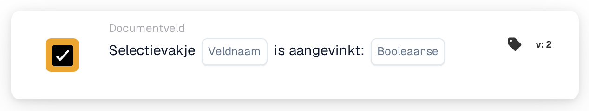

# Het selectievakje is aangevinkt

<figure><figcaption>
Versie 2
</figcaption></figure>

## Doel:

Deze workflowkaart controleert of een selectievakjeveld op het document aangevinkt of niet aangevinkt is. De kaart kan worden gebruikt om een workflow pas verder te laten gaan nadat op het document een markering is gezet, bijvoorbeeld een controlemarkering.

## Onderdelen van de kaart:

1. **Veldnaam**
   * **Beschrijving:** De technische naam van het selectievakjeveld op het document.
   * **Detail:** Het veld hoort een selectievakjeveld (Boolean) van het documenttype te zijn.
2. **Boolean**
   * **Beschrijving:** De status die het selectievakje hoort te hebben.
   * **Opties:**
     * **WAAR:** Het selectievakje hoort aangevinkt te zijn.
     * **Onwaar:** Het selectievakje hoort niet aangevinkt te zijn.

## Functionaliteit:

* **Voorwaarde-evaluatie:** Wanneer de workflow de kaart bereikt, leest de kaart de huidige waarde van het veld op het document en vergelijkt die met **Boolean**. De kaart houdt het veld niet in de gaten over langere tijd en wijzigt het niet.
  * Een lege selectievakjewaarde geldt als niet aangevinkt.
  * Als er geen waarde voor **Boolean** is geselecteerd, controleert de kaart op een niet aangevinkt selectievakje.
  * Als het veld geen selectievakjeveld is, vermeldt de kaart dit in het workflowlogboek en vergelijkt ze de waarde toch.
* **Actie-uitvoering:**
  * **True-voorwaarde:**\
    Als de status van het selectievakje overeenkomt met **Boolean**, gaat de workflow verder met de volgende kaarten.
  * **False-voorwaarde:**\
    Als die niet overeenkomt, stopt de workflow met een niet voldane voorwaarde.
* **Ontbrekende gegevens:** Als het veld niet op het document bestaat, evalueert de kaart de voorwaarde niet. Ze meldt dat het veld niet op het document is gevonden. Dat is een ander resultaat dan een niet aangevinkt selectievakje.

## Opzet en configuratie:

* De kaart kan als And-voorwaarde worden toegevoegd vanuit de categorie **Documentveld**. Daarna wordt de technische naam van het selectievakjeveld ingevoerd bij **Veldnaam** en wordt **WAAR** of **Onwaar** geselecteerd.
* Met **Testkaart** in het kaartmenu van de Workflow Builder kan de configuratie worden gecontroleerd op een document met het selectievakje aangevinkt, een document met het selectievakje niet aangevinkt en een document zonder het veld.

## Conclusie:

De workflowkaart "Checkbox is checked" maakt van een selectievakje op het document een workflowvoorwaarde. Zo kan een workflow wachten op een handmatige stap, zoals een afgeronde controle, voordat de volgende acties worden uitgevoerd.
