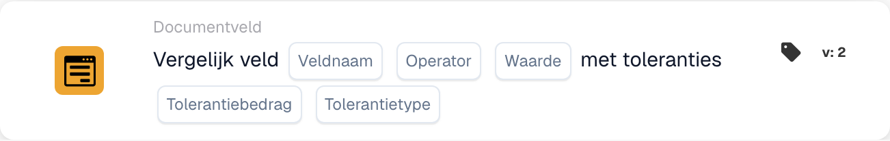

# Vergelijk Veld met toleranties

<figure><figcaption>
Kaartvelden in de getoonde versie. De velden zijn nog niet ingevuld.
</figcaption></figure>

## Wanneer gebruikt u deze kaart?

Gebruik deze voorwaarde om een numeriek documentveld te vergelijken met een vaste referentiewaarde en daarbij een bepaalde afwijking toe te staan. Een totaalbedrag kan bijvoorbeeld overeenkomen met referentie 100 als het verschil niet groter is dan 5.

## Waar vindt u de kaart?

Voeg in de standaard workflowdesigner een kaart toe onder **En**, open **Documentveld** en selecteer de vergelijking van één veld met een referentie en toleranties. Het volgende voorbeeld gebruikt versie 2.

## Instellingen

Gebruik een numeriek veld dat in uw organisatie is geconfigureerd. De veldwaarde, referentie en tolerantie worden numeriek beoordeeld. Gebruik dezelfde eenheden.

| Instelling | Betekenis |
| --- | --- |
| Veldnaam | Het geconfigureerde documentveld, bijvoorbeeld `total_amount`. |
| Operator | De vergelijking: `eq`, `neq`, `gt`, `ge`, `lt` of `le`. |
| Referentiewaarde | Het vaste getal waarmee het veld wordt vergeleken. |
| Tolerantie | De toegestane numerieke afwijking. |
| Tolerantietype | **Waarde** (`value`) voor een absoluut bedrag of **Procent** (`percent`) voor een relatieve afwijking. |

Bij een positieve referentie van 200 geeft een procentuele tolerantie van 5 een toegestane afwijking van 10. Een absolute tolerantie van 5 geeft een afwijking van 5. Controleer de relevante grensgevallen voor uw operator en waarden.

## Hoe verandert tolerantie de vergelijking?

Bij referentie **100** en absolute tolerantie **5** is de ondergrens **95** en de bovengrens **105**.

| Operator | Aan de voorwaarde is voldaan als de veldwaarde… |
| --- | --- |
| `eq` (=) | Tussen 95 en 105 ligt, inclusief beide grenzen. |
| `neq` (≠) | Lager dan 95 of hoger dan 105 is. |
| `gt` (>) | Hoger dan 105 is. |
| `ge` (≥) | Minstens 95 is. |
| `lt` (<) | Lager dan 95 is. |
| `le` (≤) | Hoogstens 105 is. |

Deze kaart geeft het resultaat van een voorwaarde terug. Vervolgstappen hangen af van de trigger, andere voorwaarden en geconfigureerde acties van de workflow.

<!-- workflow-card-complete-example-20261021 condition_docfield_operator_value_tolerances -->

## Praktisch voorbeeld

1. Selecteer het geconfigureerde numerieke veld **Totaalbedrag** (`total_amount`).
2. Kies **is gelijk aan** (`eq`).
3. Voer referentie **100** en tolerantie **5** in.
4. Kies tolerantietype **Waarde** (`value`).

| Veldwaarde | Absoluut verschil met 100 | Verwacht resultaat |
| --- | --- | --- |
| 103 | 3 | Aan de voorwaarde is voldaan. |
| 110 | 10 | Aan de voorwaarde is niet voldaan. |
| 95 of 105 | 5 | Aan de voorwaarde is voldaan: de gelijkheidsvergelijking omvat de tolerantiegrenzen. |

Dit zijn verwachte rekenresultaten voor een voorbeeldconfiguratie. Voor dit voorbeeld is geen workflow uitgevoerd.

## Voordat u de regel activeert

Controleer een passend geval, een niet-passend geval en de grenzen met geschikte testgegevens. Onderzoek ontbrekende velden, niet-numerieke waarden en configuratiefouten afzonderlijk. Controleer in het uitvoeringslog de daadwerkelijk gebruikte waarden, operator, tolerantie en uitkomst.

Als beide bedragen uit documentvelden komen, gebruikt u de afzonderlijke kaart voor het [vergelijken van twee velden met tolerantie](compare-two-fields-with-tolerance.md).
