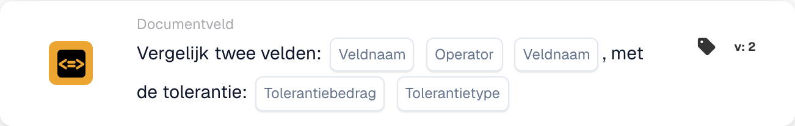

# Vergelijk twee velden met tolerantie

<figure><figcaption>
Kaartvelden in de getoonde versie. De velden zijn nog niet ingevuld.
</figcaption></figure>

## **Doel:**

Deze workflow-kaart is ontworpen om acties te automatiseren door de waarden van twee opgegeven documentvelden te vergelijken, met de toegevoegde mogelijkheid om een tolerantiewaarde toe te passen. Met deze functie kan het systeem rekening houden met een foutmarge (tolerantie) bij het vergelijken van veldwaarden, wat flexibelere besluitvorming binnen workflows mogelijk maakt.

## **Onderdelen van de kaart:**

1. **Veldnaam (1)**
   * **Beschrijving:** Geeft het eerste te vergelijken documentveld op.
   * **Details:** Dit moet exact overeenkomen met de identifier van het eerste veld binnen het document.
2. **Exploitant**
   * **Beschrijving:** Definieert het type vergelijking dat tussen de twee velden wordt uitgevoerd.
   * **Opties:**
     * **Is gelijk aan (=):** Controleert of de waarden van de twee velden gelijk zijn.
     * **Niet gelijk aan (≠):** Zorgt ervoor dat de waarden van de twee velden verschillend zijn.
     * **Groter dan (>):** Bevestigt dat de waarde van het eerste veld groter is dan het tweede veld.
     * **Groter of gelijk aan (≥):** Valideert dat de waarde van het eerste veld gelijk is aan of groter is dan het tweede veld.
     * **Kleiner dan (<):** Controleert of de waarde van het eerste veld kleiner is dan het tweede veld.
     * **Minder of gelijk aan (≤):** Zorgt ervoor dat de waarde van het eerste veld kleiner dan of gelijk is aan het tweede veld.
3. **Veldnaam (2)**
   * **Beschrijving:** Geeft het tweede documentveld op dat met het eerste veld wordt vergeleken.
   * **Details:** Dit moet exact overeenkomen met de identifier van het tweede veld binnen het document.
4. **Tolerantiebedrag**
   * **Beschrijving:** Definieert de aanvaardbare foutmarge voor de vergelijking.
   * **Details:** Het tolerantiebedrag is een numerieke waarde die het maximaal toegestane verschil tussen de twee veldwaarden aangeeft om de vergelijking als true te beschouwen.
5. **Tolerantietype**
   * **Beschrijving:** Geeft de meeteenheid voor het tolerantiebedrag op.
   * **Opties:**
     * **Waarde:** De tolerantie is een absolute waarde, wat betekent dat de twee velden met het opgegeven tolerantiebedrag kunnen verschillen.
     * **Percent:** De tolerantie wordt berekend als een percentage van de waarde van het tweede veld, wat een relatieve foutmarge mogelijk maakt.

## **Functionaliteit:**

* **Voorwaarde-evaluatie:** Het systeem evalueert of de waarden in de twee opgegeven velden aan de vergelijkingsvoorwaarde voldoen, rekening houdend met de gedefinieerde tolerantie. Als het absolute of relatieve verschil tussen de twee velden binnen de tolerantie valt, wordt de voorwaarde als true beschouwd.
* **Actie-uitvoering:**
  * **True-voorwaarde:**\
    Als de waarden van de twee velden, na het in aanmerking nemen van de tolerantie, overeenkomen met de vergelijkingsvoorwaarde, triggert het systeem de bijbehorende acties. Deze acties kunnen het voortzetten van de workflow, het bijwerken van records, het triggeren van waarschuwingen of het inschakelen van bepaalde bewerkingen omvatten.
  * **False-voorwaarde:**\
    Als de waarden van de twee velden, na het in aanmerking nemen van de tolerantie, niet overeenkomen met de opgegeven voorwaarde, kunnen alternatieve acties of geen acties worden uitgevoerd, afhankelijk van de configuratie van de workflow.

## **Opzet en configuratie:**

* Gebruikers configureren de kaart door de twee te vergelijken velden uit een lijst van beschikbare velden in het systeem te selecteren. De operator wordt geselecteerd uit een dropdownlijst van beschikbare vergelijkingsopties. Gebruikers voeren het tolerantiebedrag in en kiezen het tolerantietype (value of percent).

## **Conclusie:**

De workflow-kaart "Compare Two Fields with Tolerance" is een krachtig hulpmiddel voor het vergelijken van documentvelden, waarbij rekening wordt gehouden met toegestane afwijkingen in de gegevens. Door tolerantie toe te passen op veldvergelijkingen voegt deze kaart flexibiliteit toe aan de workflow, waardoor deze variaties in gegevens uit de praktijk kan verwerken. Hij verbetert de besluitvorming, ondersteunt gegevensvalidatie en verbetert de algehele workflow-automatisering.

<!-- workflow-card-practical-example-20261021 -->

## Praktisch voorbeeld

**Wanneer gebruiken:** Accepteer een klein verschil tussen een geëxtraheerd bedrag en een afzonderlijk berekend bedrag.

**Configuratie:** Selecteer numerieke velden `net_total` en `calculated_total`, gelijkheidsvergelijking en een absolute tolerantie van `5`. Gebruik waarden `103` en `100`.

**Verwacht resultaat en tegenvoorbeeld:** Het verschil is `3`, dus het valt binnen de tolerantie. Met `110` en `100` is het verschil `10` en mislukt de voorwaarde van gelijkheid met tolerantie.

Dit is een illustratieve configuratie en een verwacht resultaat. Gebruik velden, gebruikers en groepen die in uw testorganisatie zijn geconfigureerd; het is geen bewering dat dit voorbeeld is uitgevoerd.
