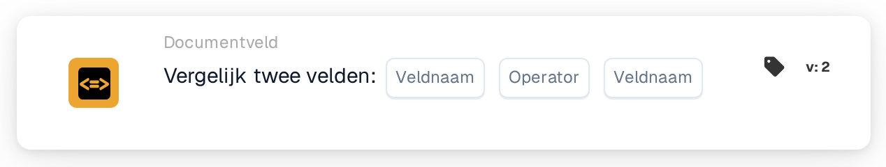

# Vergelijk twee velden

<figure><figcaption>
Versie 2
</figcaption></figure>

## **Doel:**

Deze workflow-kaart is ontworpen om acties te automatiseren door de waarden van twee opgegeven documentvelden te vergelijken. Hij maakt dynamische besluitvorming op basis van veldgegevens mogelijk en zorgt ervoor dat workflows worden uitgevoerd op basis van vergelijkingen tussen verschillende documentwaarden.

## **Onderdelen van de kaart:**

1. **Veldnaam (1)**
   * **Beschrijving:** Geeft het eerste te vergelijken documentveld op.
   * **Details:** Dit moet exact overeenkomen met de identifier van het eerste veld binnen het document.
2. **Exploitant**
   * **Beschrijving:** Definieert het type vergelijking dat tussen de twee velden wordt uitgevoerd.
   * **Opties:**
     * **Is gelijk aan (=):** Controleert of de waarden van de twee velden gelijk zijn.
     * **Niet gelijk aan (≠):** Zorgt ervoor dat de waarden van de twee velden verschillend zijn.
     * **Groter dan (>):** Bevestigt dat de waarde van het eerste veld groter is dan het tweede veld.
     * **Groter of gelijk aan (≥):** Valideert dat de waarde van het eerste veld gelijk is aan of groter is dan het tweede veld.
     * **Kleiner dan (<):** Controleert of de waarde van het eerste veld kleiner is dan het tweede veld.
     * **Minder of gelijk aan (≤):** Zorgt ervoor dat de waarde van het eerste veld kleiner dan of gelijk is aan het tweede veld.
3. **Veldnaam (2)**
   * **Beschrijving:** Geeft het tweede documentveld op dat met het eerste veld wordt vergeleken.
   * **Details:** Dit moet exact overeenkomen met de identifier van het tweede veld binnen het document.

## **Functionaliteit:**

**Voorwaarde-evaluatie:** Het systeem evalueert of de waarden in de twee opgegeven velden aan de door de operator gedefinieerde vergelijkingsvoorwaarde voldoen.

**Actie-uitvoering:**

* **True-voorwaarde:**\
  Als de waarden van de twee velden overeenkomen met de vergelijkingsvoorwaarde, triggert het systeem de bijbehorende acties. Deze acties kunnen het bijwerken van records of het triggeren van waarschuwingen omvatten.
* **False-voorwaarde:**\
  Als de waarden van de twee velden niet overeenkomen met de opgegeven voorwaarde, kunnen alternatieve acties of geen acties worden uitgevoerd, afhankelijk van de configuratie van de workflows.

## **Opzet en configuratie:**

* Gebruikers configureren de kaart door de twee te vergelijken velden uit een lijst van beschikbare velden in het systeem te selecteren. De operator wordt geselecteerd uit een dropdownlijst van beschikbare vergelijkingsopties.

## **Conclusie:**

De workflow-kaart "Compare Two Fields" is een essentieel hulpmiddel voor het vergelijken van gegevens tussen velden binnen documenten. Door acties te automatiseren op basis van veldvergelijkingen helpt deze kaart de besluitvorming te optimaliseren, ondersteunt hij gegevensvalidatie en verbetert hij de workflow-automatisering.

<!-- workflow-card-practical-example-20261021 -->

## Praktisch voorbeeld

**Wanneer gebruiken:** Controleer of een gekopieerde referentie gelijk is aan de originele referentie.

**Configuratie:** Selecteer tekstvelden `purchase_order_number` en `confirmed_order_number` en de is gelijk-operator.

**Verwacht resultaat en tegenvoorbeeld:** Waarden `PO-DEMO-001` en `PO-DEMO-001` zijn geslaagd. Een tweede waarde van `PO-DEMO-002` mislukt.

Dit is een illustratieve configuratie en een verwacht resultaat. Gebruik velden, gebruikers en groepen die in uw testorganisatie zijn geconfigureerd; het is geen bewering dat dit voorbeeld is uitgevoerd.
