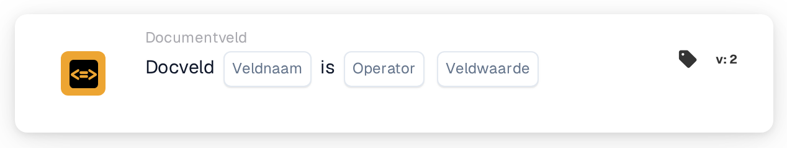

# Documentveld vergelijken met een referentiewaarde

<figure><figcaption>
Versie 1
</figcaption></figure>

<figure><figcaption>
Versie 2
</figcaption></figure>

## **Doel:**

Deze workflow-kaart is ontworpen om acties te automatiseren door de waarde van een opgegeven documentveld te vergelijken met een referentiewaarde of -voorwaarde. Hij zorgt voor dynamische en nauwkeurige besluitvorming in workflows op basis van validatie van documentgegevens.

## **Onderdelen van de kaart:**

1. **Veldnaam**
   * **Beschrijving:** Geeft de naam op van het te evalueren documentveld.
   * **Details:** Dit moet exact overeenkomen met de identifier van het veld binnen het document.
2. **Exploitanten**
   * **Beschrijving:** Definieert het type vergelijking dat tussen de veldwaarde en de referentiewaarde wordt uitgevoerd.
   * **Opties:**
     * **Is gelijk aan (=):** Controleert of de veldwaarde overeenkomt met de referentiewaarde.
     * **Niet gelijk aan (≠):** Zorgt ervoor dat de veldwaarde verschilt van de referentiewaarde.
     * **Groter dan (>):** Bevestigt dat de veldwaarde groter is dan de referentiewaarde.
     * **Groter of gelijk aan (≥):** Valideert dat de veldwaarde gelijk is aan of groter is dan de referentiewaarde.
     * **Kleiner dan (<):** Controleert of de veldwaarde kleiner is dan de referentiewaarde.
     * **Minder of gelijk aan (≤):** Zorgt ervoor dat de veldwaarde kleiner dan of gelijk is aan de referentiewaarde.

## **Functionaliteit:**

* **Voorwaarde-evaluatie:** Het systeem controleert of de waarde van het documentveld, in relatie tot de bijbehorende kolom, aan de door de operator en referentiewaarde opgegeven vergelijkingsvoorwaarde voldoet.
* **Actie-uitvoering:**
  * **True-voorwaarde:**\
    Als de waarde van het documentveld aan de opgegeven voorwaarde voldoet (bijv. gelijk aan de referentiewaarde), triggert het systeem de bijbehorende acties. Deze kunnen het bijwerken van records, het voortzetten van de workflow of het genereren van meldingen omvatten.
  * **False-voorwaarde:**\
    Als de waarde van het documentveld niet aan de opgegeven voorwaarde voldoet, worden alternatieve acties of geen acties uitgevoerd, op basis van de workflow-configuratie.

## **Opzet en configuratie:**

* De gebruiker de veldnaam van het relevante document selecteert en de operator uit het dropdownmenu kiest. Vervolgens geeft de gebruiker de referentieveldwaarde op om de configuratie te voltooien.

## **Conclusie:**

De workflow-kaart "DocField Comparison Validation" is een robuust hulpmiddel voor dynamische documentverwerking. Door acties te automatiseren op basis van veldvergelijkingen stroomlijnt deze kaart workflows, verbetert hij de nauwkeurigheid en ondersteunt hij datagedreven besluitvorming.

<!-- workflow-card-practical-example-20261021 -->

## Praktisch voorbeeld

**Wanneer gebruiken:** Facturen boven een bepaald bedrag bekijken.

**Configuratie:** Selecteer numeriek veld `total_amount`, operator `>` en referentiewaarde `1000`.

**Verwacht resultaat en tegenvoorbeeld:** Een waarde van `1200` voldoet aan de voorwaarde. `1000` en `900` voldoen niet: de operator `>` vereist een waarde groter dan `1000`.

Dit is een illustratieve configuratie en een verwacht resultaat. Gebruik velden, gebruikers en groepen die in uw testorganisatie zijn geconfigureerd; het is geen bewering dat dit voorbeeld is uitgevoerd.
