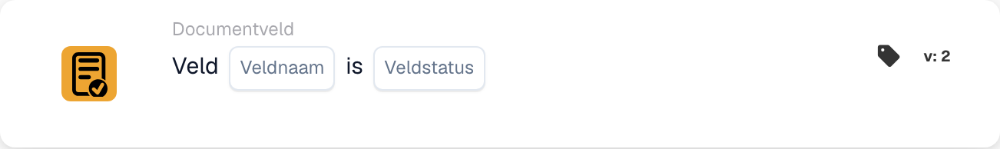

# Aanwezigheid en inhoud van een documentveld controleren

<figure><figcaption>
Kaartvelden in de getoonde versie. De velden zijn nog niet ingevuld.
</figcaption></figure>

## Wanneer gebruiken

Gebruik deze kaart om te controleren of een documentveld leeg is of ontbreekt, bijvoorbeeld wanneer een factuur zonder factuurnummer extra controle nodig heeft. Dit is een voorwaarde; stel de daaropvolgende actie afzonderlijk in.

**Locatie:** Standaardworkflow → aanvullende voorwaarden (AND) → Documentveld.

## Configuratie — versie 2

| Instelling | Voorbeeldwaarde |
| --- | --- |
| Veld | `invoice_id` — factuurnummer |
| Veldstatus | Leeg of ontbrekend (`field_empty`) |

Selecteer een veld dat daadwerkelijk in uw organisatie is geconfigureerd. De optie `field_not_empty` controleert of het veld een waarde bevat.

<!-- workflow-card-practical-example-20261021 -->

## Praktisch voorbeeld

| Voorbeeldwaarde | Verwacht resultaat voor `field_empty` |
| --- | --- |
| Leeg of ontbrekend veld | Voorwaarde vervuld |
| `DEMO-001` | Voorwaarde niet vervuld |
| Nummer aanwezig maar onjuist | Voorwaarde niet vervuld — het veld bevat nog steeds een waarde |

Dit zijn voorbeelden van verwachte resultaten. Voeg een passende inhoudsvoorwaarde toe om het nummer zelf te controleren; deze kaart controleert de veldstatus. In versie 2 worden spaties aan het begin en einde van tekst verwijderd voordat wordt gecontroleerd of het veld leeg is.

## Voorbeeldvideo met een beheerder

Wanneer ik deze kaart gebruik, waar deze staat en hoe ik ontbrekende factuurnummers vind. De beheerder, het kantoor en de stem zijn synthetisch; de demonstratie toont de echte DocBits-interface van een testaccount. De voorbeelden tonen verwachte resultaten.



[Video met Nederlandse ondertitels openen](https://docbits-videos.fra1.cdn.digitaloceanspaces.com/settings-assistant/workflow-card-field-status-admin/v1/nl.html)

[Transcript lezen](https://docbits-videos.fra1.cdn.digitaloceanspaces.com/settings-assistant/workflow-card-field-status-admin/v1/nl.txt)
