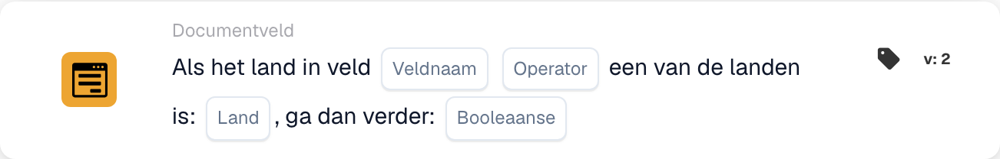

# Als Land in veld één van is

<figure><figcaption>
Kaartvelden in de getoonde versie. De velden zijn nog niet ingevuld.
</figcaption></figure>

Gebruik deze voorwaarde wanneer een extra verwerkingsstap moet gelden voor documenten uit bepaalde landen, bijvoorbeeld Duitsland en Frankrijk. De kaart vergelijkt het land uit een documentveld met een ingestelde landenlijst.

**Locatie:** Standaardworkflow → aanvullende voorwaarden (AND) → Documentveld. Stel de volgende actie afzonderlijk in onder THEN.

## Configuratie — versie 2

| Instelling | Waarde |
| --- | --- |
| Veld | Een bestaand tekstveld met de landnaam |
| Operator | `is` |
| Landen | `Germany, France` |
| Vervolgwaarde | `true` |

<!-- workflow-card-practical-example-20261021 -->

## Praktisch voorbeeld

| Landwaarde in het veld | Verwachte voorwaarde |
| --- | --- |
| `Germany` | Vervuld |
| `France` | Vervuld |
| `United States` | Niet vervuld |

De landnamen in codeopmaak zijn vaste invoerwaarden voor dit voorbeeld.

## Beperkingen en controles

`false` keert de vergelijking niet om. Ook een overeenkomend land geeft met die instelling geen positief voorwaarderesultaat. Kies voor de tegenovergestelde voorwaarde `isnot` met `true`.

Behandel ontbrekende velden en lege landwaarden afzonderlijk; ze kunnen een resultaat voor ontbrekende gegevens geven in plaats van een gewone niet-overeenkomst.

Controle van de broncode van de ontwikkelversie van 22 oktober 2026 toont een conversiefout voor ISO-invoer zoals `DE` en `DEU`. Deze voorbeelden gebruiken daarom volledige landnamen. Controleer de verwerking van ISO-codes afzonderlijk in uw geïnstalleerde versie.
