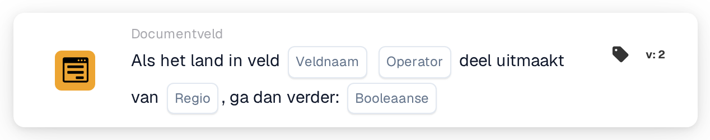

# Als land in veld

<figure><figcaption>
Versie 2
</figcaption></figure>

Beoogd gebruik: een extra verwerkingsstap hangt af van een landengroep. Het onderstaande voorbeeld beschrijft een regel voor lidmaatschap van de Europese Unie.

## Huidige beperking — broncode gecontroleerd op 22 oktober 2026

Lokale broncodetests met het oorspronkelijke type van de regioselectie mislukken vóór de landenvergelijking en geven `missing_variable` of `error`. Volledige landnamen omzeilen dit probleem niet. Een geslaagde uitvoering op de uitgerolde backend is voor deze versie niet bevestigd.

**Locatie:** Standaardworkflow → aanvullende voorwaarden (AND) → Documentveld. Stel de volgende actie afzonderlijk in onder THEN.

## Configuratie — versie 2

| Instelling | Waarde |
| --- | --- |
| Veld | Een bestaand tekstveld met de landnaam |
| Operator | `is` |
| Regio | Europese Unie (EU) |
| Vervolgwaarde | `true` |

<!-- workflow-card-practical-example-20261021 -->

## Beoogd voorbeeld — controleer de oplossing vóór gebruik

Controleer de oplossing en beide voorbeeldgevallen in uw geïnstalleerde versie voordat u deze regel activeert. De tabel beschrijft de beoogde bedrijfsregel, geen bevestigde geslaagde uitvoering.

| Landwaarde in het veld | Beoogde landenindeling |
| --- | --- |
| `Germany` | Binnen de EU |
| `United States` | Buiten de EU |

De landnamen in codeopmaak zijn vaste invoerwaarden voor dit voorbeeld.

## Beperkingen en controles

`false` keert de vergelijking niet om. Ook een overeenkomend land geeft met die instelling geen positief voorwaarderesultaat. Kies voor de tegenovergestelde voorwaarde `isnot` met `true`.

Behandel ontbrekende velden en lege landwaarden afzonderlijk; ze kunnen een resultaat voor ontbrekende gegevens geven in plaats van een gewone niet-overeenkomst.

Het ISO-conversieprobleem bij invoer zoals `DE` en `DEU` staat hier los van. ISO-codes vervangen door volledige landnamen verhelpt de fout in de regioselectie niet.

De aangeboden groepen, waaronder EU, Schengen en NAFTA, komen uit de kaartimplementatie. Controleer welke landen uw versie bevat voordat u een groep in een bedrijfsregel gebruikt.
