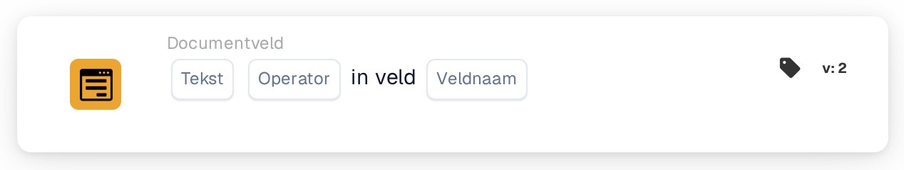

# Tekst in veld

<figure><figcaption>
Versie 2
</figcaption></figure>

## **Doel:**

Deze workflow-kaart is ontworpen om acties te automatiseren op basis van de aanwezigheid of afwezigheid van specifieke tekst binnen een opgegeven documentveld. Hij zorgt ervoor dat workflows zich dynamisch kunnen aanpassen aan de inhoud van documenten, wat efficiënte verwerking en nauwkeurige besluitvorming ondersteunt.

## **Onderdelen van de kaart:**

1. **Tekst**
   * **Beschrijving:** Geeft de tekenreeks op die binnen het veld wordt gecontroleerd.
   * **Details:** Dit kan een woord, zin of reeks tekens zijn die relevant is voor de workflow.
2. **Exploitant**
   * **Beschrijving:** Definieert de voorwaarde voor de aanwezigheid van tekst in het veld.
   * **Opties:**
     * **Is:** Triggert de workflow als de opgegeven tekst in het veld aanwezig is.
     * **Is niet:** Triggert de workflow als de opgegeven tekst niet in het veld aanwezig is.
3. **Veldnaam**
   * **Beschrijving:** Geeft de naam op van het te evalueren documentveld.
   * **Details:** Dit moet exact overeenkomen met de identifier van het veld binnen het document.

## **Functionaliteit:**

1. **Voorwaarde-evaluatie:** Het systeem controleert of de opgegeven tekst in het veld bestaat, op basis van de geselecteerde operator (Is of Is Not).
2. **Actie-uitvoering:**
   * **True-voorwaarde:**\
     Als de aanwezigheid van de tekst in het veld overeenkomt met de opgegeven voorwaarde, start het systeem de bijbehorende acties. Deze kunnen het triggeren van waarschuwingen, het voortzetten van workflows of het bijwerken van records omvatten.
   * **False-voorwaarde:**\
     Als de aanwezigheid van de tekst in het veld niet overeenkomt met de voorwaarde, kunnen alternatieve acties of geen acties worden uitgevoerd, afhankelijk van de workflow-configuratie.

## **Opzet en configuratie:**

* De gebruiker voert de te controleren tekst in. Vervolgens selecteert hij de veldnaam van het relevante document.

## **Conclusie:**

De workflow-kaart "Text Presence in Field" is een eenvoudig maar krachtig hulpmiddel voor het analyseren van documentinhoud. Door acties te automatiseren op basis van tekstdetectie ondersteunt deze kaart intelligentere workflows, verbetert hij de nauwkeurigheid van documentafhandeling en vermindert hij handmatige inspanning.

<!-- workflow-card-practical-example-20261021 -->

## Praktisch voorbeeld

**Wanneer gebruiken:** Vind documenten met een recensiemarkering.

**Configuratie:** Selecteer tekstveld `review_note`, de bevat operator en tekst `manual review`.

**Verwacht resultaat en tegenvoorbeeld:** `Please start manual review` geslaagd. `Ready for export` bevat de geselecteerde tekst niet en mislukt.

Dit is een illustratieve configuratie en een verwacht resultaat. Gebruik velden, gebruikers en groepen die in uw testorganisatie zijn geconfigureerd; het is geen bewering dat dit voorbeeld is uitgevoerd.
