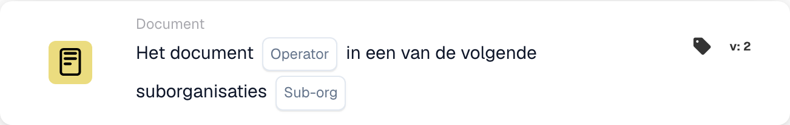

# Document

De kaarten van deze categorie in de **Kaart toevoegen**-kiezer van de Workflow Builder:

<figure><figcaption>
Beschikbare kaarten in de geselecteerde categorie. Vul de velden vóór gebruik in. Sommige labels van deze versie zijn in de interface nog niet of onjuist vertaald. De uitleg op deze pagina gebruikt de juiste termen; de afbeelding toont de werkelijke interface.
</figcaption></figure>

<!-- workflow-card-example-condition_sub_org_is_isnot_in_list-20261021 -->

### Documenteer in een van de verschillende suborganisaties

<figure><figcaption>
Kaartvelden in de getoonde versie. De velden zijn nog niet ingevuld.
</figcaption></figure>

`CONDITION_SUB_ORG_IS_ISNOT_IN_LIST` · versie 2

Selecteer is-een-van en geconfigureerde suborganisaties `Demo North` en `Demo South`. Een document dat tot een van de geselecteerde eenheden behoort, gaat voorbij; `Demo Default` mislukt. Hiermee wordt de documentsuborganisatie gecontroleerd; het verandert het niet.
