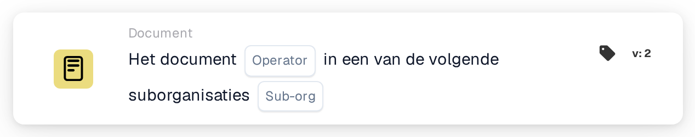

# Documentoperator voor suborganisaties één van

<figure><figcaption>
Versie 2
</figcaption></figure>

## Doel:

Deze workflowkaart controleert of een document bij een van meerdere suborganisaties hoort. In plaats van het document met één suborganisatie te vergelijken, vergelijkt de kaart het met een lijst. Zo dekt één kaart een hele groep suborganisaties af die op dezelfde manier behandeld moeten worden. Afhankelijk van het resultaat gaat de workflow verder met de true- of de false-voorwaarde.

Voor een vergelijking met precies één suborganisatie kan de kaart **Document Operator for Sub-Organizations** worden gebruikt.

## Onderdelen van de kaart:

1. **Operator**
   * **Beschrijving:** Bepaalt of het document bij een van de genoemde suborganisaties hoort of bij geen van hen.
   * **Opties:**
     * **Is:** De voorwaarde is waar als de suborganisatie van het document een van de genoemde suborganisaties is.
     * **Is Not:** De voorwaarde is waar als de suborganisatie van het document niet in de lijst staat.
2. **Sub-org**
   * **Beschrijving:** De lijst met suborganisaties waarmee het document wordt vergeleken.
   * **Detail:** Er kunnen een of meer suborganisaties van de organisatie worden geselecteerd. Vergeleken wordt de suborganisatie waaraan het document is toegewezen.

## Functionaliteit:

* **Voorwaarde-evaluatie:** Het systeem leest de suborganisatie van het document en controleert of deze een van de op de kaart geselecteerde suborganisaties is.
* **Actie-uitvoering:**
  * **True-voorwaarde:**\
    Met **Is** staat de suborganisatie van het document in de lijst, met **Is Not** staat ze er niet in. De workflow gaat verder met de true-voorwaarde, bijvoorbeeld om het document door te sturen naar het team dat verantwoordelijk is voor deze suborganisaties of om regels toe te passen die alleen voor hen gelden.
  * **False-voorwaarde:**\
    Als niet aan de voorwaarde is voldaan, gaat de workflow verder met de false-voorwaarde, bijvoorbeeld om algemene regels toe te passen of het document ergens anders heen te sturen.
* **Ontbrekende gegevens:** Als het document aan geen enkele suborganisatie is toegewezen, of als er op de kaart geen suborganisatie is geselecteerd, evalueert de kaart de voorwaarde niet. Ze meldt de ontbrekende gegevens in het workflowlogboek in plaats van verder te gaan met de false-voorwaarde.

## Opzet en configuratie:

* De kaart kan worden toegevoegd vanuit de categorie **Document**. Daarna kunnen de operator (**Is** of **Is Not**) en in het veld **Sub-org** de suborganisaties worden gekozen waartegen wordt gecontroleerd. Tot slot wordt de vervolgvoorwaarde (true of false) ingesteld, die de volgende stap in de workflow bepaalt.

## Conclusie:

Met de workflowkaart "Document Operator for Sub-Organizations one of" dekt één voorwaarde meerdere suborganisaties tegelijk af. Dat houdt workflows kort wanneer meerdere suborganisaties dezelfde verwerkingsregels hebben, en zorgt ervoor dat documenten in de juiste organisatorische context worden behandeld.
