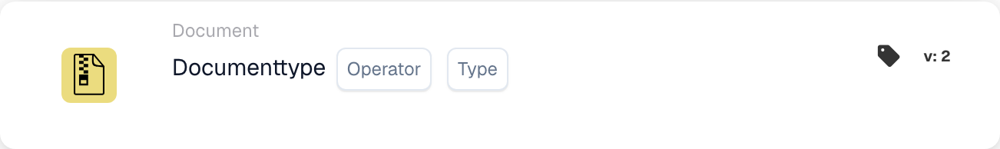

# Documenttype

<figure><figcaption>
Kaartvelden in de getoonde versie. De velden zijn nog niet ingevuld.
</figcaption></figure>

## Doel:

Deze workflow-kaart is ontworpen om te evalueren of een document overeenkomt met een specifiek type. Door te controleren of het document overeenkomt met het opgegeven type, kunnen workflows doorgaan of alternatieve acties ondernemen op basis van deze voorwaarde. Dit helpt processen te automatiseren waarbij het documenttype de volgende stappen in de workflow bepaalt.

## Onderdelen van de kaart:

1. **Exploitant**
   * **Beschrijving**: Definieert of het document wel of niet van het opgegeven type moet zijn.
   * **Opties**:
     * **Is**: Het document moet overeenkomen met het opgegeven type om de voorwaarde true te maken.
     * **Is niet**: Het document mag niet overeenkomen met het opgegeven type om de voorwaarde true te maken.
2. **Typ**
   * **Beschrijving**: Geeft het documenttype op waarmee wordt vergeleken.
   * **Details**: Dit omvat een verscheidenheid aan documenttypen, zoals "Invoice", "Purchase Order", enz., op basis waarvan de voorwaarde (is/is not) wordt geëvalueerd.

## Functionaliteit:

* **Voorwaarde-evaluatie**: Het systeem evalueert of het documenttype in het opgegeven veld overeenkomt met de door de operator gedefinieerde voorwaarde. Het vergelijkt de veldwaarde met het opgegeven documenttype.
* **Actie-uitvoering**:
  * **True-voorwaarde**: Als het documenttype overeenkomt met het opgegeven type (of niet, op basis van de operator), gaat de workflow verder met de true-voorwaarde. Dit kan acties triggeren zoals verdere verwerking van het document, het ter goedkeuring verzenden of het toepassen van specifieke regels op basis van het documenttype.
  * **False-voorwaarde**: Als het documenttype niet overeenkomt met het opgegeven type, gaat de workflow verder met de false-voorwaarde. Dit kan alternatieve acties triggeren, zoals het omleiden van het document naar een ander proces of het stoppen van verdere acties.

## Opzet en configuratie:

* Gebruikers configureren de kaart door het documentveld dat het documenttype bevat uit een lijst van beschikbare velden te selecteren. Vervolgens wordt de operator geselecteerd om te definiëren of het document wel of niet van het opgegeven type moet zijn. Ten slotte stellen gebruikers de doorgaan-voorwaarde (true of false) in, die de volgende actie op basis van het documenttype bepaalt.

## Conclusie:

De workflow-kaart "Document Type Comparison" is essentieel om ervoor te zorgen dat workflows doorgaan op basis van het type document dat wordt verwerkt. Door het documenttype te vergelijken, helpt hij organisaties documentroutering en -verwerkingstaken te automatiseren, zodat documenten op de juiste manier worden afgehandeld op basis van hun type.

<!-- workflow-card-practical-example-20261021 -->

## Praktisch voorbeeld

**Wanneer gebruiken:** Voer een factuurspecifieke controle uit.

**Configuratie:** Selecteer documenttype `Invoice` en de gelijk-operator.

**Verwacht resultaat en tegenvoorbeeld:** Er wordt een factuur doorgegeven. Een creditnota voldoet niet aan deze voorwaarde.

Dit is een illustratieve configuratie en een verwacht resultaat. Gebruik velden, gebruikers en groepen die in uw testorganisatie zijn geconfigureerd; het is geen bewering dat dit voorbeeld is uitgevoerd.
