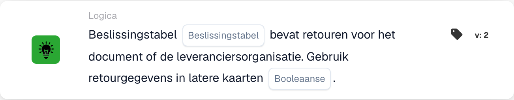

# Beslissingstabel geeft resultaten terug

<figure><figcaption>
Kaartvelden in de getoonde versie. De velden zijn nog niet ingevuld. Sommige labels van deze versie zijn in de interface nog niet of onjuist vertaald. De uitleg op deze pagina gebruikt de juiste termen; de afbeelding toont de werkelijke interface.
</figcaption></figure>

## **Doel:**

Deze DocBits-kaart controleert of een opgegeven beslistabel retourwaarden voor een bepaald document heeft en bepaalt of de geretourneerde gegevens in volgende workflow-stappen moeten worden gebruikt. Hij zorgt ervoor dat workflows zich dynamisch kunnen aanpassen op basis van de uitkomsten van de beslistabel.

## **Functionaliteit:**

* **Beslistabelvalidatie:** Deze kaart verifieert of de geselecteerde beslistabel retourwaarden levert voor het document dat wordt verwerkt.
* **Beslistabelselectie:** Gebruikers geven de naam op van de te controleren beslistabel.
* **Retourgegevens gebruiken:** Gebruikers kunnen met een **Booleaans**-instelling opgeven of de retourgegevens in latere kaarten moeten worden gebruikt:
  * **True:** De retourgegevens zijn beschikbaar en worden in volgende workflow-stappen gebruikt.
  * **False:** De retourgegevens worden niet gebruikt en de workflow gaat er zonder verder.

## **Gebruik:**

Deze kaart is ideaal voor workflows met voorwaardelijke logica of besluitvorming op basis van vooraf gedefinieerde regels in een beslistabel. Hij zorgt voor naadloze integratie van de uitvoer van de beslistabel in workflowprocessen.

## **Voorbeeldscenario:**

* Een gebruiker configureert de kaart om de beslistabel **"Regels voor factuurverwerking"** op retourwaarden te controleren. De **Booleaans** is ingesteld op **True**, wat aangeeft dat de retourgegevens (bijv. goedkeuringsvereisten) in latere kaarten worden gebruikt om workflow-beslissingen te sturen.

Door de kaart "Decision Table Check" te gebruiken, kunnen organisaties de workflow-flexibiliteit verbeteren, regelgebaseerde verwerking stroomlijnen en consistentie in de besluitvorming over geautomatiseerde workflows heen waarborgen.
