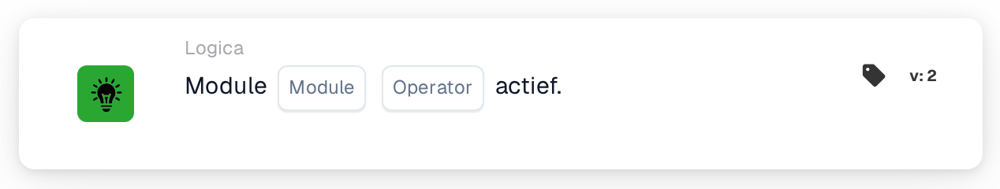

# Module actief

<figure><figcaption>
Versie 2
</figcaption></figure>

## **Doel:**

Deze DocBits-kaart controleert of een specifieke module in het systeem actief of inactief is. Hij maakt het mogelijk dat workflows doorgaan op basis van de activeringsstatus van een module, waardoor acties alleen worden uitgevoerd als de benodigde module beschikbaar is.

## **Functionaliteit:**

* **Modulestatusvalidatie:** Deze kaart verifieert de activeringsstatus van een opgegeven module en evalueert deze ten opzichte van een door de gebruiker gedefinieerde voorwaarde.
* **Moduleselectie:** Gebruikers geven de naam op van de te controleren module, wat zorgt voor een nauwkeurige validatie.
* **Operatoren:** De volgende voorwaarden kunnen worden toegepast:
  * **Is:** De workflow gaat verder als de geselecteerde module actief is.
  * **Is niet:** De workflow gaat verder als de geselecteerde module inactief is.

## **Gebruik:**

Deze kaart is met name nuttig voor beheerders of systeembeheerders die workflows moeten maken die afhankelijk zijn van de beschikbaarheid of functionaliteit van specifieke modules. Hij helpt ervoor te zorgen dat workflows alleen worden uitgevoerd wanneer alle vereiste modules op de juiste manier zijn geconfigureerd.

## **Voorbeeldscenario**

* Een gebruiker configureert de kaart om te controleren of de module **"Documentverwerking"** **actief is.** Als de module actief is, gaat de workflow verder en worden geautomatiseerde documentverwerkingstaken getriggerd. Als de module inactief is, stopt de workflow, wat onnodige acties voorkomt.

Door de kaart "Module Active Check" te gebruiken, kunnen organisaties de betrouwbaarheid van workflows verbeteren, fouten door inactieve modules voorkomen en ervoor zorgen dat processen aansluiten op de systeemconfiguratie.
