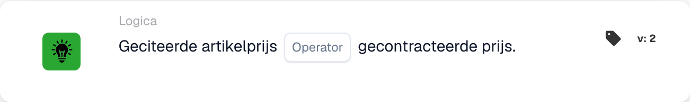

# Genoemde artikelprijs

<figure><figcaption>
Kaartvelden in de getoonde versie. De velden zijn nog niet ingevuld.
</figcaption></figure>

## **Doel:**

Deze DocBits-kaart vergelijkt de opgegeven prijs van een artikel met de contractprijs, waardoor workflows acties kunnen activeren op basis van de vraag of de twee waarden overeenkomen of verschillen. Het helpt bij het garanderen van prijsconsistentie en naleving van contractvoorwaarden.

## **Functionaliteit:**

* **Prijsvergelijking:** Deze kaart evalueert of de opgegeven artikelprijs voldoet aan de opgegeven voorwaarde ten opzichte van de contractprijs.
* **Exploitanten:** De volgende voorwaarden kunnen worden toegepast:
  * **Is gelijk aan (=):** Controleert of de opgegeven prijs overeenkomt met de contractprijs.
  * **Niet gelijk aan (≠):** Zorgt ervoor dat de opgegeven prijs afwijkt van de contractuele prijs.

## **Gebruik:**

Deze kaart is met name handig bij inkoop-, verkoop- of contractbeheerworkflows, waarbij het van cruciaal belang is om te valideren dat de opgegeven prijzen overeenkomen met de overeengekomen contractvoorwaarden voordat u doorgaat met goedkeuringen of orderverwerking.

## **Voorbeeldscenario:**

* Een gebruiker configureert de kaart om te controleren of de **geciteerde prijs gelijk is aan (=)** de **gecontracteerde prijs**. Als de prijzen overeenkomen, gaat de workflow over tot goedkeuring; Als dit niet het geval is, wordt er een melding geactiveerd voor handmatige beoordeling om de discrepantie op te lossen.

Door gebruik te maken van de kaart 'Opgegeven artikelprijs versus contractprijs' kunnen organisaties het prijsbeleid afdwingen, de naleving van contracten handhaven en het aantal fouten in financiële transacties verminderen.

## Versie 3: Alles of Alles

Versie 3 voegt `match_any` en `match_all` toe. Elke versie vereist ten minste één succesvolle vergelijkbare lijn; Alles vereist dat elke vergeleken lijn voldoet aan de geselecteerde operator. Versie 2 behoudt Alles. Een niet-ingestelde selectie op v3 wordt standaard ingesteld op Alles en wordt vastgelegd. Geen vergelijkbare lijnen ontbreken gegevens, geen succesvolle match. Zie [Quote-vergelijkingskaarten](../../cards-overview/quote-comparison-guide.md) voor gemengde resultaten, overgeslagen regels en tests.
