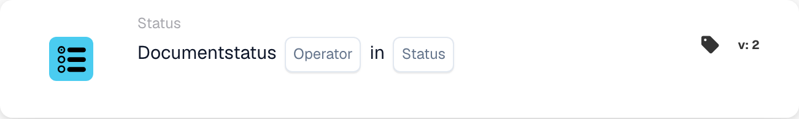

# Documentstatus Conditielijst

<figure><figcaption>
Kaartvelden in de getoonde versie. De velden zijn nog niet ingevuld.
</figcaption></figure>

**Doel**

Deze kaart is ontworpen om workflow-acties te controleren op basis van de huidige status van een document, waarbij voorwaardelijke logica wordt gebruikt om bepaalde processen te triggeren of te beperken. Hij zorgt ervoor dat documenten alleen door workflows gaan wanneer ze aan vooraf gedefinieerde statuscriteria voldoen.

**Onderdelen van de kaart**

1. **Exploitant**
   * **Beschrijving**: Bepaalt hoe de documentstatus ten opzichte van een opgegeven voorwaarde wordt geëvalueerd.
   * **Opties**:
     * **is**: Triggert de bijbehorende acties als de huidige status van het document overeenkomt met een van de opgegeven statussen.
     * **niet**: Triggert de acties als de status van het document met geen van de opgegeven statussen overeenkomt.
2. **Status ( Lijst )**
   * **Beschrijving**: Somt de specifieke statussen op waarmee de huidige status van het document wordt vergeleken.
   * **Voorbeelden**: "Error", "Export Error", "Ready in Validation", "Ready in Review", "Pending Approval", "Pending Second Approval". Deze vertegenwoordigen verschillende fasen of toestanden waarin een document zich binnen een workflowproces kan bevinden.

**Functionaliteit**

* **Statusidentificatie**: Identificeert automatisch de huidige status van een document terwijl het door de workflow van het ERP-systeem beweegt.
* **Voorwaarde-evaluatie**: Past de gekozen operator (is of is not) toe op de status van het document in vergelijking met de vermelde statussen:
  * Bij **is** controleert hij of de status van het document overeenkomt met een status in de lijst.
  * Bij **niet** controleert hij of de status van het document niet in de lijst voorkomt.
* **Actie-uitvoering**: Afhankelijk van de uitkomst van de voorwaarde-evaluatie:
  * **True**: Voert vooraf gedefinieerde acties of workflows uit als aan de voorwaarde wordt voldaan.
  * **False**: Slaat alternatieve workflows over of triggert ze als niet aan de voorwaarde wordt voldaan.
* **Workflow-integratie**: Integreert naadloos met andere workflow-onderdelen, zodat de documentafhandeling over het systeem heen wordt gecoördineerd.

**Gebruikersinteracties**

* **Opzet en configuratie**: Gebruikers configureren de kaart door de operator te selecteren en de relevante statussen op te geven. Deze opzet kan eenvoudige dropdownmenu's of selectievakjes omvatten voor het selecteren van statussen en operatoren.
* **Monitoring en beheer**: Gebruikers kunnen de activiteit van de kaart volgen via een dashboard, dat inzicht biedt in de gemonitorde statusvoorwaarden en de acties die op basis van die voorwaarden worden ondernomen.
* **Foutafhandeling en waarschuwingen**: Ondersteunt het instellen van waarschuwingen voor procesfouten of mismatches in verwachte documentstatussen, wat snelle reacties op operationele problemen mogelijk maakt.

#### Conclusie

De workflow-kaart "Document Status Condition" is essentieel om ervoor te zorgen dat documenten correct worden verwerkt volgens hun huidige status, wat de controle en efficiëntie binnen het ERP-systeem verbetert. Het duidelijk documenteren van deze kaart in de handleiding van het systeem helpt gebruikers hem effectief te implementeren en beheren, en de functionaliteit ervan te benutten om soepele en conforme documentworkflows te behouden. Deze kaart is met name nuttig bij het beheren van documentlevenscycli en om ervoor te zorgen dat alleen documenten die aan specifieke criteria voldoen, doorstromen naar volgende fasen van bedrijfsprocessen.

<!-- workflow-card-complete-example-20261021 condition_doc_status_is_isnot_in_list -->

### Voorbeeld van een statuslijst

**Configuratie:** Kies de operator die vereist dat de huidige status in de lijst staat. Selecteer `Pending Approval` en `Pending Second Approval` in de statuslijst.

**Verwacht resultaat en tegenvoorbeeld:** De voorwaarde is waar voor een document met een van beide geselecteerde statussen. Dit is false voor een document met de status `Ready in Validation`. Als de operator vereist dat de status buiten de lijst valt, zijn de resultaten van deze voorwaarde omgekeerd. Inspecteer de daadwerkelijke lijst in plaats van een door komma's gescheiden vrije tekstwaarde te vergelijken.

Dit is een illustratieve testconfiguratie en verwachte uitkomst; het werd niet uitgevoerd. Gebruik gegevens en ontvangers die in uw testorganisatie zijn geconfigureerd.
