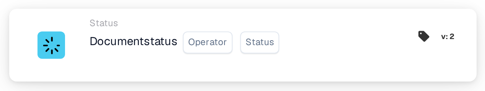

# Status van één document Conditie

<figure><figcaption>
Versie 2
</figcaption></figure>

**Doel**

Deze workflow-kaart is afgestemd op het beheren van bewerkingen op documenten op basis van één enkele, opgegeven documentstatus. Door de voorwaarde tot één status te vereenvoudigen, is de kaart gericht op zeer specifieke workflow-triggers, waardoor hij ideaal is voor gerichte documentverwerkingsactiviteiten binnen een ERP-systeem.

**Onderdelen van de kaart**

1. **Exploitant**
   * **Beschrijving**: Geeft de methode op voor het evalueren van de status van het document ten opzichte van de geselecteerde voorwaarde.
   * **Opties**:
     * **is**: Triggert de bewerking als de huidige status van het document overeenkomt met de geselecteerde status.
     * **niet**: Triggert de bewerking als de huidige status van het document niet overeenkomt met de geselecteerde status.
2. **Status**
   * **Beschrijving**: Maakt de selectie van één enkele documentstatus mogelijk om de voorwaarde in te stellen.
   * **Voorbeelden van statussen**: "Error", "Export Error", "Ready in Validation", "Ready in Review", "Pending Approval", "Pending Second Approval".
   * **Details**: Gebruikers kiezen één status uit een dropdown of een set keuzerondjes. Deze status dient vervolgens als criterium voor de bewerking van de kaart.

**Functionaliteit**

* **Documentstatusidentificatie**: Identificeert de huidige status van een document terwijl het door het ERP-systeem wordt verwerkt.
* **Voorwaarde-evaluatie**:
  * Op basis van de geselecteerde operator (`is` of `is not`) controleert de kaart of de huidige status van het document overeenkomt met het gekozen statuscriterium.
* **Actie-uitvoering**:
  * **True-voorwaarde**: Als de status overeenkomt (of niet overeenkomt, op basis van de operator), wordt de bijbehorende actie gestart. Dit kan routering voor verdere verwerking, het genereren van meldingen of andere vooraf gedefinieerde workflows zijn.
  * **False-voorwaarde**: Als niet aan de voorwaarde wordt voldaan, wordt geen actie ondernomen of wordt een alternatief pad getriggerd.
* **Integratie met andere workflows**: Hoewel hij is ontworpen voor evaluatie van één status, kan deze kaart effectief worden geïntegreerd in bredere workflow-reeksen om een nauwkeurige documentafhandeling te waarborgen.

**Gebruikersinteracties**

* **Opzet en configuratie**: Gebruikers stellen de kaart in door een operator te selecteren en vervolgens één status uit de beschikbare opties te kiezen. Dit selectieproces is eenvoudig en ontworpen om verwarring te voorkomen.
* **Monitoring en rapportage**: Maakt monitoring mogelijk via door het systeem gegenereerde rapporten of dashboards die de verwerking van documenten op basis van hun status volgen, wat helpt de effectiviteit van de geïmplementeerde workflows te overzien.
* **Foutafhandeling en meldingen**: Configureerbaar om gebruikers te waarschuwen voor verwerkingsafwijkingen of om documenten te markeren die niet aan de ingestelde voorwaarden voldoen, wat zorgt voor snelle aandacht en oplossing.

#### Conclusie

De workflow-kaart "Single Document Status Condition" vereenvoudigt het documentbeheer door zich te richten op individuele statusvoorwaarden. Deze specificatie helpt in gevallen waarin nauwkeurige controle over documentstromen nodig is, met name in omgevingen met strenge verwerkingscriteria. Het duidelijk documenteren van deze versie van de kaart zorgt ervoor dat gebruikers de toepassing ervan volledig begrijpen en hem effectief in hun dagelijkse werkzaamheden kunnen integreren, wat zowel de naleving als de efficiëntie in de documentverwerking verbetert.

<!-- workflow-card-complete-example-20261021 condition_doc_status_is_isnot -->

### Voorbeeld met één status

**Configuratie:** Kies operator `is` en status `Pending Approval`. Voeg een volgende beoordelingsactie toe die geschikt is voor die status.

**Verwacht resultaat en tegenvoorbeeld:** De voorwaarde is waar voor een document dat momenteel `Pending Approval` is; het is false voor een document met status `Ready in Validation`. Gebruik de daadwerkelijk geselecteerde status uit uw release. Als u een status wijzigt, wordt het document niet zelf geëxporteerd.

Dit is een illustratieve testconfiguratie en verwachte uitkomst; het werd niet uitgevoerd. Gebruik gegevens en ontvangers die in uw testorganisatie zijn geconfigureerd.
