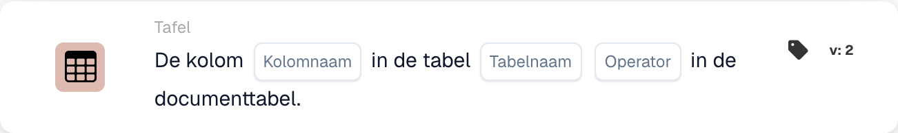
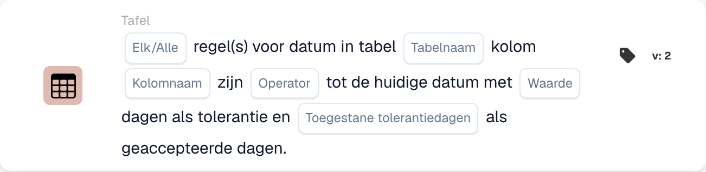

# Tabel

De kaarten van deze categorie in de **Kaart toevoegen**-kiezer van de Workflow Builder:

<figure><figcaption>
Beschikbare kaarten in de geselecteerde categorie. Vul de velden vóór gebruik in. Sommige labels van deze versie zijn in de interface nog niet of onjuist vertaald. De uitleg op deze pagina gebruikt de juiste termen; de afbeelding toont de werkelijke interface.
</figcaption></figure>

<!-- workflow-card-example-condition_table_column_exists-20261021 -->

### Documenttabel bevat een kolom

<figure><figcaption>
Kaartvelden in de getoonde versie. De velden zijn nog niet ingevuld. Sommige labels van deze versie zijn in de interface nog niet of onjuist vertaald. De uitleg op deze pagina gebruikt de juiste termen; de afbeelding toont de werkelijke interface.
</figcaption></figure>

`CONDITION_TABLE_COLUMN_EXISTS` · versie 2

Selecteer tabel `lines`, kolom `article_number` en de bestaande operator. Er komt een ingevulde tabel met die kolom voorbij; dezelfde tabel zonder de kolom faalt in de bestaansvergelijking. Een ontbrekende of lege tabel kan een resultaat van ontbrekende gegevens opleveren en is geen bewijs van een succesvolle negatieve vergelijking.

<!-- workflow-card-example-condition_compare_table_date_to_current_date-20261021 -->

### Datums in een tabel tegen de peildatum

<figure><figcaption>
Kaartvelden in de getoonde versie. De velden zijn nog niet ingevuld. Sommige labels van deze versie zijn in de interface nog niet of onjuist vertaald. De uitleg op deze pagina gebruikt de juiste termen; de afbeelding toont de werkelijke interface.
</figcaption></figure>

`CONDITION_COMPARE_TABLE_DATE_TO_CURRENT_DATE` · versie 2

Voor referentiedatum `2026-10-21` vergelijkt u tabel `lines`, kolom `delivery_date`, later dan, Alle en nuldagentolerantie. Rijen gedateerd `2026-10-22` en `2026-10-23` voldoen aan de vergelijking. Een rij gedateerd `2026-10-20` zorgt ervoor dat alles mislukt. Test ontbrekende en ongeldige datums afzonderlijk.
