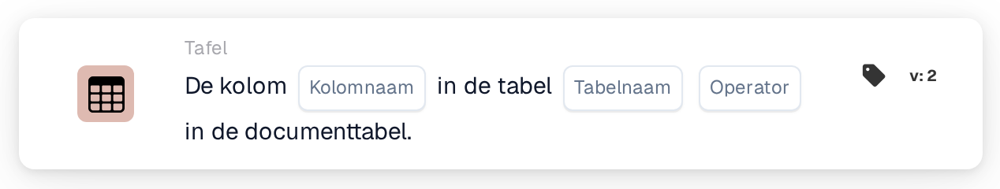

# Kolom bestaat in tabel

<figure><figcaption>
Versie 2
</figcaption></figure>

## Doel:

Deze workflowkaart controleert of een documenttabel een bepaalde kolom bevat. De kaart kan worden gebruikt om vervolgkaarten alleen uit te voeren voor documenten waarvan de tabel de benodigde gegevens bevat, bijvoorbeeld een kolom met de leverdatum of het artikelnummer, of om documenten met een andere tabelindeling elders heen te sturen. Afhankelijk van het resultaat gaat de workflow verder met de true- of de false-voorwaarde.

## Onderdelen van de kaart:

1. **Kolomnaam**
   * **Beschrijving:** De naam van de kolom die de kaart zoekt.
   * **Detail:** De kolomnaam wordt vergeleken zonder onderscheid tussen hoofd- en kleine letters.
2. **Tabelnaam**
   * **Beschrijving:** De naam van de documenttabel die wordt gecontroleerd.
   * **Detail:** De tabelnaam wordt vergeleken zonder onderscheid tussen hoofd- en kleine letters.
3. **Operator**
   * **Beschrijving:** Bepaalt of de kolom wel of niet in de tabel hoort voor te komen.
   * **Opties:**
     * **Is:** De voorwaarde is waar als de tabel de kolom bevat.
     * **Is niet:** De voorwaarde is waar als de tabel de kolom niet bevat.

## Functionaliteit:

* **Voorwaarde-evaluatie:** De kaart zoekt de documenttabel met de opgegeven naam en controleert of de eerste rij van die tabel een kolom met de opgegeven naam heeft. De gevonden kolom, of de kolommen die in plaats daarvan aanwezig waren, worden in het workflowlogboek vermeld.
* **Actie-uitvoering:**
  * **True-voorwaarde:**\
    Met **Is** staat de kolom in de tabel, met **Is niet** staat ze er niet in. De workflow gaat verder met de true-voorwaarde, bijvoorbeeld om een vergelijking op deze kolom uit te voeren.
  * **False-voorwaarde:**\
    Als niet aan de voorwaarde is voldaan, gaat de workflow verder met de false-voorwaarde.
* **Ontbrekende gegevens:** De kaart evalueert de voorwaarde niet en meldt de ontbrekende gegevens in het workflowlogboek als er op de kaart geen kolomnaam of geen tabelnaam is ingesteld, als het document geen tabel met de opgegeven naam heeft, of als die tabel geen rijen heeft of de eerste rij geen kolommen heeft.
* **Fouten:** Is er geen operator ingesteld of een andere operator dan **Is** of **Is niet**, dan meldt de kaart een instellingsfout.

## Opzet en configuratie:

* De kaart kan worden toegevoegd vanuit de categorie **Tafel**. Daarna kunnen de kolomnaam, de tabelnaam en de operator (**Is** of **Is niet**) worden ingesteld. Tot slot wordt de vervolgvoorwaarde (true of false) ingesteld, die de volgende stap in de workflow bepaalt.

## Conclusie:

De workflowkaart "Column Exists in Table" controleert de indeling van een documenttabel voordat de gegevens ervan worden gebruikt. Vóór andere tabelkaarten geplaatst, helpt ze ervoor te zorgen dat die kaarten alleen worden uitgevoerd op documenten die de verwachte kolom bevatten.
