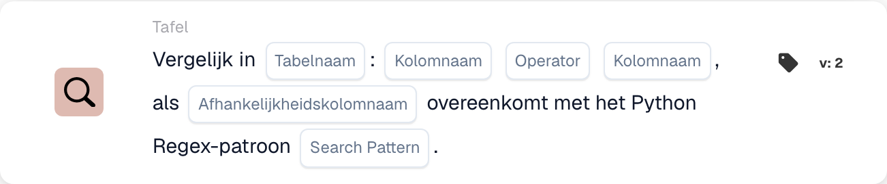

# Vergelijk In

<figure><figcaption>
Kaartvelden in de getoonde versie. De velden zijn nog niet ingevuld. Sommige labels van deze versie zijn in de interface nog niet of onjuist vertaald. De uitleg op deze pagina gebruikt de juiste termen; de afbeelding toont de werkelijke interface.
</figcaption></figure>

## **Doel:**

Deze DocBits-kaart voert een vergelijking uit tussen twee kolommen in een opgegeven tabel, waardoor gebruikers voorwaarden kunnen instellen op basis van waarden in elke kolom. Daarnaast bevat deze kaart een afhankelijkheidsfunctie, waarbij de vergelijking alleen plaatsvindt als de waarde in een derde kolom overeenkomt met een opgegeven Python-regex-patroon. Deze opzet is nuttig voor voorwaardelijke controles die afhankelijk zijn van meerdere datapunten binnen een dataset.

## **Functionaliteit:**

* **Kolomvergelijking met afhankelijkheid:** Deze kaart vergelijkt waarden in twee opgegeven kolommen op basis van een ingestelde voorwaarde, die alleen wordt toegepast als de waarde in een derde "afhankelijkheids"-kolom overeenkomt met een gedefinieerd Python-regex-patroon.
* **Operatoren:** Gebruikers kunnen de volgende operatoren voor de kolomvergelijking kiezen:
  * **Is gelijk aan (=):** Controleert of de waarden in de twee kolommen exact gelijk zijn.
  * **Niet gelijk aan (≠):** Zorgt ervoor dat de waarden in de twee kolommen niet gelijk zijn.
  * **Groter dan (>):** Bevestigt dat de waarden in de eerste kolom groter zijn dan die in de tweede kolom.
  * **Groter of gelijk aan (≥):** Zorgt ervoor dat de waarden in de eerste kolom groter dan of gelijk zijn aan die in de tweede kolom.
  * **Kleiner dan (<):** Controleert of de waarden in de eerste kolom kleiner zijn dan die in de tweede kolom.
  * **Minder of gelijk aan (≤):** Zorgt ervoor dat de waarden in de eerste kolom kleiner dan of gelijk zijn aan die in de tweede kolom.
* **Regex-afhankelijkheid:** Deze kaart bevat een afhankelijkheidsfunctie waarmee gebruikers een regex-patroon voor een derde kolom kunnen definiëren. De vergelijkingsvoorwaarde wordt alleen toegepast als ten minste één waarde in de afhankelijkheidskolom overeenkomt met het regex-patroon.

## **Gebruik:**

Deze kaart is met name nuttig in scenario's waarin complexe voorwaardelijke logica vereist is, zoals kwaliteitscontroles die afhankelijk zijn van relaties tussen datapunten, met aanvullende voorwaarden op basis van gegevensopmaak of specifieke patronen.

***

## **Voorbeeldscenario:**

* Een gebruiker configureert de kaart om de kolommen "Quantity" en "Threshold" in een tabel "Stock" te vergelijken met de voorwaarde **Hoeveelheid ≥ Drempel**. Deze vergelijking vindt alleen plaats als de kolom "Item Code" overeenkomt met het regex-patroon voor specifieke codeformaten, zoals **^A\d{3}$** (wat een itemcode aangeeft die begint met "A" gevolgd door drie cijfers).

Door de kaart "Conditional Column Comparison" te gebruiken, kunnen organisaties geavanceerde, patroonafhankelijke vergelijkingen binnen datasets maken, wat fijnafgestemde gegevensverwerking en verbeterde nauwkeurigheid in voorwaardelijke workflows mogelijk maakt.
