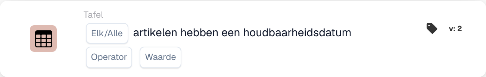

# Artikelen hebben een houdbaarheidsdatum

<figure><figcaption>
Kaartvelden in de getoonde versie. De velden zijn nog niet ingevuld. Sommige labels van deze versie zijn in de interface nog niet of onjuist vertaald. De uitleg op deze pagina gebruikt de juiste termen; de afbeelding toont de werkelijke interface.
</figcaption></figure>

## **Doel:**

Deze DocBits-kaart verifieert of items in een dataset aan opgegeven voorwaarden voldoen op basis van hun houdbaarheid. De kaart stelt gebruikers in staat te kiezen tussen "any"- of "all"-items voor validatie en ondersteunt diverse vergelijkingsoperatoren. Dit is ideaal voor scenario's waarin workflow-beslissingen afhangen van de houdbaarheid van items, zoals kwaliteitscontrole, voorraadbeheer of nalevingscontroles

## **Functionaliteit:**

* **Houdbaarheidsvalidatie:** Deze kaart controleert de houdbaarheid van items ten opzichte van een opgegeven voorwaarde. Gebruikers kunnen ervoor kiezen **een** item of **alle** items in de dataset te valideren en diverse vergelijkingsoperatoren toe te passen om de voorwaarde te definiëren.
* **Itemselectie:** Gebruikers kunnen kiezen tussen:
  * **Any Item:** De kaart wordt getriggerd als ten minste één item aan de opgegeven houdbaarheidsvoorwaarde voldoet.
  * **Alle artikelen:** De kaart wordt alleen getriggerd als alle items aan de opgegeven houdbaarheidsvoorwaarde voldoen.
* **Operatoren:** De volgende operatoren zijn beschikbaar om de houdbaarheidsvoorwaarde in te stellen:
  * **Is gelijk aan (=):** Controleert of de houdbaarheid exact gelijk is aan de opgegeven waarde.
  * **Niet gelijk aan (≠):** Zorgt ervoor dat de houdbaarheid niet gelijk is aan de opgegeven waarde.
  * **Groter dan (>):** Bevestigt dat de houdbaarheid groter is dan de opgegeven waarde.
  * **Groter of gelijk aan (≥):** Zorgt ervoor dat de houdbaarheid groter dan of gelijk is aan de opgegeven waarde.
  * **Less Than (<):** Controleert of de houdbaarheid kleiner is dan de opgegeven waarde.
  * **Minder of gelijk aan (≤):** Zorgt ervoor dat de houdbaarheid kleiner dan of gelijk is aan de opgegeven waarde.

## **Gebruik:**

Deze kaart is geschikt voor kwaliteitscontroleteams, voorraadmanagers of nalevingsfunctionarissen die ervoor moeten zorgen dat items aan specifieke houdbaarheidsvereisten voldoen voordat ze met verdere acties of workflows verdergaan.

## **Voorbeeldscenario:**

* Een gebruiker configureert de kaart om te controleren of **alle artikelen** een houdbaarheid **groter dan of gelijk aan 30 dagen** hebben. Als elk item aan deze voorwaarde voldoet, gaat de workflow verder, wat bevestigt dat alle items voldoende houdbaarheid hebben voor verkoop of distributie.

Door de kaart "Shelf Life Validation" te gebruiken, kunnen organisaties houdbaarheidsnormen afdwingen, productkwaliteit behouden en workflow-nauwkeurigheid waarborgen op basis van houdbaarheidsvoorwaarden van items.
