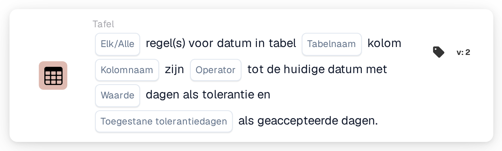

# Vergelijk tabeldatum met huidige datum

<figure><figcaption>
Versie 2
</figcaption></figure>

Hoe het tolerantievenster wordt berekend, met voorbeelden zoals "vandaag of morgen", wordt uitgelegd op [Date Tolerances](../date-tolerances.md).

## Doel:

Deze workflowkaart vergelijkt een datum in elke regel van een documenttabel, bijvoorbeeld een leverdatum, met de huidige datum. Er kan een tolerantie in dagen worden ingesteld en er kan worden gekozen welke dagen van de week meetellen, zodat bijvoorbeeld alleen werkdagen worden gebruikt. De kaart kan worden gebruikt om te controleren of de data op een document in het verleden liggen, vandaag zijn, binnen enkele dagen vallen of in de toekomst liggen. Afhankelijk van het resultaat gaat de workflow verder met de true- of de false-voorwaarde.

## Onderdelen van de kaart:

1. **Elk/Alle**
   * **Beschrijving:** Bepaalt of één regel of elke regel van de tabel aan de voorwaarde hoort te voldoen.
   * **Opties:**
     * **Elk:** De voorwaarde is waar als minstens één regel aan de voorwaarde voldoet.
     * **Alle:** De voorwaarde is alleen waar als elke regel aan de voorwaarde voldoet.
2. **Tabelnaam**
   * **Beschrijving:** De naam van de documenttabel die de data bevat.
3. **Kolomnaam**
   * **Beschrijving:** De kolom van de tabel die de datum bevat.
4. **Operator**
   * **Beschrijving:** Bepaalt hoe de datum in de tabel wordt vergeleken met de huidige datum, rekening houdend met de tolerantie.
   * **Opties:**
     * **is gelijk aan:** De datum ligt binnen het tolerantiebereik rond de huidige datum.
     * **Niet gelijk:** De datum ligt buiten het tolerantiebereik.
     * **Groter dan:** De datum ligt na het tolerantiebereik.
     * **Groter of gelijk aan:** De datum ligt binnen of na het tolerantiebereik.
     * **Minder dan:** De datum ligt vóór het tolerantiebereik.
     * **Kleiner of gelijk aan:** De datum ligt binnen of vóór het tolerantiebereik.
5. **Waarde**
   * **Beschrijving:** De tolerantie in dagen.
   * **Detail:** Het tolerantiebereik reikt dit aantal dagen vóór en na de huidige datum. Alleen de dagen die onder **Toegestane tolerantiedagen** zijn geselecteerd, worden meegeteld. Is er geen waarde ingesteld, dan wordt een tolerantie van 0 dagen gebruikt, zodat het bereik alleen de huidige datum is.
6. **Toegestane tolerantiedagen**
   * **Beschrijving:** De dagen van de week die als geaccepteerde dagen gelden.
   * **Opties:** Maandag tot en met Zondag; er kunnen meerdere dagen worden geselecteerd.

## Functionaliteit:

* **Voorwaarde-evaluatie:** De kaart leest voor elke regel van de eerste tabel met de opgegeven naam de datum in de geselecteerde kolom en vergelijkt die met de huidige datum (de datum in UTC). Het tolerantiebereik wordt berekend door het opgegeven aantal dagen vooruit en terug te tellen vanaf de huidige datum. Dagen van de week die niet zijn geselecteerd, worden niet meegeteld; het bereik loopt dus over die dagen heen door, en ze blijven binnen het bereik. Met een tolerantie van 2 dagen, alleen maandag tot en met vrijdag geselecteerd en een vrijdag als huidige datum loopt het bereik bijvoorbeeld van woensdag tot en met de dinsdag daarna.
* **Geaccepteerde dagen:** Naast de vergelijking hoort de datum van elke regel op een van de geselecteerde dagen van de week te vallen. Een regel voldoet alleen aan de voorwaarde als beide controles slagen. De resultaten van alle regels worden vervolgens samengevoegd met **Elk** of **Alle**.
* **Actie-uitvoering:**
  * **True-voorwaarde:**\
    De data voldoen aan de geselecteerde operator en vallen op geaccepteerde dagen, bij elke of alle regels. De workflow gaat verder met de true-voorwaarde.
  * **False-voorwaarde:**\
    Als niet aan de voorwaarde is voldaan, gaat de workflow verder met de false-voorwaarde, bijvoorbeeld om het document ter handmatige controle door te sturen.
* **Ontbrekende gegevens:** De kaart evalueert de voorwaarde niet en meldt de ontbrekende gegevens in het workflowlogboek als er op de kaart geen tabelnaam, kolomnaam of geaccepteerde dagen zijn ingesteld, als het document geen tabel met de opgegeven naam heeft, als een regel van de tabel de kolom niet heeft, of als de tabel geen regels heeft. Is er geen optie **Elk/Alle** ingesteld, dan vermeldt de kaart dit in het logboek en gebruikt ze **Alle**.
* **Fouten:** Kan een waarde in de datumkolom niet als datum worden gelezen, dan eindigt de kaart met een fout.

## Opzet en configuratie:

* De kaart kan worden toegevoegd vanuit de categorie **Tafel**. Daarna kunnen **Elk** of **Alle**, de tabelnaam, de kolomnaam, de operator, de tolerantie in dagen en de geaccepteerde dagen van de week worden ingesteld. Tot slot wordt de vervolgvoorwaarde (true of false) ingesteld, die de volgende stap in de workflow bepaalt.

## Conclusie:

De workflowkaart "Table Date to Current Date" controleert de data van regelitems tegen vandaag, met een tolerantie die kan worden beperkt tot werkdagen of een andere selectie van weekdagen. Zo kunnen documenten worden gemarkeerd met data die te vroeg of te laat zijn of op dagen vallen die niet worden geaccepteerd.
