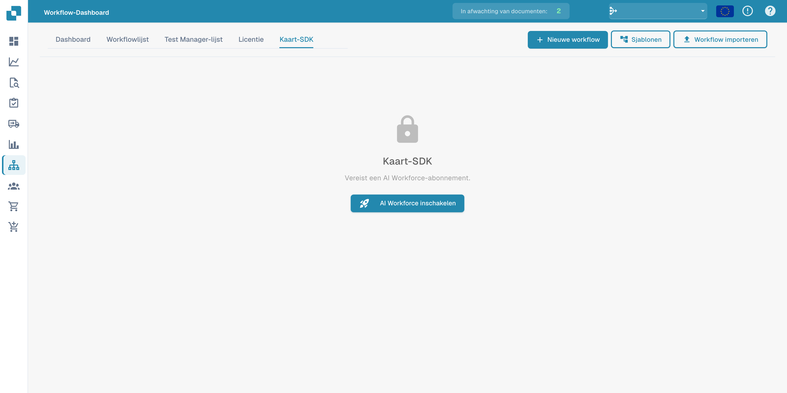

# Card SDK

De **Card SDK** stelt partners en ontwikkelaars in staat om aangepaste workflow-kaarten voor DocFlow te bouwen. U verpakt een kaart als een partner-app en uploadt deze, of importeert hem rechtstreeks vanuit GitHub.

<figure><figcaption>
Card SDK met melding dat een AI Workforce-abonnement vereist is.
</figcaption></figure>

## Hoe het werkt

- **Download SDK-sjabloon** — begin met de officiële template die de verwachte structuur bevat.
- **Upload ZIP** — de ZIP moet `app.json` en een `.docflowcompose/flow/`-map met de kaartdefinities bevatten (max. 10 MB). Upload &#x26; Validate controleert het pakket voordat het wordt geaccepteerd.
- **GitHub-import** — importeer een kaartdefinitie rechtstreeks uit een GitHub-repository.
- **Inzendingen** — volg de status van kaarten die u hebt ingediend.

Zodra ze zijn gevalideerd en geaccepteerd, verschijnen uw aangepaste kaarten in de **Kaart toevoegen**-bibliotheek naast de ingebouwde kaarten.
