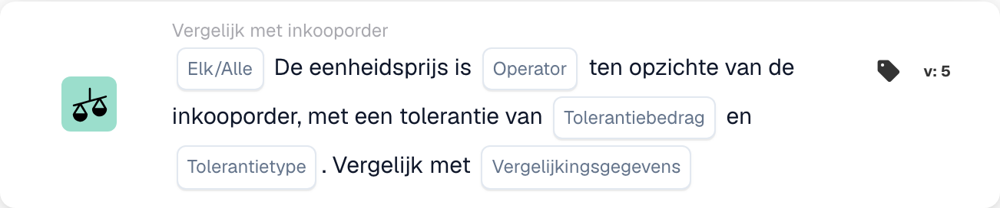

# Kaartversies en beschikbaarheid

<figure><figcaption>
Kaartvelden in de getoonde versie. De velden zijn nog niet ingevuld.
</figcaption></figure>

Een kaart in een opgeslagen workflow behoudt zijn kaart-ID en versie. Een nieuwere sjabloon kan velden toevoegen of gedrag veranderen zonder elke eerder opgeslagen workflow te wijzigen. Controleer de versie op de daadwerkelijke kaart voordat u instructies voor een nieuwere versie toepast.

## Voordat u een opgeslagen kaart wijzigt

1. Registreer de velden en het huidige resultaat op representatieve testgegevens.
2. Vergelijk de versie met de referentie, inclusief de standaardinstellingen en het gedrag van ontbrekende gegevens.
3. Upgrade of vervang de kaart alleen via de ondersteunde bouwactie en controleer de instellingen opnieuw.
4. Valideer de grafiek en test gevallen van geslaagde, mislukte en ontbrekende gegevens voordat u de gewijzigde workflow activeert.

Bewerk een opgeslagen technisch kaarttype niet louter om de spelling ervan te corrigeren. Bestaande workflows kunnen afhankelijk zijn van die ID. Een niet-ondersteunde versie is een uitvoeringsfout en geen valse bedrijfsvoorwaarde.

## Als een gedocumenteerde kaart ontbreekt

Controleer de geselecteerde When, And or Then-groep, categorie, Standard versus Advanced builder, ingeschakelde modules, machtigingen en geïmplementeerde release bij uw beheerder. Een kaart vermeld in een technische integratie of nieuwere referentie is niet noodzakelijkerwijs ingeschakeld voor uw organisatie. Maak of importeer geen geraden kaartdefinitie om een ​​ontbrekende sjabloon te omzeilen.

De aanvullende kalendervoorwaarden die in bepaald ontwikkelingsmateriaal worden beschreven, zijn niet in elke release een bevestigde selecteerbare set. De documentvariabele-setter wordt ook geïmplementeerd zonder een algemeen geplaatste UI-sjabloon. Gebruik de kaarten die daadwerkelijk beschikbaar zijn in uw omgeving en vraag om opheldering voordat u afhankelijk bent van een niet-beschikbare kaart.

## Referenties die afhankelijk zijn van de versie

- [Kaarten exporteren](export-cards-guide.md): resultaatstatus en onmiddellijke versus in de wachtrij geplaatste export.
- [PO-vergelijkingskaarten](po-comparison-versions-guide.md): vergelijkingsrichting en tolerantiebasis.
- [Quote-vergelijkingskaarten](quote-comparison-guide.md): Alle/Alles en ontbrekende vergelijkbare prijzen.
- [Logische kaarten](logic-cards-guide.md): tags, organisatievariabelen en invoertypen.

Gebruik [Workflow Logs](../workflow-logs.md) om succes, een valse voorwaarde, ontbrekende gegevens, een installatiefout en een overgeslagen kaart te onderscheiden. Leg de documentstatus en kaartinstellingen vast met een testresultaat; een screenshot van de kaartkiezer alleen stelt geen runtime-gedrag vast.
