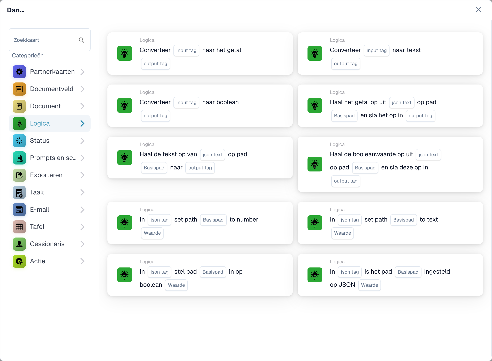

# Logicakaarten: variabelen, conversies, JSON en triggers

<figure><figcaption><p>Conversie- en JSON-kaarten in de bibliotheek. Kaarten voor organisatievariabelen vereisen de Advanced Builder; zichtbare sjablonen hangen ook af van de release. Sommige labels van deze versie zijn in de interface nog niet of onjuist vertaald. De uitleg op deze pagina gebruikt de juiste termen; de afbeelding toont de werkelijke interface.</p></figcaption></figure>

Gebruik deze kaarten in de Advanced Workflow Builder waar de geselecteerde kaart beschikbaar is. De zichtbaarheid van de kaart is afhankelijk van uw release en ingeschakelde sjablonen. De onderstaande referenties beschrijven versie 2. Houd de versie die is opgeslagen in een bestaande workflow in gedachten wanneer u de velden ervan vergelijkt met deze handleiding.

## Kies de juiste waardewinkel

Een organisatiewerkstroomvariabele die is geselecteerd in het deelvenster Variabelen, wordt gedeeld tussen werkstromen en wordt onafhankelijk van het canvas opgeslagen. Een benoemde tag die wordt gebruikt door conversie-, JSON- en tag-vergelijkingskaarten behoort tot de huidige uitvoeringscontext. Door een tag te maken, wordt er geen organisatievariabele gemaakt. Voer de tagnaam in zonder een voorvoegsel voor de interne opslag. Een documentveld is een derde, afzonderlijke gegevensbron.

Een organisatievariabele en een uitvoeringstag blijven gescheiden, zelfs als hun namen overeenkomen. Selecteer een compatibel variabel veld of geef expliciet de waarde op die de ontvangende kaart verwacht. Zie [Variabelen](../advanced-workflow/variables.md) voor de reikwijdte van de organisatie en onmiddellijke persistentie.

## Organisatievariabele acties

Maak eerst de variabele met het juiste type aan en selecteer deze op de kaart. Een ontbrekende variabelereferentie rapporteert `MISSING_VARIABLE`. De kaarten die variabelen instellen, registreren de vorige en nieuwe waarde in het kaartlogboek. Vermijd echte persoonlijke of vertrouwelijke gegevens in testwaarden en gedeelde logs.

| Kaart | Vereiste invoer | Resultaat en voorbeeld | Mislukking of grensgeval |
| --- | --- | --- | --- |
| `ACTION_LOGIC_SET_TEXT_VAR` | Tekstvariabele en `value` | Slaat tekst op; Stel een routeringslabel bijvoorbeeld in op `review`. | Een ontbrekende waarde verschilt van een opzettelijk lege tekstwaarde. |
| `ACTION_LOGIC_SET_NUMBER_VAR` | Variabele van type Nummer en numeriek `value` | Slaat een eindig getal op; Stel bijvoorbeeld een drempel in op `1000.50`. | Ongeldige numerieke tekst, oneindig en NaN worden afgewezen. Gebruik een decimaalteken, zonder valutasymbool. |
| `ACTION_LOGIC_CALC_NUMBER` | Getalvariabele en `expression` | Slaat het rekenkundige resultaat op; `(100 + 20) / 2` geeft `60`. | Ondersteunt numerieke letterlijke waarden, haakjes, `+`, `-`, `*`, `/`, `%` en `**`. Namen, functieaanroepen en documentveldreferenties worden niet geaccepteerd in de expressie. Ongeldige expressies of deling door nul mislukken. |
| `ACTION_LOGIC_SET_BOOLEAN_VAR` | Ja/Nee variabele en `value` | Stelt de vlag in op Ja of Nee. | Gebruik de Booleaanse waarde die door de kaart wordt aangeboden in plaats van een vertaald synoniem in vrije tekst. |
| `ACTION_LOGIC_INVERT_BOOLEAN` | Ja/Nee variabele | Keert de huidige waarde om; Ja wordt Nee. | Initialiseer de variabele voordat u op een bepaald eerste resultaat vertrouwt. |

### Documentreferentieactie

`ACTION_LOGIC_SET_DOCUMENT_VAR` slaat de huidige document-ID op in een geselecteerde documentvariabele. Er is een actueel document nodig; zonder één rapporteert het `NO_DOCUMENT`. Een geactiveerde workflow ontvangt de document-ID, niet een geserialiseerd documentobject. De gecontroleerde implementatie heeft geen geplaatste UI-kaartsjabloon voor deze actie, dus verwacht niet dat deze in elke kaartkiezer verschijnt. Gebruik het alleen als uw beheerder bevestigt dat er een passend sjabloon beschikbaar is; het invoeren van een document-ID in het formulier voor het aanmaken van variabelen is geen vervanging.

## Tags en typeconversies

Deze acties gebruiken tagnamen in de huidige uitvoeringscontext. Maak de invoertag voordat u deze leest. Een ontbrekende invoertag of ontbrekende naam rapporteert `MISSING_VARIABLE`; een ongeldige numerieke conversie rapporteert een installatiefout. De uitvoer is een nieuwe of overschreven tag, niet een geëxtraheerd documentveld.

| Kaart | Ingangen | Uitvoer en voorbeeld |
| --- | --- | --- |
| `ACTION_LOGIC_CREATE_TEXT_TAG` | `tag_name`, `value` | Creëert een teksttag; `raw_amount` met waarde `125.50`. Een lege tekstwaarde is toegestaan. |
| `ACTION_LOGIC_CONVERT_TO_NUMBER` | `input_tag`, `output_tag` | Converteert `125.50` naar het getal `125.5`. Een Booleaanse waarde wordt `1` of `0`. Tekst zoals `EUR 125,50` is geen geldige numerieke invoer. |
| `ACTION_LOGIC_CONVERT_TO_TEXT` | `input_tag`, `output_tag` | Converteert de opgeslagen waarde naar tekst. Het formatteert geen valuta en lokaliseert geen decimale scheidingstekens. |
| `ACTION_LOGIC_CONVERT_TO_BOOLEAN` | `input_tag`, `output_tag` | Converteert een bestaande Boolean rechtstreeks; een getal dat niet nul is, wordt waar en nul wordt onwaar. Gebruik `true` of `false` voor voorspelbare tekstinvoer en test andere geaccepteerde representaties. |

### Conversie voorbeeld

1. Maak een teksttag `raw_amount` met de waarde `125.50`.
2. Converteer `raw_amount` naar Getal en schrijf naar `amount_number`.
3. Gebruik Getal groter dan met `tag_name` ingesteld op `amount_number` en `value` ingesteld op `100`.
4. Controleer of de voorwaarde slaagt voor `125.50`, mislukt voor `100` en een conversiefout rapporteert voor `EUR 125,50` bij stap 2.

## Waarden uit JSON lezen

Alle drie de leeskaarten hebben `json_text`, `json_path` en `output_tag`. Ondanks zijn naam is `json_text` de naam van een tag die JSON bevat, en niet een vak voor het plakken van een letterlijk JSON-document. Maak eerst die tag aan, bijvoorbeeld met Teksttag maken.

Paden zijn door punten gescheiden sleutels en op nul gebaseerde lijstindexen: `invoice.lines.0.amount`. Gebruik geen JSONPath-syntaxis zoals `$.invoice.lines[0].amount`. Als een sleutel ontbreekt, een index ongeldig is of JSON ongeldig is, is het resultaat `ERROR_CARD_SETUP`; een ontbrekende brontag rapporteert `MISSING_VARIABLE`.

| Kaart | Uitvoer |
| --- | --- |
| `ACTION_LOGIC_JSON_TO_NUMBER` | Numerieke waarde; numerieke tekst wordt geconverteerd en een Booleaanse waarde wordt `1` of `0`. Ongeldige numerieke tekst mislukt. |
| `ACTION_LOGIC_JSON_TO_TEXT` | Tekstweergave van de geselecteerde waarde. Dit is geen belofte van JSON-serialisatie voor geneste objecten. |
| `ACTION_LOGIC_JSON_TO_BOOLEAN` | Een Booleaanse waarde; tekst `true`, `1` of `yes` is waar na kleine letters, terwijl andere tekst onwaar is. Getallen volgen hun nul/niet-nul-waarde. |

Voor een tag `payload` die de volgende JSON bevat, levert het lezen van `invoice.lines.0.amount` in `amount` met JSON als nummer `125.5` op:

```json
{"invoice":{"lines":[{"amount":"125.50"}],"approved":false}}
```

Test ook een niet-bestaand pad, een index die buiten het bereik ligt en een verkeerd opgemaakte JSON. Een mislukte uitlezing mag niet worden behandeld als een geldige nul of een succesvolle goedkeuring.

## JSON bijwerken

De vier schrijfkaarten hebben `json_tag`, `json_path` en `value`. `json_tag` noemt een bestaande tag die JSON bevat. Ze updaten die tag met geserialiseerde JSON. Dezelfde door punten gescheiden padsyntaxis is van toepassing; Er kunnen ontbrekende tussenobjectsleutels worden gemaakt, maar lijstindexen moeten bestaande elementen identificeren. Ze breiden geen lijst uit en ondersteunen geen jokertekenpaden.

| Kaart | Waarde en effect |
| --- | --- |
| `ACTION_LOGIC_JSON_SET_NUMBER` | Een numerieke waarde, zoals `125.5`; slaat een JSON-nummer op. Ongeldige numerieke tekst mislukt. |
| `ACTION_LOGIC_JSON_SET_TEXT` | Tekst, zoals `review`; slaat een JSON-tekenreeks op. |
| `ACTION_LOGIC_JSON_SET_BOOLEAN` | Tekst `true`, `1` of `yes` wordt waar na kleine letters; andere tekstsets zijn false. Geef de voorkeur aan `true` en `false`. |
| `ACTION_LOGIC_JSON_SET_JSON` | Geldige JSON, zoals `{"status":"review"}`; voegt de geparseerde waarde in, niet de geciteerde tekst. Ongeldige JSON mislukt. |

Stel bijvoorbeeld pad `invoice.approved` in op `true` in `payload` met JSON-set Boolean. Lees vervolgens hetzelfde pad met JSON naar Boolean en verifieer waar. Een ontbrekende brontag, ongeldige JSON of ongeldig pad moet in het kaartlogboek worden gediagnosticeerd voordat u verdergaat.

## Voorwaarden

Alle zes onderstaande voorwaarden zijn versie 2. Een valse voorwaarde is een zakelijk resultaat, geen succesvolle actie of een uitvoeringsfout. In een voorwaardereeks in standaardstijl voorkomt het de volgende acties; in een geavanceerde workflow koppelt u het resultaat aan de beoogde vertakking.

| Kaart | Velden | Evaluatie en belangrijke grens |
| --- | --- | --- |
| `CONDITION_LOGIC_VALUE_EQUALS` | `tag_name`, `value` | Vergelijkt tekstrepresentaties exact, inclusief hoofdlettergebruik. Gebruik dit niet als aanwezigheidscontrole: een ontbrekende tag wordt niet automatisch als fout gerapporteerd. |
| `CONDITION_LOGIC_BOOLEAN_IS` | `tag_name` | Controleert of de tag waar is. Een ontbrekende tag resulteert in 'onwaar'. Gebruik een echte Booleaanse waarde voor betrouwbare resultaten. |
| `CONDITION_LOGIC_TEXT_CONTAINS` | `tag_name`, `value` | Hoofdlettergevoelig zoeken naar subtekenreeksen. Een ontbrekende tag wordt behandeld als lege tekst. Een lege zoekreeks komt overeen; stel de zoekwaarde altijd bewust in. |
| `CONDITION_LOGIC_NUMBER_LESS` | `tag_name`, numeriek `value` | Strikt minder dan. Een ontbrekende tag of weggelaten vergelijkingswaarde is standaard nul; ongeldige numerieke gegevens zijn een installatiefout. |
| `CONDITION_LOGIC_NUMBER_GREATER` | `tag_name`, numeriek `value` | Strikt groter dan. Een waarde gelijk aan de drempel voldoet niet aan deze voorwaarde. Dezelfde nulstandaardwaarden en numeriek foutgedrag zijn van toepassing. |
| `CONDITION_LOGIC_EXPRESSION` | `value1`, `operator`, `value2` | Ondersteunt `==`, `!=`, `<`, `<=`, `>`, `>=`, `contains`, `not_contains`. Het probeert eerst numerieke vergelijking en vergelijkt anderszins tekst. Het is geen willekeurig Python-expressieveld. |

Voor een getal groter dan `100` test u `99`, `100` en `101`. Voor Tekst bevat `ABC`, test `ABC`, `abc` en een lege zoekopdracht. Controleer zowel de branch als het log; een grijze knoop werd overgeslagen en blijkt geen succesvolle vergelijking.

## Triggers

| Kaart | Configuratie | Wanneer het overeenkomt |
| --- | --- | --- |
| `CONDITION_LOGIC_VAR_CHANGED` | Selecteer een organisatievariabele. De opgeslagen referentie gebruikt zijn ID, dus het hernoemen van de variabele verandert niet opzettelijk het doel. | De geleverde huidige en vorige variabelewaarden verschillen. Het herhalen van dezelfde waarde is geen verandering. Een ontbrekende variabelereferentie rapporteert `MISSING_VARIABLE`. |
| `CONDITION_LOGIC_WEBHOOK_EVENT` | Optioneel `event_name`. | Er is een webhookpayload aanwezig in de context van de werkstroomuitvoering. Bij een naam moet de `event`-waarde van de payload exact overeenkomen; zonder naam geleverde webhook-evenementmatches. Geen enkele gebeurtenis betekent onwaar. |

Als u een Webhook-gebeurtenis selecteert, wordt er geen openbaar webhook-eindpunt of de authenticatie ervan gemaakt. Uw integratie moet de gebeurtenis via een geconfigureerd toegangspunt aanleveren. Test de overeenkomende gebeurtenis, een andere gebeurtenis en geen gebeurtenis. Voor een variabele-trigger test u een echte waardeverandering en een ongewijzigde waarde, en vermijdt u een keten die herhaaldelijk dezelfde gedeelde variabele herschrijft.

## Testen en diagnosticeren

Valideer de grafiek, test elke vertakking met representatieve invoer en inspecteer [Workflow Logs](../workflow-logs.md). Inclusief ontbrekende tags, ongeldige JSON, verkeerde typen variabelen, numerieke grenzen en valse voorwaarden. Een test zonder document kan geen documentafhankelijke handeling bewijzen. Controleer de versie van de opgeslagen kaart en de ingeschakelde status opnieuw voordat u vertrouwt op automatische uitvoering.

<!-- workflow-card-logic-examples-20261021 -->

## Uitgewerkte voorbeelden voor elke logicakaart

Dit zijn illustratieve invoer en verwachte resultaten voor versie 2. Gebruik kaarten met organisatievariabelen alleen waar de Advanced Builder hun sjablonen openbaar maakt.

| Kaart | Voorbeeldconfiguratie | Verwacht resultaat en tegenvoorbeeld |
| --- | --- | --- |
| `ACTION_LOGIC_SET_TEXT_VAR` | Stel de organisatietekstvariabele `routing_label` in op `review`. | De gedeelde variabele bevat `review`. Een latere workflow kan dezelfde organisatievariabele lezen. |
| `ACTION_LOGIC_SET_NUMBER_VAR` | Stel de getalvariabele `approval_limit` in op `1000.50`. | Het slaat numeriek `1000.5` op. Tekst `EUR 1000,50` is geen geldige numerieke invoer. |
| `ACTION_LOGIC_CALC_NUMBER` | Sla expressie `(100 + 20) / 2` op in getalvariabele `calculated_limit`. | Het resultaat is `60`. Een documentveldnaam of deling door nul is geen geldige vervanging. |
| `ACTION_LOGIC_SET_BOOLEAN_VAR` | Stel de Ja/Nee-variabele `review_required` in op de aangeboden Booleaanse waarde `true`. | De organisatievlag is waar. Gebruik Boolean `false` in een apart hoofdlettergebruik om het te wissen. |
| `ACTION_LOGIC_INVERT_BOOLEAN` | Begin met organisatievariabele `demo_flag` gelijk aan `true`. | Eén uitvoering maakt het `false`. Opnieuw uitvoeren maakt het `true`, dus herhaalde uitvoering is niet idempotent. |
| `ACTION_LOGIC_CREATE_TEXT_TAG` | Maak uitvoeringstag `raw_amount` met tekst `125.50`. | De tag bevat die tekst in deze uitvoering; het is geen nieuwe organisatievariabele of documentveld. |
| `ACTION_LOGIC_CONVERT_TO_NUMBER` | Converteer invoertag `raw_amount`, die `125.50` bevat, naar uitvoertag `amount_number`. | De uitvoer is numeriek `125.5`. `EUR 125,50` levert een conversiefout op. |
| `ACTION_LOGIC_CONVERT_TO_TEXT` | Converteer numerieke tag `amount_number` met `125.5` naar `amount_text`. | De uitvoer is tekst `125.5`; het is niet gelokaliseerd als een valutabedrag. |
| `ACTION_LOGIC_CONVERT_TO_BOOLEAN` | Converteer een numerieke invoertag die `1` bevat naar uitvoertag `has_value`. | De uitvoer is waar. Numeriek `0` levert false op. |
| `ACTION_LOGIC_JSON_TO_NUMBER` | Maak brontag `payload` met `{"invoice":{"amount":"125.50"}}`; lees pad `invoice.amount` naar `amount_number`. | De uitvoer is numeriek `125.5`. Een afwezig pad is een fout, geen geldige nul. |
| `ACTION_LOGIC_JSON_TO_TEXT` | Gebruik brontag `payload` met daarin `{"invoice":{"status":"review"}}` en pad `invoice.status`. | De uitvoertag bevat tekst `review`. |
| `ACTION_LOGIC_JSON_TO_BOOLEAN` | Gebruik brontag `payload` met daarin `{"invoice":{"approved":false}}` en pad `invoice.approved`. | De uitvoer is Boolean false. Een ontbrekend pad is niet hetzelfde als een opgeslagen vals pad. |
| `ACTION_LOGIC_JSON_SET_NUMBER` | Gebruik de bestaande JSON-tag `payload` met daarin `{"invoice":{}}`; stel `invoice.total` in op `125.5`. | De tag bevat een numeriek JSON-totaal, geen numerieke tekenreeks tussen aanhalingstekens. |
| `ACTION_LOGIC_JSON_SET_TEXT` | Gebruik de bestaande JSON-tag `payload` met daarin `{"invoice":{}}`; stel `invoice.status` in op `review`. | De opgeslagen JSON-waarde is een tekenreeks: `{"invoice":{"status":"review"}}`. |
| `ACTION_LOGIC_JSON_SET_BOOLEAN` | Gebruik de bestaande JSON-tag `payload` met daarin `{"invoice":{}}`; stel `invoice.approved` in met tekst `true`. | De opgeslagen JSON-waarde is Boolean true. Gebruik `false` om het te wissen. |
| `ACTION_LOGIC_JSON_SET_JSON` | Gebruik de bestaande JSON-tag `payload` met daarin `{"invoice":{}}`; stel `invoice.metadata` in op geldige JSON `{"source":"demo"}`. | De ingevoegde waarde is een object. Ongeldige JSON moet worden gerapporteerd en niet worden opgeslagen als een succesvolle objectupdate. |
| `CONDITION_LOGIC_VALUE_EQUALS` | Maak tag `route` met tekst `review` en vergelijk deze met `review`. | Het gaat voorbij. Vergelijken met `Review` mislukt omdat de vergelijking hoofdlettergevoelig is. |
| `CONDITION_LOGIC_BOOLEAN_IS` | Gebruik tag `review_required` met echte Booleaanse waarde `true`. | Het gaat voorbij; false of een ontbrekende tag levert geen waar resultaat op. |
| `CONDITION_LOGIC_TEXT_CONTAINS` | Gebruik tag `note` met tekst `manual review` en zoek naar `review`. | Het gaat voorbij. Zoeken naar hoofdletters `REVIEW` mislukt. Een lege zoekreeks komt overeen en moet worden vermeden, tenzij dit bedoeld is. |
| `CONDITION_LOGIC_NUMBER_LESS` | Gebruik numerieke tag `amount` gelijk aan `50` en vergelijkingswaarde `100`. | Het gaat voorbij. Een waarde van `100` voldoet niet aan de strikte kleiner dan-vergelijking. |
| `CONDITION_LOGIC_NUMBER_GREATER` | Gebruik numerieke tag `amount` gelijk aan `125` en vergelijkingswaarde `100`. | Het gaat voorbij. `100` voldoet niet aan de strikte groter-dan-vergelijking. |
| `CONDITION_LOGIC_EXPRESSION` | Selecteer waarde1 `120`, operator `>` en waarde2 `100`. | De numerieke vergelijking gaat door. Gebruik `80` als waarde1 voor een valse vertakking; dit is geen Python-expressie in vrije vorm. |
| `CONDITION_LOGIC_VAR_CHANGED` | Selecteer een organisatievariabele waarvan de vorige waarde `new` is en de opgegeven huidige waarde `review` is. | De gebeurtenis met gewijzigde waarde komt overeen. Het herhalen van `review` als zowel de vorige als de huidige waarde komt niet overeen. |
| `CONDITION_LOGIC_WEBHOOK_EVENT` | Selecteer gebeurtenisnaam `invoice.ready` en geef een geconfigureerde integratiegebeurtenis op met payload `{"event":"invoice.ready"}`. | Het komt overeen. `{"event":"invoice.updated"}` en geen enkele gebeurtenis komen niet overeen. De kaart maakt geen webhookeindpunt. |

De optionele documentverwijzingsactie `ACTION_LOGIC_SET_DOCUMENT_VAR` heeft geen geplaatste sjabloon in de gecontroleerde bron. Als uw beheerder een ondersteunde sjabloon biedt, selecteert u een documentvariabele en voert u deze uit met een huidig ​​demodocument: het slaat die document-ID op. Zonder document rapporteert het `NO_DOCUMENT`. Beschouw het niet als een beschikbare kaart alleen maar omdat de implementatie bestaat.
