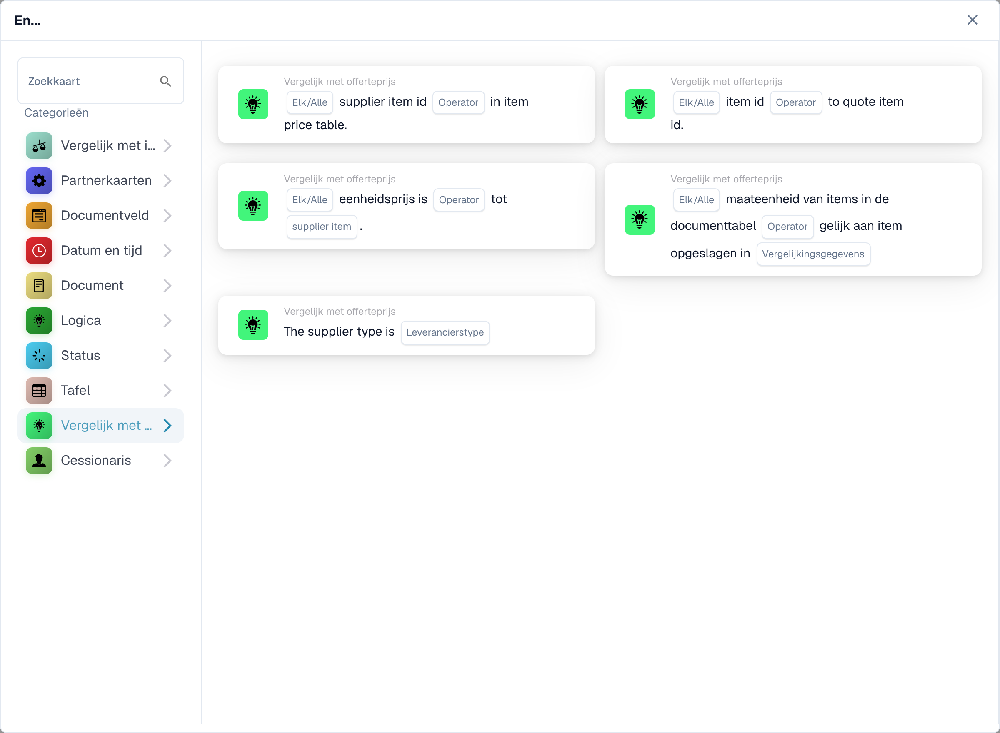

# Citeer vergelijkingskaarten

<figure><figcaption>
Beschikbare kaarten in de geselecteerde categorie. Vul de velden vóór gebruik in. Sommige labels van deze versie zijn in de interface nog niet of onjuist vertaald. De uitleg op deze pagina gebruikt de juiste termen; de afbeelding toont de werkelijke interface.
</figcaption></figure>

Deze En-voorwaarden maken gebruik van de offerte- of leveranciersartikelgegevens die beschikbaar zijn in het document. Configureer en test ze nadat de benodigde offertegegevens zijn geladen. Een overeenkomende artikel-ID bewijst op zichzelf niet dat de prijs of maateenheid correct is.

## Selecteer de cheque

| Kaarttype | Controle en configuratie |
| --- | --- |
| `CONDITION_QUOTES_ITEM_NUMBER_COMPARISON` | Controleert de artikel-ID aan de hand van de artikelprijsgegevens. Selecteer de vergelijkings- en Alle/Alle-velden die door de kaart worden aangeboden. |
| `CONDITION_SPECIFY_SUPPLIER_TYPE` | Vergelijkt het leverancierstype uit de offertegegevens met `supplier_type`. Dit is een leveranciersclassificatiecontrole, geen prijsvergelijking. |
| `CONDITION_QUOTE_SUPPLIER_ITEM_NUMBER_EXISTS` | Controleert of de artikel-ID van de leverancier wel of niet aanwezig is in de artikelprijsgegevens; kies de operator en Alles/Alles. Ontbrekende offerte- of artikelgegevens moeten in het logboek worden onderzocht. |
| `CONDITION_QUOTE_PRICE_MATCH` | Vergelijkt een eenheidsprijs met de geselecteerde leveranciersprijs: `ManagedPrice` of `LastPrice`. Kies Alle/Alles en de numerieke vergelijkingsoperator. Lijnen zonder een vergelijkbaar nummer aan weerszijden worden overgeslagen en geregistreerd; als geen enkele regel vergelijkbaar is, rapporteert de kaart ontbrekende documentgegevens. |
| `CONDIITON_UNIT_OF_MEASURE_EQUAL` | Controleert de maateenheid aan de hand van de gerelateerde gegevens. Het technische type bevat een behouden spelfout; verander het niet in de opgeslagen workflow-JSON. Een prijs uitgedrukt per verschillende eenheden heeft aparte aandacht nodig. |
| `CONDITION_ITEM_QUOTES_TO_CONTRACTED_PRICE` | Vergelijkt offerte- en contractprijzen. Versie 3 voegt Any/All toe; zie hieronder. |

Zichtbare labels kunnen per release en UI-taal verschillen. Selecteer op basis van de daadwerkelijke controle, niet alleen op basis van de categorienaam. De Prijs van geciteerde artikelen kan bijvoorbeeld verschijnen onder Logica, terwijl de andere prijsopgavecontroles verschijnen in Vergelijken met prijsopgave.

## Geciteerde artikelprijs: versie 3

Kies de gelijkheids- of ongelijkheidsoperator en of een vergeleken lijn of elke vergeleken lijn hieraan moet voldoen:

- `match_any`: één succesvolle vergelijkbare regel is voldoende.
- `match_all`: elke vergeleken lijn moet voldoen aan de geselecteerde operator.

Versie 2 behoudt het gedrag Alle. Een uitgeschakelde Any/All-instelling op v3 valt terug naar All en wordt vastgelegd. Een kaart zonder vergelijkbare lijnen meldt ontbrekende gegevens; Het ontbreken van een prijs is geen bewijs van gelijkheid of ongelijkheid. Inspecteer overgeslagen regels en hun ontbrekende kant in het logboek.

Twee vergelijkbare lijnen leveren bijvoorbeeld de resultaten 'waar' en 'onwaar' op voor gelijkheid. Eventuele passen; Alles mislukt. Bij ongelijkheid verandert eerst het vergelijkingsresultaat voor elke regel, en vervolgens combineert Any/All deze resultaten. Het uiteindelijke All-resultaat wordt niet omgekeerd om Any te implementeren.

## Testgevallen

Gebruik exacte artikel- en leveranciers-ID's, de beoogde prijsbron en overeenkomende eenheden. Test alle regels die overeenkomen, een gemengd resultaat, geen vergelijkbare prijzen, ontbrekende offertegegevens en een verkeerde leverancier-ID. Controleer zowel het vergelijkingsresultaat als welke regels zijn overgeslagen. Houd de goedkeuring of export achter de bedrijfscontroles die daadwerkelijk nodig zijn; een succesvolle identificatiecontrole is geen volledige aanbestedingsvalidatie.

Zie [PO Matching](../and/compare-with-purchase-order/po-matching-complete-guide.md) voor vergelijkingen van inkooporders en [Workflowlogboeken](../workflow-logs.md) voor probleemoplossing.

<!-- workflow-card-complete-example-20261021 condition_quotes_item_number_comparison -->

### Voorbeeld van een vergelijking van artikelnummers

**Configuratie:** Bereid twee vergelijkbare prijsopgaveregels voor: leveranciersartikel `DEMO-S1` wordt aan beide zijden toegewezen aan artikel `DEMO-I1`; leveranciersitem `DEMO-S2` heeft documentitem `DEMO-I2` en matrixitem `DEMO-I9`. Kies gelijkheid en `match_all`.

**Verwacht resultaat en tegenvoorbeeld:** Het conditieresultaat is onwaar bij `match_all`, omdat één vergelijkbaar artikelnummer verschilt. Het resultaat is waar met `match_any`, omdat het eerste artikelnummer overeenkomt. Bij het opzoeken wordt gebruik gemaakt van het artikelnummer van de leverancier. Een matrixinvoer zonder artikelnummer wordt overgeslagen en gelogd; als geen enkele lijn vergelijkbaar is, is het conditieresultaat onwaar. Een datumbereiklogboek alleen is geen afzonderlijke geldigheidsvoorwaarde.

Dit is een illustratieve testconfiguratie en verwachte uitkomst; het werd niet uitgevoerd. Gebruik gegevens en ontvangers die in uw testorganisatie zijn geconfigureerd.

<!-- workflow-card-complete-example-20261021 condition_quote_supplier_item_number_exists -->

### Voorbeeld van bestaan van leveranciersitems

**Configuratie:** Het document heeft leveranciersartikelnummers `DEMO-S1` en `DEMO-S2`; de geladen artikelprijsgegevens van de leverancier bevatten alleen `DEMO-S1`. Kies de aanwezigheidsoperator en `match_all`.

**Verwacht resultaat en tegenvoorbeeld:** Het voorwaarderesultaat is onwaar met `match_all` en waar met `match_any`. Bij de verzuimoperator is de tweede regel een positief verzuimresultaat. Het bestaan ​​bewijst niet dat de artikelprijs, eenheid of leveranciersclassificatie correct is. Laad eerst geldige offertegegevens en inspecteer fouten in ontbrekende gegevens.

Dit is een illustratieve testconfiguratie en verwachte uitkomst; het werd niet uitgevoerd. Gebruik gegevens en ontvangers die in uw testorganisatie zijn geconfigureerd.

<!-- workflow-card-complete-example-20261021 condition_quote_price_match -->

### Voorbeeld leveranciersprijs

**Configuratie:** Voor twee overeenkomende lijnen kiest u `ManagedPrice`, gelijkheid en `match_all`. Documentprijzen zijn `10` en `12`; de bijbehorende beheerde prijzen zijn `10` en `13`, in overeenkomende valuta's en eenheden.

**Verwacht resultaat en tegenvoorbeeld:** Het voorwaarderesultaat is onwaar met `match_all` en waar met `match_any`. Overschakelen naar `LastPrice` gebruikt een andere bron en moet onafhankelijk worden getest. Een regel zonder vergelijkbare numerieke prijs wordt overgeslagen en geregistreerd; als geen enkele regel vergelijkbaar is, rapporteert de kaart ontbrekende documentgegevens en geen gelijkheid.

Dit is een illustratieve testconfiguratie en verwachte uitkomst; het werd niet uitgevoerd. Gebruik gegevens en ontvangers die in uw testorganisatie zijn geconfigureerd.

<!-- workflow-card-complete-example-20261021 condition_specify_supplier_type -->

### Voorbeeld van leveranciersclassificatie

**Configuratie:** Kies leverancierstype `Contract`. Bereid twee geladen offerteleveranciergegevens voor waarbij `managed_class` gelijk is aan `contract`.

**Verwacht resultaat en tegenvoorbeeld:** De voorwaarde is waar als elk geladen item die classificatie heeft. De voorwaarde is onwaar als één item classificatie `managed` heeft. De selecteerbare `Nonmanaged`-waarde wordt door de backend genormaliseerd naar `unmanaged`. Deze classificatie staat los van een leveranciersrechtsvorm. Ontbrekende offertegegevens zijn geen match.

Dit is een illustratieve testconfiguratie en verwachte uitkomst; het werd niet uitgevoerd. Gebruik gegevens en ontvangers die in uw testorganisatie zijn geconfigureerd.

<!-- workflow-card-complete-example-20261021 condiiton_unit_of_measure_equal -->

### Voorbeeld van maateenheid

**Configuratie:** Bereid gekoppelde offerteregels voor met documenteenheid `EA` en vergelijkingseenheid `EA` van de leverancier. Kies gelijkheid en `match_all`. Behoud de kaartversie die u wilt testen.

**Verwacht resultaat en tegenvoorbeeld:** De voorwaarde is waar voor het matchen van vergelijkbare eenheden; een tweede vergelijkbare rij die `KG` gebruikt in plaats van `EA` maakt de voorwaarde onwaar met `match_all`. Ontbrekende vergelijkingseenheden worden overgeslagen en geregistreerd; als geen enkele vergelijkbaar is, rapporteert de kaart ontbrekende gegevens. Versie 3 past mogelijk de geconfigureerde eenheidstoewijzing toe, dus verifieer die toewijzing afzonderlijk. Het matchen van prijzen alleen zorgt niet voor matchende eenheden.

Dit is een illustratieve testconfiguratie en verwachte uitkomst; het werd niet uitgevoerd. Gebruik gegevens en ontvangers die in uw testorganisatie zijn geconfigureerd.
