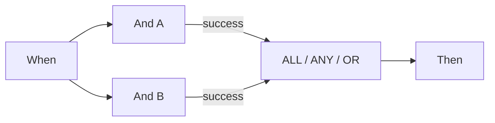

# P0: Wait ALL, Wait ANY en OR correct verbinden

ALL vereist een passend verbonden resultaat van **elke verschillende bron**. ANY en OR vereisen minstens één passende bron. Groen en oranje vanaf dezelfde bron aansluiten telt nog steeds als één bron. OR maakt geen exclusieve vertakking en annuleert geen andere acties. ANY garandeert evenmin dat de snelste tak wint.

De onderzochte planner wacht eerst op alle inkomende voorgangers. Blijft een voorganger onbereikbaar doordat een tak niet gekozen is, dan slaat een normale uitvoering de vastgelopen samenvoeging over. De testmodus kan deze met de beschikbare resultaten toch beoordelen. **Een groene gedeeltelijke test bewijst dus niet dat een documentuitvoering door dezelfde graaf verdergaat.**

Voer voor twee verplichte controles beide uit en verbind hun vereiste uitgangen met ALL. Gebruik voor alternatieve routes in deze versie de directe gezamenlijke Then-afsluitkaart van het v2-voorbeeld. Die samenkomst geldt voor elkaar uitsluitende routes en is geen barrière voor meerdere gelijktijdige acties.

Controleer bron, verbonden uitgang, gekozen uitgang en werkelijke bereikbaarheid afzonderlijk. Een bronfout blijft een fout in de totale uitvoering, ook als ANY/OR daarna slaagt. Een niet-voldane ALL bevat in de onderzochte code ook een foutdetail; de oranje kleur alleen volstaat niet.

## Kaarten en voorbeeldparameters

Deze waarden beschrijven kaartparameters, geen volledig importeerbare workflow. Vervang YOUR_* door eigen testkeuzes. De ontwerper beheert het verborgen aanroeper-ID. Catalogus: Dev, DocFlow 2.10.38, 21 oktober 2026; controleer versies en rechten van uw organisatie afzonderlijk.

`node_type`: `all`, `any`, `or`

## Zakelijke testgevallen

| Geval | Invoer / configuratie | Verwacht resultaat |
| --- | --- | --- |
| MERGE-01 | A=success; B=success | ALL/ANY/OR: join=success |
| MERGE-02 | A=success; B=failed_condition; B→failed_condition: — | ALL: join=failed_condition, workflow=error; ANY/OR: join=success, workflow=failed_condition |
| MERGE-03 | A=success; B=error | ANY/OR: join=success; workflow=error |
| MERGE-04 | A=success; B=niet bereikt | test: beoordelen; planner: overslaan |
| MERGE-05 | A→success + A→failed_condition; B→success | sources=2 |

## Bewijs en grenzen

Geselecteerde kaart- en knoopresultaten zijn met synthetische gegevens in Advanced Test gecontroleerd. Antwoorden staan in het oefenpakket. Documentacties zijn gesimuleerd en bewijzen geen opgeslagen documentuitvoering of externe aflevering.

[Verder leren](../workflow-learning-path.md) · [Oefenpakket](../workflow-training-kit.md)
