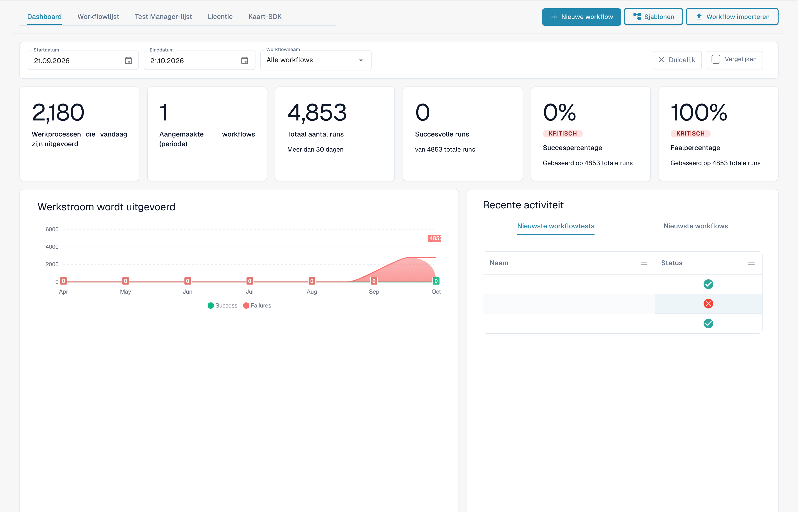
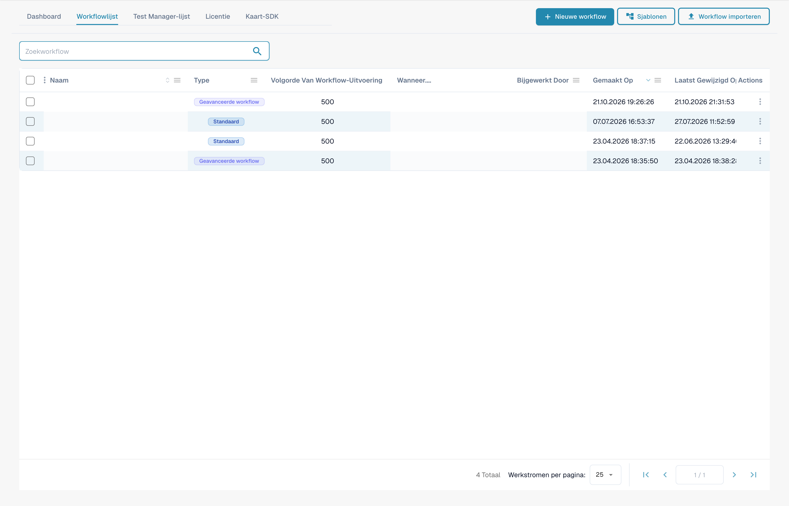
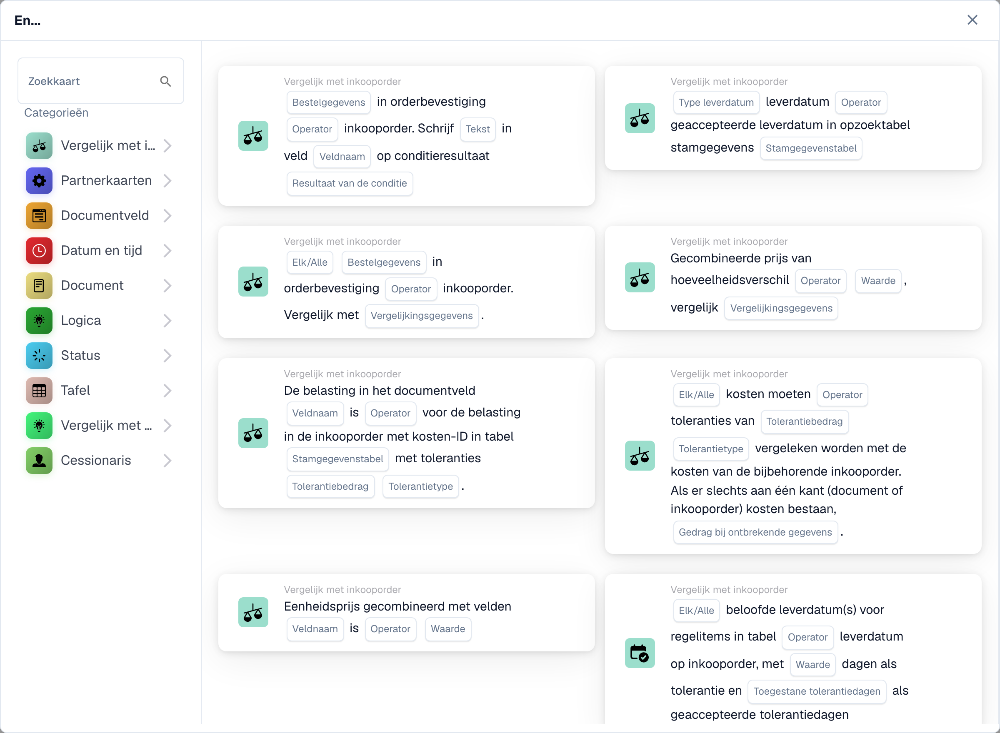

# Gidsen voor workflowpatronen

**Versie:** 1.0 **Laatst bijgewerkt:** 23 oktober 2025

***

## Overzicht

Deze map bevat uitgebreide handleidingen voor werkstroompatronen die laten zien hoe u meerdere werkstroomkaarten kunt combineren om algemene bedrijfsscenario's op te lossen. Elk patroon biedt stapsgewijze implementatie-instructies, volledige voorbeelden en best practices.

**Wat zijn workflowpatronen?**

Workflowpatronen zijn beproefde, herbruikbare oplossingen voor algemene uitdagingen op het gebied van documentatieverwerking. In plaats van helemaal opnieuw te beginnen, kunt u deze patronen als sjablonen gebruiken en ze aanpassen aan uw specifieke behoeften.

***

## De Workflow Builder in één oogopslag

Elk patroon op deze pagina is samengesteld in de **Workflow-bouwer**. U bereikt dit via **Workflowdashboard → Workflowlijst → Workflow toevoegen** (of door een bestaande workflow te openen). Het dashboard geeft u de rungeschiedenis en succes-/mislukkingspercentages voor al uw workflows:

<figure><figcaption><p>Het Workflow Dashboard — uitvoeringstotalen, slaag-/faalpercentages en recente activiteit voor elke workflow. Vertrouwelijke namen en documentverwijzingen zijn verborgen.</p></figcaption></figure>

Op het tabblad **Workflowlijst** wordt elke workflow vermeld met het type, de uitvoeringsvolgorde en de trigger. Gebruik **Workflow toevoegen** om een nieuwe te maken, of klik op een workflow om deze in de builder te openen:

<figure><figcaption><p>De Workflowlijst — elke rij is een workflow die u kunt openen, in-/uitschakelen of bewerken. Vertrouwelijke namen en documentverwijzingen zijn verborgen.</p></figcaption></figure>

Een workflow bestaat uit drie kaartgroepen: **Wanneer** (trigger), **En** (aanvullende voorwaarden) en **Dan** (acties). Het volgende niet-opgeslagen voorbeeld toont deze structuur. Het documenttype, de suborganisatie en de gebruiker moeten nog worden geselecteerd:

<figure><figcaption><p>Niet-opgeslagen voorbeeld met Wanneer-, En- en Dan-kaarten. Vul alle velden in vóór uitvoering. Sommige labels van deze versie zijn in de interface nog niet of onjuist vertaald. De uitleg op deze pagina gebruikt de juiste termen; de afbeelding toont de werkelijke interface.</p></figcaption></figure>

Klik op **Kaart toevoegen** in een willekeurige groep om de kaartbibliotheek te openen. Kaarten zijn geordend per categorie (vergelijk met inkooporder, partnerkaarten, documentveld, datum en tijd, document, logica, status, tabel, toegewezen persoon, ...), zodat u de bouwsteen kunt vinden waar elk patroon om vraagt:

<figure><figcaption><p>Beschikbare kaarten in de geselecteerde categorie. Vul de velden vóór gebruik in. Sommige labels van deze versie zijn in de interface nog niet of onjuist vertaald. De uitleg op deze pagina gebruikt de juiste termen; de afbeelding toont de werkelijke interface.</p></figcaption></figure>

***

## Beschikbare patronen

### 1. [API-integratiepatroon](api-integration-pattern.md)

**Complexiteit:** Gemiddeld | **Installatietijd:** 45-60 minuten

Leer hoe u DocBits kunt integreren met externe API's om gegevens van externe systemen op te halen, te valideren en op te slaan.

**Gebruiksscenario's:**

* Haal realtime prijzen op van externe systemen
* Valideer leveranciersinformatie aan de hand van hoofddatabases
* Zoek productdetails op uit catalogussystemen
* Ontvang wisselkoersen van valutadiensten
* Verifieer adressen met geocoderingsservices

**Gebruikte kaarten:** CALL\_API, CONDITION\_HTTPS\_REQUEST\_STATUS, ACTION\_SET\_FIELD\_TO\_TEXT, CONDITION\_COMPARE\_TWO\_DOCFIELD\_VALUES

[**Volledig patroon bekijken →**](api-integration-pattern.md)

***

### 2. [Taakbeheerpatroon](task-management-pattern.md)

**Complexiteit:** Laag-gemiddeld | **Installatietijd:** 30-45 minuten

Beheers de kunst van het creëren, toewijzen, volgen en beheren van taken binnen DocBits-workflows voor goedkeurings- en beoordelingsprocessen.

**Gebruiksscenario's:**

* Goedkeuringsworkflows maken
* Wijs beoordelingstaken toe aan gebruikers
* Afhandelen van uitzonderingen die menselijke tussenkomst vereisen
* Escaleer problemen naar managers
* Creëer goedkeuringsketens op meerdere niveaus
* Volg de voltooiing van taken en deadlines

**Gebruikte kaarten:** tasks\_create, ACTION\_ASSIGN\_TO\_USER, ACTION\_SEND\_EMAIL\_TO\_GROUPS, CONDITION\_TASK\_STATUS

[**Volledig patroon bekijken →**](task-management-pattern.md)

***

### 3. [PO-overeenkomend patroon](po-matching-pattern.md)

**Complexiteit:** Middelhoog | **Installatietijd:** 60-90 minuten

Implementeer uitgebreide workflows voor het matchen van inkooporders om facturen te valideren aan de hand van inkooporders met op tolerantie gebaseerde routering.

**Gebruiksscenario's:**

* Valideer facturen ten opzichte van inkooporders
* Detecteer prijsfouten vóór betaling
* Identificeer hoeveelheidsverschillen
* Voer inkoopcontroles uit
* Voorkom dubbele betalingen
* Automatiseer driewegmatching

**Gebruikte kaarten:** PURCHASE\_ORDER\_FULL\_MATCH, CONDITION\_DOC\_TO\_PO\_UNIT\_PRICE, CONDITION\_DOC\_TO\_PO\_QUANTITY, CONDITION\_DOC\_TO\_PO\_TAX\_LINES

[**Volledig patroon bekijken →**](po-matching-pattern.md)

***

### 4. [Beslissingslogicapatroon](decision-logic-pattern.md)

**Complexiteit:** Gemiddeld | **Installatietijd:** 30-45 minuten

Implementeer complexe beslissingsbomen en voorwaardelijke routeringslogica om documenten via verschillende paden te verwerken op basis van bedrijfsregels.

**Gebruiksscenario's:**

* Documenten routeren op bedragdrempels
* Pas verschillende regels toe voor verschillende documenttypen
* Implementeer goedkeuringslogica op meerdere niveaus
* Behandel complex bedrijfsbeleid
* Creëer dynamische routing op basis van meerdere criteria
* Implementeer goedkeuringsmatrixen

**Gebruikte kaarten:** CONDITION\_DOC\_FIELD\_AMOUNT, CONDITION\_DOC\_TYPE\_IS\_ISNOT, CONDITION\_SUPPLIER\_STATUS\_IS\_ISNOT, ACTION\_ASSIGN\_TO\_USER

[**Volledig patroon bekijken →**](decision-logic-pattern.md)

***

### 5. [Gegevenstransformatiepatroon](data-transformation-pattern.md)

**Complexiteit:** Gemiddeld | **Installatietijd:** 30-45 minuten

Transformeer, bereken, formatteer en verrijk documentgegevens om de export voor te bereiden, voer berekeningen uit en standaardiseer formaten.

**Gebruiksscenario's:**

* Bereken totalen, subtotalen, belastingen
* Converteer valuta's of eenheden
* Datums, cijfers, tekst opmaken
* Waarden afleiden uit bestaande velden
* Verrijk gegevens uit externe bronnen
* Standaardiseer gegevensformaten
* Valideer berekeningen

**Gebruikte kaarten:** ACTION\_CALCULATE\_FIELD, ACTION\_SET\_FIELD\_TO\_TEXT, ACTION\_COPY\_FIELD\_VALUE, CALL\_API, CONDITION\_COMPARE\_TWO\_DOCFIELD\_VALUES

[**Volledig patroon bekijken →**](data-transformation-pattern.md)

***

## Patroonkeuzegids

### Door complexiteit

| Complexiteit      | Patronen                                                                                                                                                                                      | Beste voor                               |
| --------------- | --------------------------------------------------------------------------------------------------------------------------------------------------------------------------------------------- | -------------------------------------- |
| **Laag-gemiddeld**  | [Taakbeheer](task-management-pattern.md)                                                                                                                                                 | Beginners, eenvoudige workflows            |
| **Gemiddeld**      | <p><a href="api-integration-pattern.md">API-integratie</a><br><a href="decision-logic-pattern.md">Besluitlogica</a><br><a href="data-transformation-pattern.md">Gegevenstransformatie</a></p> | Gemiddelde gebruikers, standaardworkflows |
| **Middelhoog** | [PO-matching](po-matching-pattern.md)                                                                                                                                                         | Geavanceerde gebruikers, complexe validatie     |

***

### Per gebruikscasus

| Ik moet...                     | Gebruik dit patroon                                              |
| -------------------------------- | ------------------------------------------------------------- |
| Integreer met externe systemen  | [API-integratiepatroon](api-integration-pattern.md)         |
| Goedkeuringsworkflows maken        | [Taakbeheerpatroon](task-management-pattern.md)         |
| Valideer tegen inkooporders | [PO-overeenkomend patroon](po-matching-pattern.md)                 |
| Route op basis van omstandigheden        | [Beslissingslogicapatroon](decision-logic-pattern.md)           |
| Bereken en transformeer gegevens     | [Gegevenstransformatiepatroon](data-transformation-pattern.md) |

***

### Per branche/afdeling

| Industrie/Afdeling    | Aanbevolen patronen                                                                                                                        |
| ---------------------- | ------------------------------------------------------------------------------------------------------------------------------------------- |
| **Financiën/boekhouding** | [PO Matching](po-matching-pattern.md), [Taakbeheer](task-management-pattern.md), [Gegevenstransformatie](data-transformation-pattern.md) |
| **Inkoop**        | [PO Matching](po-matching-pattern.md), [Besluitlogica](decision-logic-pattern.md), [API-integratie](api-integration-pattern.md)           |
| **Bewerkingen**         | [Taakbeheer](task-management-pattern.md), [Besluitlogica](decision-logic-pattern.md)                                                  |
| **IT/Integratie**     | [API-integratie](api-integration-pattern.md), [Gegevenstransformatie](data-transformation-pattern.md)                                        |
| **Alle afdelingen**    | [Besluitlogica](decision-logic-pattern.md), [Taakbeheer](task-management-pattern.md)                                                  |

***

## Hoe u deze patronen kunt gebruiken

### Stap 1: Kies een patroon

1. Bekijk de patroonbeschrijvingen hierboven
2. Identificeer welk patroon overeenkomt met uw gebruiksscenario
3. Controleer de complexiteit en de geschatte insteltijd
4. Bekijk het gedeelte 'Wanneer gebruiken' in de patroongids

### Stap 2: Controleer de vereisten

Elke patroongids vermeldt:

* Vereiste kennis
* Gerelateerde handleidingen die u eerst moet lezen
* Kaarten die gebruikt zullen worden
* Configuratievereisten

### Stap 3: Volg stapsgewijze instructies

Elk patroon biedt:

* Compleet workflowvoorbeeld
* Stapsgewijze implementatiehandleiding
* Configuratiesjablonen
* Voorbeelden uit de echte wereld
* Tips voor het oplossen van problemen

### Stap 4: Aanpassen aan uw behoeften

* Pas het voorbeeld aan uw bedrijfsregels aan
* Pas drempels en toleranties aan
* Wijzig de routeringslogica
* Voeg indien nodig stappen toe/verwijder deze
* Grondig testen vóór gebruik in productie

### Stap 5: Monitor en optimaliseer

* Volg de workflowprestaties
* Bewaak de succespercentages
* Verzamel gebruikersfeedback
* Verfijn de configuratie
* Documentaanpassingen

***

## Patrooncombinaties

Veel scenario's in de echte wereld vereisen het combineren van meerdere patronen:

### Voorbeeld 1: Volledige factuurverwerking

```
1. API Integration Pattern → Fetch current pricing
2. Data Transformation Pattern → Calculate totals
3. PO Matching Pattern → Validate against PO
4. Decision Logic Pattern → Route based on variance
5. Task Management Pattern → Create approval tasks
```

### Voorbeeld 2: Goedkeuring van hoge facturen

```
1. Data Transformation Pattern → Calculate amounts
2. Decision Logic Pattern → Check thresholds
3. Task Management Pattern → Multi-level approval
4. API Integration Pattern → Notify external systems
```

### Voorbeeld 3: Afhandeling van uitzonderingen

```
1. PO Matching Pattern → Detect variances
2. Decision Logic Pattern → Classify exception severity
3. Task Management Pattern → Create review tasks
4. Data Transformation Pattern → Calculate impact
```

***

## Patroonsjablonen

Elk patroon bevat deze gestandaardiseerde secties:

1. **Overzicht** - Wat het patroon doet
2. **Wanneer gebruiken** - Geschikte gebruiksscenario's
3. **Volledig voorbeeld** - Real-world scenario
4. **Stap-voor-Stap** - Implementatie-instructies
5. **Configuratie** - Sjablonen voor kaartinstellingen
6. **Werkstroomdiagram** - Visuele weergave
7. **Geavanceerde variaties** - Alternatieve implementaties
8. **Foutafhandeling** - Veelvoorkomende problemen en oplossingen
9. **Checklist testen** - Validatiestappen
10. **Verwante patronen** - Complementaire patronen
11. **Gerelateerde handleidingen** - Referentiedocumentatie

***

## Hulp krijgen

### Patroonondersteuningsbronnen

**Documentatie:**

* [Volledige workflowgidsindex](..)
* [Individuele kaartgidsen](../then/action)
* [Conditiekaartenreferentie](../and/condition-cards-complete-guide.md)
* [Werkstroomkoppelingskaart](https://github.com/Fellow-Consulting-AG/docbits/tree/main/WORKFLOW_LINKING_MAP.md)

**Extra bronnen:**

* [Snelle referentiehandleiding](https://github.com/Fellow-Consulting-AG/docbits/tree/main/WORKFLOW_LINKING_QUICK_REFERENCE.md)
* [Releaseopmerkingen oktober 2025](https://github.com/Fellow-Consulting-AG/docbits/tree/main/readme/administration-and-setup/workflow/changelog/2025-10-october.md)
* [Kaartversiereferentie](../cards-overview/po-comparison-versions-guide.md)

**Contactpersoon:**

* Patroonfeedback: docs@docbits.com
* Technische ondersteuning: support@docbits.com
* Hulp bij implementatie: consulting@docbits.com

***

## Patroonstatistieken

| Metrisch                      | Waarde               |
| --------------------------- | ------------------- |
| **Totaal aantal patronen**          | 5                   |
| **Totaal gedekte kaarten**     | 30+                 |
| **Gecombineerde documentatie**  | \~1.200 regels       |
| **Voorbeeldscenario's**       | 25+                 |
| **Configuratiesjablonen** | 15+                 |
| **Werkstroomdiagrammen**       | 5 volledige diagrammen |
| **Kruisverwijzingen**        | 87+ interne links  |

***

## Bijdragen aan patronen

Heeft u een workflowpatroon waar anderen voordeel uit kunnen halen?

**Richtlijnen voor patroonbijdragen:**

1. **Documenteer uw workflow**
   * Duidelijk bedrijfsscenario
   * Stapsgewijze implementatie
   * Voorbeelden van werkende configuraties
   * Testresultaten uit de echte wereld
2. **Volg patroonsjabloon**
   * Gebruik de standaard sectiestructuur
   * Voeg alle vereiste elementen toe
   * Geef diagrammen/voorbeelden
   * Gids voor probleemoplossing toevoegen
3. **Verzenden ter beoordeling**
   * E-mail naar: docs@docbits.com
   * Inclusief: patroonbeschrijving, gebruiksscenario's, implementatiegids
   * We zullen de officiële documentatie beoordelen en mogelijk aanvullen

**Voordelen:**

* Help andere DocBits-gebruikers
* Zorg dat u wordt herkend in documentatie
* Verbeter de algemene productkennisbasis
* Ontvang feedback over uw implementatie

***

## Wijzigingslog

### Versie 1.0 (23 oktober 2025)

* Eerste release van 5 uitgebreide workflowpatronen
* API-integratiepatroon toegevoegd
* Taakbeheerpatroon toegevoegd
* PO-overeenkomend patroon toegevoegd
* Beslissingslogicapatroon toegevoegd
* Gegevenstransformatiepatroon toegevoegd
* Kruisverwijzingen geïmplementeerd (87 links)
* Patroonkeuzegids gemaakt

***

## Volgende stappen

**Nieuw bij workflowpatronen?**

1. Begin met [Taakbeheerpatroon](task-management-pattern.md) - het gemakkelijkst te begrijpen
2. Bekijk [Besluitlogicapatroon](decision-logic-pattern.md) - fundamenteel voor alle workflows
3. Ontdek [API-integratiepatroon](api-integration-pattern.md) - gemeenschappelijke integratiebehoefte

**Klaar voor implementatie?**

1. Kies uw patroon uit de bovenstaande lijst
2. Lees de volledige patroongids
3. Bekijk de vereisten en gerelateerde handleidingen
4. Volg stapsgewijze instructies
5. Test met voorbeelddocumenten
6. Implementeren naar productie
7. Monitoren en optimaliseren

**Meer hulp nodig?**

* Bekijk [Overzicht workflowdocumentatie](..)
* Controleer [Beknopte referentiehandleiding](https://github.com/Fellow-Consulting-AG/docbits/tree/main/WORKFLOW_LINKING_QUICK_REFERENCE.md)
* Neem contact op met het ondersteuningsteam

***

**Laatst bijgewerkt:** 23 oktober 2025 **Onderhoud door:** Documentatieteam **Versie:** 1.0
