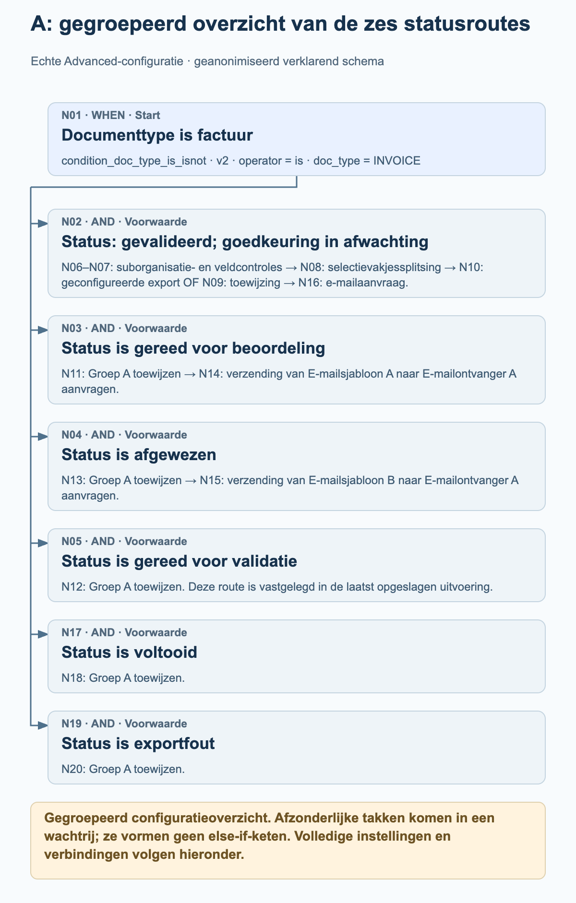
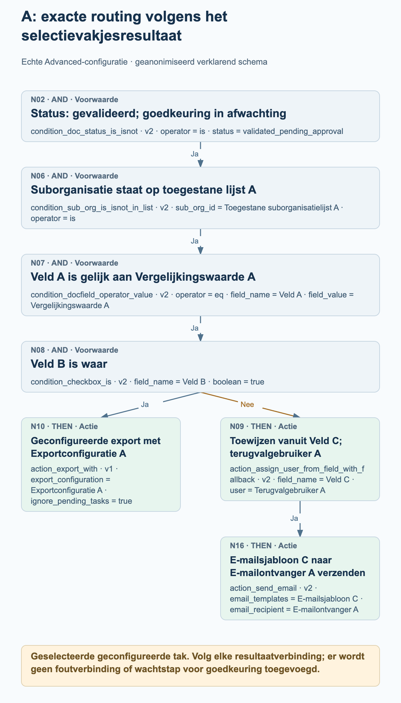
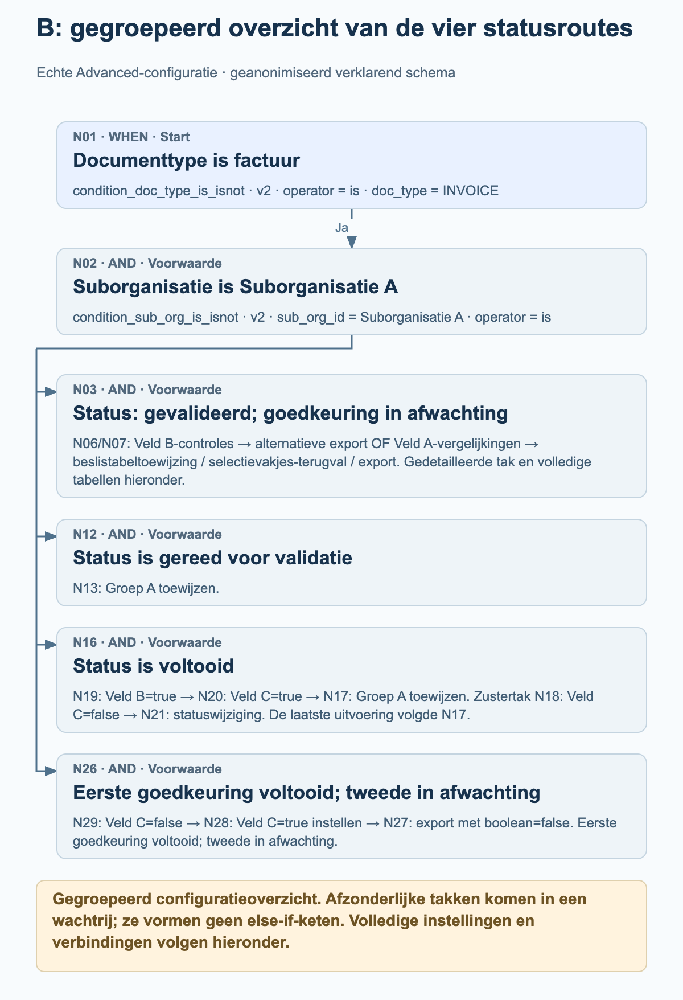
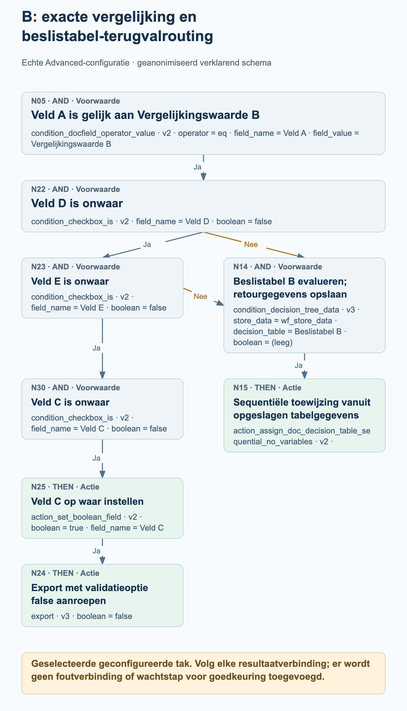

# Echte Advanced-workflowvoorbeelden uit productie

Twee actieve Advanced-workflows uit productie laten zien hoe echte factuurrouting statustakken, selectievakjes, toewijzingen en geconfigureerde exportacties combineert. De vier processchema’s verklaren geselecteerde delen van elke graaf; de volledige knooppuntinstellingen en verbindingen worden afzonderlijk vermeld.

Broncontrole met uitsluitend leestoegang op 27 oktober 2026: beide huidige configuraties komen voor knooppunten, kaarten, versies, instellingen en verbindingen overeen met de gegevens die bij hun laatst vastgelegde uitvoering zijn opgeslagen. Voorbeeld A heeft 20 knooppunten en 19 verbindingen; voorbeeld B heeft 30 knooppunten en 30 verbindingen. Beide vastgelegde uitvoeringen hebben de algemene status failed_condition, hoewel elk een geslaagde groepstoewijzing bevat. Dit zijn waargenomen configuraties en opgeslagen uitvoeringsgegevens, geen nieuw uitgevoerde tests. Organisatie-, veld-, gebruikers-, groeps-, tabel-, sjabloon- en ontvangerwaarden zijn geanonimiseerd. De aliassen behouden de verschillen binnen elk voorbeeld en verwijzen tussen voorbeelden niet naar dezelfde werkelijke entiteit.

## Deze grafen lezen

Elke verbinding volgt een specifiek resultaat: success, failed_condition of error. Deze voorbeelden bevatten success- en failed_condition-verbindingen; geen van beide grafen configureert een error-verbinding. Een niet-vervulde voorwaarde is een normaal voorwaarderesultaat en mag niet als technische fout worden gelezen.

Meerdere uitgaande success-verbindingen voegen meerdere bestemmingen aan de uitvoeringswachtrij toe. Ze vormen geen else-if-keten en betekenen niet dat acties parallel worden uitgevoerd. Een bestemming wordt binnen één graafuitvoering maximaal één keer verwerkt. Volg de werkelijke verbindingen in plaats van het verloop af te leiden uit de positie van een kaart.

Een bestemming met meerdere inkomende verbindingen wacht niet automatisch op alle ingangen. In voorbeeld B kan elk van de twee geconfigureerde failed_condition-verbindingen de gewone voorwaardekaart N14 in de wachtrij zetten; dit is geen afzonderlijke ALL- of ANY-poort.

Toewijzingen bewijzen niet dat een persoon een document heeft goedgekeurd. Uit een toewijzing of geconfigureerde exportkaart mag geen wachtstap, voltooide goedkeuring of ontvangstbevestiging van een extern systeem worden afgeleid. De schema’s voegen dergelijke stappen niet toe.

Gegroepeerde overzichten vatten statusroutes samen en groeperen vervolgknooppunten uitdrukkelijk. De detailschema’s werken de geselecteerde selectievakjes- of terugvalpaden uit. Gebruik de volledige lijsten met knooppunten en verbindingen om de hele geconfigureerde graaf te controleren.

## A. Statusrouting met een door een selectievakje gestuurd export- of toewijzingspad

Een factuur vertakt naar zes statuscontroles. De tak voor gevalideerde documenten die op goedkeuring wachten controleert daarnaast een toegestane suborganisatielijst, vergelijkt Veld A en test Veld B. Het resultaat van het selectievakje kiest een geconfigureerde exportkaart of een actie voor toewijzing vanuit een veld, gevolgd door een e-mail. Andere statusroutes wijzen Groep A toe, en twee van die routes verzenden daarna een geconfigureerde e-mail.

### A: gegroepeerd overzicht van de zes statusroutes

<figure><figcaption>N01 vertakt naar zes afzonderlijke statuscontroles. Het overzicht groepeert de langere N02-tak en toont de geconfigureerde toewijzings- en e-mailroutes voor de andere statussen. Het is een gegroepeerde configuratiekaart, geen uitvoeringsspoor of else-if-volgorde.</figcaption></figure>

### A: exacte routing volgens het selectievakjesresultaat

<figure><figcaption>Uitgewerkte tak N02 → N06 → N07 → N08. Veld B=true volgt success naar geconfigureerde exportkaart N10 met ignore_pending_tasks=true. De failed_condition-verbinding leidt naar de kaart voor toewijzing vanuit een veld N09; de success daarvan leidt naar e-mailkaart N16. Er wordt geen exportresultaat, menselijke goedkeuring of wachtstap geïmpliceerd.</figcaption></figure>

### Wat de laatst opgeslagen uitvoering daadwerkelijk laat zien

Opgeslagen uitvoering: 26 oktober 2026, 12:01:54 UTC. N01 en de controle op ready_for_validation N05 gaven success terug; toewijzing N12 gaf daarna success terug. De vijf andere statuscontroles gaven failed_condition terug; de overige knooppunten hebben in deze uitvoering geen vastgelegd resultaat. Het algemene resultaat is failed_condition. Deze uitvoering toont dus de groepstoewijzingsroute N01 → N05 → N12; ze toont niet de selectievakjes-, export- of e-mailroutes.

- Nadat N01 slaagt, worden statuscontroles N02, N03, N04, N05, N17 en N19 via afzonderlijke success-verbindingen in de wachtrij gezet. Ze vormen geen else-if-keten.
- De gedetailleerde goedkeuringstak volgt N02 → N06 → N07 → N08 via success. N08 test Veld B op true. De success-verbinding leidt naar N10; de failed_condition-verbinding leidt naar N09.
- N10 is action_export_with v1, geconfigureerd met Exportconfiguratie A en ignore_pending_tasks=true. Het schema vermeldt de configuratie en beweert niet dat een export geslaagd is of extern ontvangen is. Bij deze kaart schakelt ignore_pending_tasks=true de controle op openstaande taken voor de exportaanvraag uit; dit is een optie van dit specifieke voorbeeld.
- N09 is geconfigureerd voor toewijzing vanuit Veld C met Terugvalgebruiker A. Alleen de success-verbinding leidt naar N16, geconfigureerd met E-mailsjabloon C en E-mailontvanger A.
- Veld C moet een gebruikers-ID bevatten. Bij een gebruikers-ID zonder overeenkomst kan de geconfigureerde terugval worden gebruikt; een ontbrekend documentveld kan echter mislukken voordat die terugval wordt bereikt. De terugval garandeert geen toewijzing voor ieder geval van een ontbrekend veld.
- N11, N12, N13, N18 en N20 configureren binnen dit voorbeeld allemaal dezelfde Groep A. Alleen N11 en N13 hebben verbonden vervolgnodes voor e-mail: N14 en N15.

Volledige knooppuntconfiguratie

| Knooppunt | Kaart | Configuratie |
| --- | --- | --- |
| N01 | condition_doc_type_is_isnot · v2 | operator = is; doc_type = INVOICE |
| N02 | condition_doc_status_is_isnot · v2 | operator = is; status = validated_pending_approval |
| N03 | condition_doc_status_is_isnot · v2 | operator = is; status = ready_for_review |
| N04 | condition_doc_status_is_isnot · v2 | operator = is; status = rejected |
| N05 | condition_doc_status_is_isnot · v2 | operator = is; status = ready_for_validation |
| N06 | condition_sub_org_is_isnot_in_list · v2 | sub_org_id = Toegestane suborganisatielijst A; operator = is |
| N07 | condition_docfield_operator_value · v2 | operator = eq; field_name = Veld A; field_value = Vergelijkingswaarde A |
| N08 | condition_checkbox_is · v2 | field_name = Veld B; boolean = true |
| N09 | action_assign_user_from_field_with_fallback · v2 | field_name = Veld C; user = Terugvalgebruiker A |
| N10 | action_export_with · v1 | export_configuration = Exportconfiguratie A; ignore_pending_tasks = true |
| N11 | doc_group_assign · v2 | groups = Groep A; use_decision_table = (leeg) |
| N12 | doc_group_assign · v2 | groups = Groep A; use_decision_table = (leeg) |
| N13 | doc_group_assign · v2 | groups = Groep A; use_decision_table = (leeg) |
| N14 | action_send_email · v2 | email_templates = E-mailsjabloon A; email_recipient = E-mailontvanger A |
| N15 | action_send_email · v2 | email_templates = E-mailsjabloon B; email_recipient = E-mailontvanger A |
| N16 | action_send_email · v2 | email_templates = E-mailsjabloon C; email_recipient = E-mailontvanger A |
| N17 | condition_doc_status_is_isnot · v2 | operator = is; status = finished |
| N18 | doc_group_assign · v2 | groups = Groep A; use_decision_table = (leeg) |
| N19 | condition_doc_status_is_isnot · v2 | operator = is; status = export_error |
| N20 | doc_group_assign · v2 | groups = Groep A; use_decision_table = (leeg) |

Alle geconfigureerde verbindingen

| Knooppunt | Resultaatpad | Knooppunt |
| --- | --- | --- |
| N01 | success | N02 |
| N01 | success | N03 |
| N01 | success | N04 |
| N01 | success | N05 |
| N08 | failed_condition | N09 |
| N08 | success | N10 |
| N07 | success | N08 |
| N06 | success | N07 |
| N02 | success | N06 |
| N03 | success | N11 |
| N04 | success | N13 |
| N05 | success | N12 |
| N13 | success | N15 |
| N11 | success | N14 |
| N09 | success | N16 |
| N01 | success | N17 |
| N17 | success | N18 |
| N19 | success | N20 |
| N01 | success | N19 |

## B. Beslistabelrouting met selectievakjes-terugvalpaden en statustakken

Een factuur in Suborganisatie A vertakt naar vier statuscontroles. De route voor gevalideerde documenten die op goedkeuring wachten gebruikt Veld B, twee alternatieve vergelijkingen van Veld A, beslistabellen en extra selectievakjescontroles. De route voor voltooide documenten gebruikt de Velden B en C voordat Groep A wordt toegewezen of een statuswijziging wordt geconfigureerd. Een afzonderlijke route die op tweede goedkeuring wacht stelt Veld C in en roept export aan als de geconfigureerde voorwaarde slaagt.

### B: gegroepeerd overzicht van de vier statusroutes

<figure><figcaption>N01 en N02 leiden naar vier afzonderlijk verbonden statuscontroles. Het overzicht groepeert de grotere beslistabeltak, behoudt de toewijzingsroute vóór validatie en de selectievakjessplitsing voor voltooide documenten, en vat de exportroute in afwachting van tweede goedkeuring samen. De volledige lijsten met knooppunten en verbindingen behouden alle 30 knooppunten en 30 verbindingen.</figcaption></figure>

### B: exacte vergelijking en beslistabel-terugvalrouting

<figure><figcaption>Geselecteerde geconfigureerde tak na N01 → N02 → N03 → N07: N05 vergelijkt Veld A met Vergelijkingswaarde B. Elk van de failed_condition-verbindingen van N22 (Veld D=false) of N23 (Veld E=false) kan Beslistabel B bij gewone voorwaardekaart N14 in de wachtrij zetten, gevolgd door sequentiële toewijzing N15. Bij success gaat N23 in plaats daarvan verder via N30 → N25 → N24. Er wordt geen ALL-samenvoeging, ANY-kaart, voltooide goedkeuring of externe ontvangst geïmpliceerd.</figcaption></figure>

### Wat de laatst opgeslagen uitvoering daadwerkelijk laat zien

Opgeslagen uitvoering: 27 oktober 2026, 11:56:25 UTC. N01, N02, de finished-statuscontrole N16, de controle Veld B=true N19, de controle Veld C=true N20 en groepstoewijzing N17 gaven success terug. N03, N12, N18 en N26 gaven failed_condition terug; de overige knooppunten hebben in deze uitvoering geen vastgelegd resultaat. Het algemene resultaat is failed_condition. Deze uitvoering toont de toewijzingsroute voor voltooide documenten, geen van beide beslistabelroutes, geen statuswijziging en geen export.

- Nadat de controles op factuur en Suborganisatie A slagen, zet N02 de statuscontroles N03, N12, N16 en N26 in de wachtrij. De graaf wacht niet tot één statustak is voltooid voordat een andere wordt gedefinieerd.
- Bij success van N03 test N06 Veld B=false en N07 Veld B=true. Bij success leidt N06 naar het instellen van Veld B=true bij N10 en daarna naar alternatieve exportkaart N11. Bij success zet N07 beide vergelijkingen van Veld A, N04 en N05, in de wachtrij.
- N06 en N07 worden vóór de wijziging van Veld B door N10 in de wachtrij gezet. Beide controles worden vóór die wijziging geëvalueerd; het instellen van Veld B=true zorgt niet dat N07 later in dezelfde doorloop slaagt. Later ingeplande kaarten kunnen waarden zien die eerdere acties teruggeven; takken zijn geen geïsoleerde momentopnamen.
- De route voor Vergelijkingswaarde A leidt naar Beslistabel A bij N08 en sequentiële toewijzing N09. De route voor Vergelijkingswaarde B controleert Veld D=false bij N22, Veld E=false bij N23 en Veld C=false bij N30 voordat Veld C=true bij N25 wordt ingesteld en export N24 wordt aangeroepen.
- Een failed_condition-resultaat van N22 of N23 kan N14, de gewone voorwaardekaart voor Beslistabel B, in de wachtrij zetten. N14 wacht niet op alle ingangen en is geen nieuw ingevoegde ANY-kaart. De success-verbinding leidt naar sequentiële toewijzing N15.
- Voor voltooide documenten test N19 Veld B=true en zet daarna N18 en N20 in de wachtrij. Veld C=true bij N20 leidt naar Groep A-toewijzing N17. Veld C=false bij N18 leidt naar statuswijzigingskaart N21, geconfigureerd met validated_pending_approval en trigger_docflow=true. Dit is geen wachtstap.
- De approved_pending_second_approval-route volgt N29 → N28 → N27 bij success: Veld C=false testen, Veld C=true instellen en vervolgens export aanroepen. Exportkaarten N24 en N27 behouden boolean=false. Dit is een validatieoptie, geen instructie om de exportaanroep uit te schakelen.
- Beide beslistabel-voorwaardekaarten slaan gegevens op onder wf_store_data. Hun acties voor sequentiële toewijzing hebben geen eigen instellingen. De tabelregels en werkelijke ontvangers worden niet gepubliceerd, en de graaf bewijst geen voltooide goedkeuring.
- Alternatieve export N11 is afhankelijk van exportattributen van het documenttype. Uit de lege knooppuntinstellingen kan geen exportconfiguratie of bestemming worden afgeleid. Statuswijziging N21 vraagt om het later activeren van workflows; ze voegt geen impliciete verbinding terug naar dezelfde doorloop toe.

Volledige knooppuntconfiguratie

| Knooppunt | Kaart | Configuratie |
| --- | --- | --- |
| N01 | condition_doc_type_is_isnot · v2 | operator = is; doc_type = INVOICE |
| N02 | condition_sub_org_is_isnot · v2 | sub_org_id = Suborganisatie A; operator = is |
| N03 | condition_doc_status_is_isnot · v2 | operator = is; status = validated_pending_approval |
| N04 | condition_docfield_operator_value · v2 | operator = eq; field_name = Veld A; field_value = Vergelijkingswaarde A |
| N05 | condition_docfield_operator_value · v2 | operator = eq; field_name = Veld A; field_value = Vergelijkingswaarde B |
| N06 | condition_checkbox_is · v2 | field_name = Veld B; boolean = false |
| N07 | condition_checkbox_is · v2 | field_name = Veld B; boolean = true |
| N08 | condition_decision_tree_data · v3 | store_data = wf_store_data; decision_table = Beslistabel A; boolean = (leeg) |
| N09 | action_assign_doc_decision_table_sequential_no_variables · v2 | — |
| N10 | action_set_boolean_field · v2 | boolean = true; field_name = Veld B |
| N11 | action_alternate_export · v2 | — |
| N12 | condition_doc_status_is_isnot_in_list · v2 | operator = is; status = ready_for_validation |
| N13 | doc_group_assign · v2 | groups = Groep A; use_decision_table = (leeg) |
| N14 | condition_decision_tree_data · v3 | store_data = wf_store_data; decision_table = Beslistabel B; boolean = (leeg) |
| N15 | action_assign_doc_decision_table_sequential_no_variables · v2 | — |
| N16 | condition_doc_status_is_isnot_in_list · v2 | operator = is; status = finished |
| N17 | doc_group_assign · v2 | groups = Groep A; use_decision_table = (leeg) |
| N18 | condition_checkbox_is · v2 | field_name = Veld C; boolean = false |
| N19 | condition_checkbox_is · v2 | field_name = Veld B; boolean = true |
| N20 | condition_checkbox_is · v2 | field_name = Veld C; boolean = true |
| N21 | staus_change · v3 | status = validated_pending_approval; trigger_docflow = true |
| N22 | condition_checkbox_is · v2 | field_name = Veld D; boolean = false |
| N23 | condition_checkbox_is · v2 | field_name = Veld E; boolean = false |
| N24 | export · v3 | boolean = false |
| N25 | action_set_boolean_field · v2 | boolean = true; field_name = Veld C |
| N26 | condition_doc_status_is_isnot_in_list · v2 | operator = is; status = approved_pending_second_approval |
| N27 | export · v3 | boolean = false |
| N28 | action_set_boolean_field · v2 | boolean = true; field_name = Veld C |
| N29 | condition_checkbox_is · v2 | field_name = Veld C; boolean = false |
| N30 | condition_checkbox_is · v2 | field_name = Veld C; boolean = false |

Alle geconfigureerde verbindingen

| Knooppunt | Resultaatpad | Knooppunt |
| --- | --- | --- |
| N01 | success | N02 |
| N02 | success | N03 |
| N03 | success | N06 |
| N03 | success | N07 |
| N07 | success | N04 |
| N07 | success | N05 |
| N06 | success | N10 |
| N10 | success | N11 |
| N02 | success | N12 |
| N12 | success | N13 |
| N16 | success | N19 |
| N20 | success | N17 |
| N19 | success | N20 |
| N19 | success | N18 |
| N18 | success | N21 |
| N04 | success | N08 |
| N02 | success | N16 |
| N05 | success | N22 |
| N22 | success | N23 |
| N25 | success | N24 |
| N02 | success | N26 |
| N22 | failed_condition | N14 |
| N23 | failed_condition | N14 |
| N28 | success | N27 |
| N26 | success | N29 |
| N29 | success | N28 |
| N23 | success | N30 |
| N30 | success | N25 |
| N08 | success | N09 |
| N14 | success | N15 |

## Voordat u een voorbeeld aanpast

Vervang elke neutrale alias door een geschikte waarde uit uw eigen organisatie. Behoud welke instellingen naar hetzelfde veld en welke naar verschillende velden verwijzen; gebruik deze tijdelijke waarden niet als echte identificaties.

Controleer elke resultaatverbinding expliciet, inclusief failed_condition-routing en bestemmingen met meerdere inkomende verbindingen. Kies foutafhandeling voor uw eigen proces in plaats van aan te nemen dat de graaf een niet-verbonden foutpad afhandelt.

Controleer exportinstellingen, validatiekeuzes en de behandeling van openstaande taken aan de hand van uw eigen eisen. Een geconfigureerde exportactie of geslaagd knooppuntrecord bewijst geen ontvangst door een extern systeem.

Valideer de aangepaste workflow in een toegestane testomgeving, inclusief elk relevant voorwaarderesultaat en ontbrekende toewijzingsgegevens. Deze productievoorbeelden zijn gelezen zonder ze te wijzigen of opnieuw uit te voeren.
