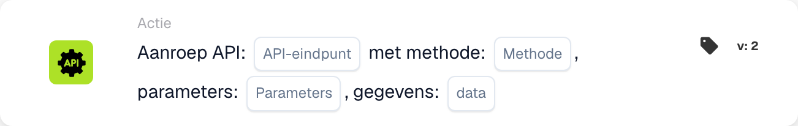

# API-integratiepatroon

<figure><figcaption>
Kaartvelden in de getoonde versie. De velden zijn nog niet ingevuld.
</figcaption></figure>

<!-- workflow-card-api-pattern-contract-20261022 -->

Dit patroon gebruikt de hieronder beschreven werkelijke DocBits-API-kaart. Het biedt geen importeerbare externe API-workflow, automatische JSON-antwoordkoppeling of ingebouwde engine voor herhalingen en caching. Externe diensten vereisen een eigen gecontroleerde HTTPS-configuratie.

## Doel

Gebruik `call_api` om een endpoint binnen de ingestelde DocBits-API aan te roepen. Het relatieve pad wordt aan het basisadres toegevoegd. Een willekeurige externe URL stelt geen integratie met een andere API in.

## Configuratie

Vul het pad, de HTTP-methode, queryparameters en de door het endpoint ondersteunde gegevens in. De aanvraag gebruikt de context van de huidige DocBits-gebruiker. Ontbrekende waarden voor `org_id` en `triggered_by_docflow` worden automatisch toegevoegd. Parameter- en gegevensobjecten, of hun ondersteunde tekstweergave, moeten bij het formaat van deze kaartversie passen. Er is geen algemene koppeling van JSON-antwoordvelden.

## Resultaat en beperkingen

De antwoordtekst wordt naar een booleaanse waarde omgezet: alleen `true`, `1`, `yes` of `on` levert waar op; een onbekend antwoord, waaronder een willekeurig JSON-object, levert standaard onwaar op. De HTTP-status alleen bepaalt deze waarde niet. Een time-out of aanvraagfout levert onwaar op. De kaarttest simuleert de aanroep en geeft waar terug zonder een aanvraag te versturen; dit bewijst geen authenticatie, bereikbaarheid of endpointgedrag.

## Praktijkvoorbeeld

Gebruik deze kaart na de vereiste voorwaarden wanneer u een booleaanse waarde van een ingesteld DocBits-API-endpoint nodig hebt. Kies voor een geïsoleerde test een bestaand, gedocumenteerd endpoint dat alleen leest, met het bedoelde booleaanse antwoordcontract en de passende methode, bijvoorbeeld `GET`. Gebruik uitsluitend de ondersteunde demoparameters.

Verwacht resultaat en tegenvoorbeeld: een hypothetisch HTTP-antwoord `200` met als volledige tekst `true` levert waar op; `false` levert onwaar op. Een object zoals `{"approved": true}` wordt niet automatisch naar waar omgezet. Controleer het werkelijke antwoord en de logboeken afzonderlijk. Dit voorbeeld is aan de uitvoeringscode getoetst; er is geen aanvraag of workflow uitgevoerd.

## Referentie

[De DocBits-API aanroepen](../then/action/call-api-guide.md)
