# Beslissingslogicapatroon

**Patroontype:** Voorwaardelijke routering en logica **Complexiteit:** Gemiddeld **Geschatte insteltijd:** 30-45 minuten **Veelvoorkomende toepassingen:** Routering via meerdere paden, voorwaardelijke verwerking, beslissingsbomen, implementatie van bedrijfsregels

***

Kies in de ontwerper in de modus Standard «Kaart toevoegen» in de groep «En....» en open de categorie «Logica». Het scherm toont een voorwaarde op basis van een beslissingstabel; er is nog geen tabel geselecteerd en de opslag van de resultaten is nog niet ingesteld. Selecteer de tabel en stel de opslag in van de resultaten voor het document of de leveranciersorganisatie. Configureer daarna de overige voorwaarden, acties en verbindingen in de workflow en test het gedrag.

<figure>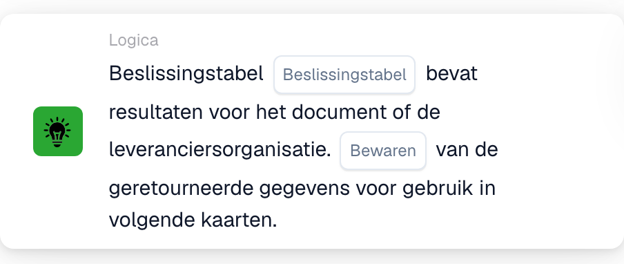<figcaption><p>Ontwerper in de modus Standard: categorie «Logica» geopend via «Kaart toevoegen» in de groep «En....»; de beslissingstabel voor de voorwaarde is nog niet geselecteerd en de opslag van de resultaten is nog niet ingesteld.</p></figcaption></figure>

***

## Patroonoverzicht

#### Schema: Overzicht

<figure>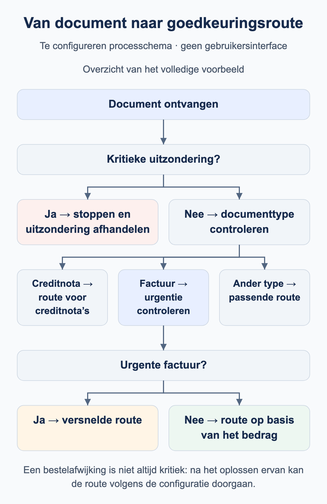<figcaption><p>Overzicht van het volledige voorbeeld: controleer kritieke uitzonderingen, het documenttype en de urgentie voordat u de goedkeuringsroute kiest. Elke verwerking en elke verbinding moeten worden geconfigureerd; het schema toont geen automatisch productgedrag.</p></figcaption></figure>

Deze schema’s verklaren te configureren bedrijfsregels. Ze vullen de bestaande bibliotheekafbeelding hierboven aan. Verbind in Advanced elke route expliciet. Bepaal in een lineaire Standard-reeks de voorwaarden waaronder acties mogen plaatsvinden.

Dit patroon laat zien hoe u complexe beslissingslogica implementeert in DocBits-workflows. Met voorwaardekaarten routeert u documenten via verschillende verwerkingspaden op basis van documentkenmerken, veldwaarden en bedrijfsregels.

**Wat dit patroon doet:**

1. Evalueert meerdere voorwaarden achtereenvolgens of parallel
2. Routeert documenten naar verschillende paden op basis van voorwaarden
3. Implementeert bedrijfsregels en beleid
4. Verwerkt complexe beslissingsbomen
5. Combineert meerdere criteria voor routeringsbeslissingen

***

## Wanneer dit patroon te gebruiken

Gebruik dit patroon wanneer u het volgende moet doen:

* ✅ Documenten routeren op basis van bedragsdrempels
* ✅ Verschillende regels toepassen voor verschillende documenttypes
* ✅ Goedkeuringslogica op meerdere niveaus implementeren
* ✅ Complex bedrijfsbeleid verwerken
* ✅ Dynamische routering creëren op basis van meerdere criteria
* ✅ Logica voor uitzonderingsafhandeling implementeren
* ✅ Goedkeuringsmatrices opstellen

**Gebruik dit patroon niet wanneer:**

* ❌ Een eenvoudige lineaire workflow volstaat
* ❌ Alle documenten hetzelfde pad volgen
* ❌ Er geen voorwaardelijke verwerking nodig is

***

## Soorten beslissingslogica

De onderstaande IF-THEN-, AND-, OR- en geneste voorbeelden zijn onafhankelijk. Hun drempels verklaren elk principe; ze vormen geen gezamenlijke goedkeuringsmatrix. De volledige matrix verderop gebruikt vier niet-overlappende banden. Een onbekende waarde of evaluatiefout is niet automatisch False: bepaal en test de afhandeling afzonderlijk.

### 1. Eenvoudige IF-THEN-logica

#### Schema: Eenvoudige voorwaarde

<figure>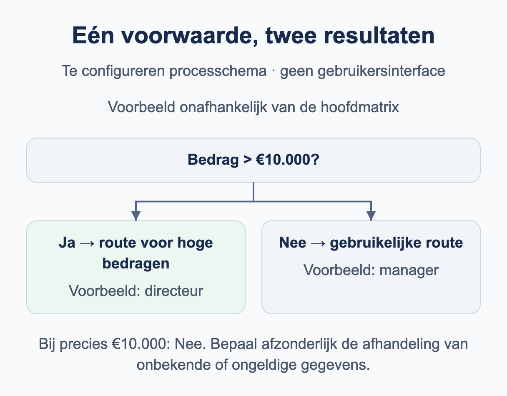<figcaption><p>Onafhankelijk IF-THEN-voorbeeld: een bedrag strikt hoger dan €10.000 kiest de directeur; anders de manager. Gelijkheid blijft in de tweede tak. Bestemmingen moeten worden geconfigureerd.</p></figcaption></figure>

<details>
<summary>IF-THEN-principe: één voorwaarde, twee resultaten</summary>

```
IF condition:
  → Actie A
ELSE:
  → Actie B
```

</details>

**Voorbeeld:**

Visuele uitleg: [eenvoudige voorwaarde](#schema-eenvoudige-voorwaarde).

<details>
<summary>IF-THEN-voorbeeld: bedragdrempel</summary>

```
IF Amount > €10,000:
  → Toewijzen aan directeur
ELSE:
  → Toewijzen aan manager
```

</details>

#### Schema: Criteria EN en OF

<figure>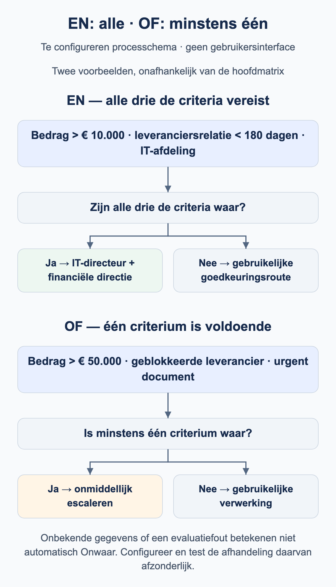<figcaption><p>Twee onafhankelijke voorbeelden: EN vereist alle drie de criteria; OF vereist er minstens één. De voorbeelddrempels vervangen de bedragscategorieën van de volledige matrix niet. De uitgangen en de afhandeling van onbekende gegevens of evaluatiefouten moeten worden geconfigureerd.</p></figcaption></figure>

### 2. Meerdere criteria (AND-logica)

<details>
<summary>AND-principe: alle criteria</summary>

```
IF condition1 AND condition2 AND condition3:
  → Actie A
ELSE:
  → Actie B
```

</details>

**Voorbeeld:**

Visuele uitleg: [criteria en en of](#schema-criteria-en-en-of).

<details>
<summary>AND-voorbeeld: drie criteria</summary>

```
IF Amount > €10,000 AND Supplier = "New" AND Department = "IT":
  → Toewijzen aan IT-directeur + CFO (dubbele goedkeuring)
ELSE:
  → Gebruikelijke goedkeuringsworkflow
```

</details>

### 3. Alternatieve criteria (OR-logica)

Visuele uitleg: [criteria en en of](#schema-criteria-en-en-of).

<details>
<summary>OR-principe: minstens één criterium</summary>

```
IF condition1 OR condition2 OR condition3:
  → Actie A
ELSE:
  → Actie B
```

</details>

**Voorbeeld:**

Visuele uitleg: [criteria en en of](#schema-criteria-en-en-of).

<details>
<summary>OR-voorbeeld: bedrag, blokkering of urgentie</summary>

```
IF Amount > €50,000 OR Supplier is "Blocked" OR Document heeft de markering "Urgent":
  → Onmiddellijk escaleren
ELSE:
  → Gebruikelijke verwerking
```

</details>

### 4. Geneste beslissingsboom

#### Schema: Geneste beslissingen

<figure>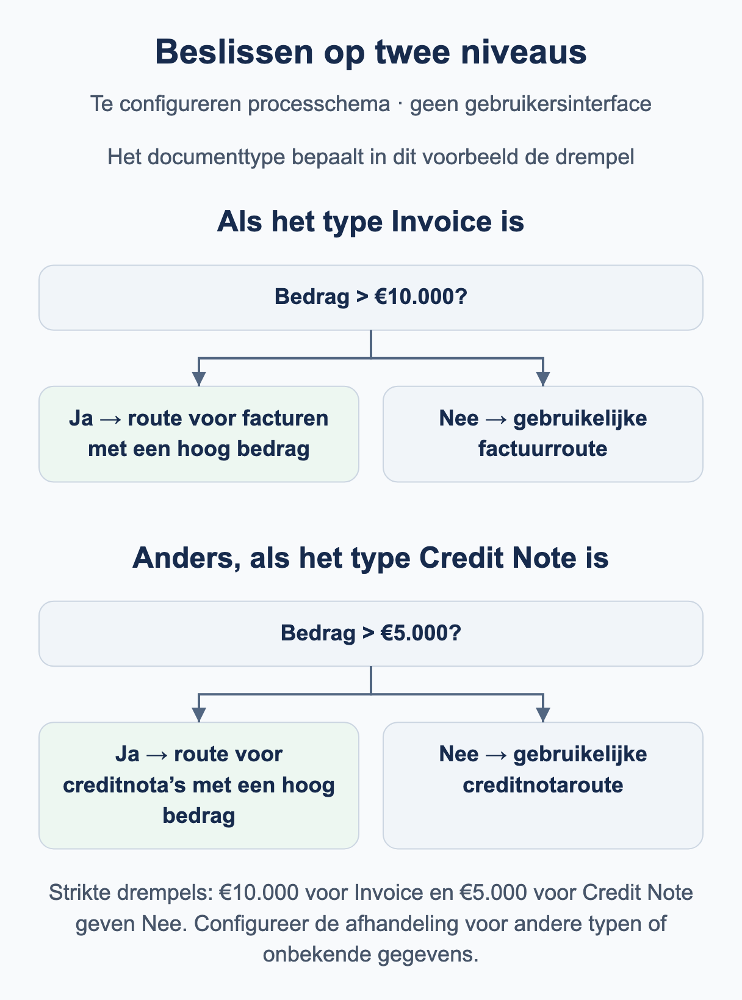<figcaption><p>Onafhankelijk genest voorbeeld: het documenttype bepaalt de bedragstoets. De drempels zijn strikt: €10.000 voor een factuur en €5.000 voor een creditnota voldoen niet aan ‘groter dan’. Bepaal de afhandeling voor andere typen en onbekende gegevens.</p></figcaption></figure>

<details>
<summary>Principe van geneste beslissingen</summary>

```
IF condition1:
  IF condition2:
    → Actie A
  ELSE:
    → Actie B
ELSE:
  IF condition3:
    → Actie C
  ELSE:
    → Actie D
```

</details>

**Voorbeeld:**

Visuele uitleg: [geneste beslissingen](#schema-geneste-beslissingen).

<details>
<summary>Genest voorbeeld: factuur en creditnota</summary>

```
IF Document_Type = "Invoice":
  IF Amount > €10,000:
    → Workflow voor facturen met een hoog bedrag
  ELSE:
    → Gebruikelijke factuurworkflow
ELSE IF Document_Type = "Credit Note":
  IF Amount > €5,000:
    → Workflow voor creditnota’s met een hoog bedrag
  ELSE:
    → Gebruikelijke creditnotaworkflow
```

</details>

***

## Volledig workflowvoorbeeld

### Scenario: factuurgoedkeuringsmatrix

**Bedrijfsregels:**

1. Stop vóór routering op bedrag bij kritieke uitzonderingen, waaronder een geblokkeerde leverancier, en handel deze af. Een PO-afwijking is niet altijd kritiek: na oplossing door inkoop kan de route volgens configuratie doorgaan. Controleer vervolgens het documenttype.
2. Volg voor een urgente factuur de versnelde route van dit voorbeeld in plaats van de gewone bedragbanden.
3. Voor een niet-urgente factuur met een geldig bedrag:
   * bedrag < €1.000: automatische goedkeuring;
   * €1.000 ≤ bedrag < €10.000: goedkeuring door manager;
   * €10.000 ≤ bedrag < €50.000: leverancierscontroles gevolgd door directeursgoedkeuring; bij een niet-geblokkeerde leverancier met een relatie korter dan 180 dagen volgt na goedkeuring door de directeur ook goedkeuring door de CFO; voor andere leveranciers wordt eveneens het risico gecontroleerd;
   * bedrag ≥ €50.000: directiegoedkeuring volgens route D.
4. Een ontbrekend of ongeldig bedrag gaat in dit voorbeeld naar expliciet geconfigureerde handmatige beoordeling. Dit is voorbeeldbeleid en geen automatische terugvalfunctie van het product.
5. Wacht na het aanmaken van een taak op het resultaat. Afwijzing stopt de keten en volgt de geconfigureerde afhandeling; een resultaat in afwachting staat doorgaan niet toe. Maak de CFO-taak pas aan na positieve goedkeuring door de directeur.

#### Schema: Bedragbanden

<figure>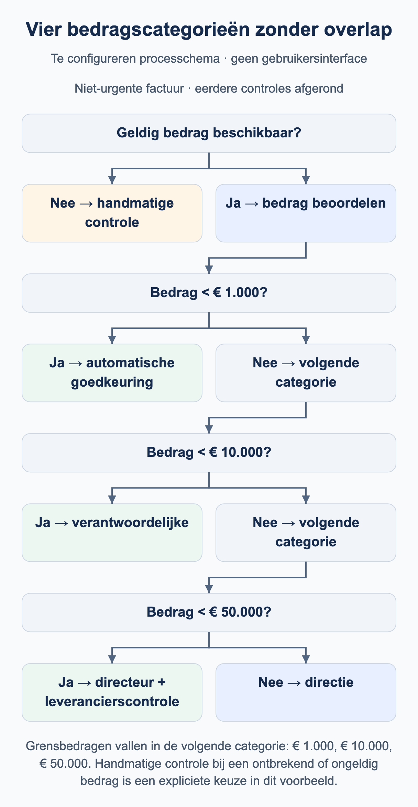<figcaption><p>Voorbeelddrempels op niveau 2: minder dan € 1.000; vanaf € 1.000 (inclusief) tot € 10.000 (exclusief); vanaf € 10.000 (inclusief) tot € 50.000 (exclusief); € 50.000 of meer. Elke test volgt op het negatieve resultaat van de vorige test. Handmatige controle bij een ontbrekend of ongeldig bedrag moet expliciet worden geconfigureerd.</p></figcaption></figure>

Grenswaarden €1.000, €10.000 en €50.000 vallen in de hogere band. Configureer en test eerdere controles, wachten op resultaten en verbindingen tussen routes. Een aangemaakte taak bewijst geen goedkeuring of documentexport.

**Illustratieve implementatie:** pas technische namen en pseudocode aan de werkelijk beschikbare kaarten in uw versie aan. De blokken beschrijven een te configureren voorbeeld, geen importeerbaar bestand. Controleer uitvoeringsresultaten en neveneffecten.

Visuele uitleg: [overzicht](#schema-overzicht), [bedragbanden](#schema-bedragbanden), [leveranciersanalyse](#schema-leveranciersanalyse), [automatische route](#schema-automatische-route), [managertaak](#schema-managertaak), [directiegoedkeuring](#schema-directiegoedkeuring), [regelregister](#schema-regelregister).

<details>
<summary>Pseudocode van de volledige matrix</summary>

```
VOORCONTROLE: kritieke uitzonderingen
  IF Critical_Exception = TRUE OR Supplier_Status = "BLOCKED":
    → Stoppen en de uitzondering afhandelen vóór routering

STAP 1: controleren op afwijkingen van de inkooporder
  IF PO_Match_Status = "FAIL":
    → Routeren naar inkoop om de afwijking van de inkooporder op te lossen
    → Na oplossing hieronder doorgaan volgens de configuratie

STAP 1b: het documenttype controleren
  IF Document_Type = "Credit Note":
    → Geconfigureerde creditnotaworkflow
  ELSE IF Document_Type is not "Invoice":
    → Geconfigureerde workflow voor dit documenttype
  ELSE:
    → Hieronder doorgaan

STAP 2: de urgentiemarkering controleren
  IF Urgent_Flag = TRUE:
    → Bedragcontroles overslaan
    → Doorsturen naar de hoogste goedkeurder
    → Prioriteit instellen = URGENT
    → Termijn van 1 dag

STAP 3: routering op bedrag (Invoice, indien niet urgent)
  IF Amount ontbreekt of is ongeldig:
    → Handmatige beoordeling (expliciet voorbeeldbeleid)
    → Niet doorgaan naar de bedragcategorieën

  ELSE IF Amount < €1,000:
    → Automatisch goedkeuren
    → Onmiddellijk exporteren

  ELSE IF Amount < €10,000:
    → Taak voor de manager aanmaken
    → Priority: Medium
    → Deadline: 3 dagen

  ELSE IF Amount < €50,000:
    CONTROLE van leveranciersstatus en risico:
      IF Supplier_Status = "BLOCKED":
        → Stoppen en de uitzondering afhandelen
      ELSE IF Supplier_Age < 180 dagen (nieuw):
        → Taak voor de directeur aanmaken (taak 1)
        → Wachten op positieve goedkeuring door de directeur voordat de CFO-taak wordt aangemaakt (taak 2)
        → Wachten op positieve goedkeuring door de CFO voordat de verwerking doorgaat
        → Elke afwijzing: de keten stoppen en de afwijzing volgens de configuratie afhandelen
        → In afwachting: niet doorgaan
        → Priority: High
        → Deadline: 2 dagen per taak
      ELSE IF Supplier_Risk_Rating = "HIGH":
        → Extra controles en voorafgaande goedkeuring door de manager
        → Wachten op positieve goedkeuring door de manager vóór goedkeuring door de directeur
        → In afwachting of afgewezen: niet doorgaan met de goedkeuringsketen
      ELSE (bestaande leverancier):
        → Alleen een taak voor de directeur aanmaken
        → Priority: High
        → Deadline: 2 dagen

  ELSE (Amount ≥ €50,000):
    → Goedkeuringsroute voor de directie (zie route D)
```

</details>

***

## Stapsgewijze implementatie

### Stap 1: Voorwaardekaarten definiëren

**Voorwaarde 1: bedragsdrempel**

#### Schema: Onafhankelijke parameters

<figure>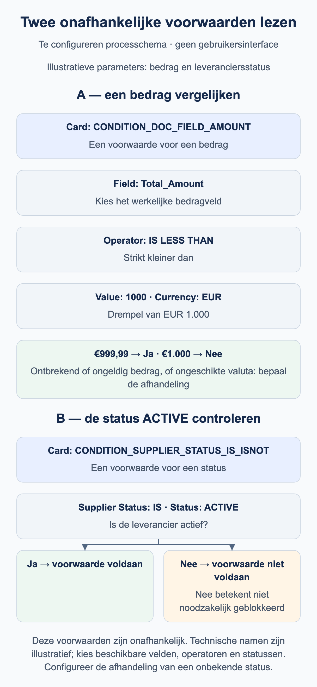<figcaption><p>Twee onafhankelijke voorwaarden: een bedrag strikt lager dan EUR 1.000 en een leverancier met status ACTIVE. Gelijkheid van het bedrag geeft Nee; een inactieve leverancier is niet noodzakelijk geblokkeerd. Technische parameters zijn illustratief en moeten aan de werkelijke configuratie worden aangepast.</p></figcaption></figure>

<details>
<summary>Illustratieve parameters: bedragdrempel</summary>

```
Card: CONDITION_DOC_FIELD_AMOUNT
Field: Total_Amount
Operator: IS LESS THAN
Value: 1000
Currency: EUR
```

</details>

**Voorwaarde 2: controle van het documenttype**

#### Schema: Documenttypen

<figure>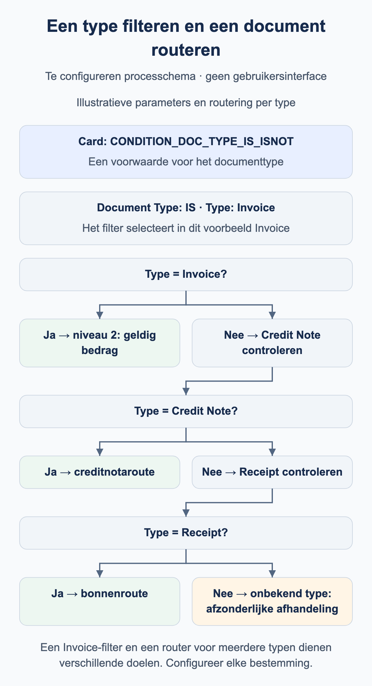<figcaption><p>Het Invoice-filter en de typerouter tonen aanvullende aspecten van dit voorbeeld. De router onderscheidt factuur, creditnota, bon en onbekend type. Kaart- en workflownamen zijn illustratief; elke bestemming moet worden geconfigureerd.</p></figcaption></figure>

<details>
<summary>Illustratieve parameters: documenttype</summary>

```
Card: CONDITION_DOC_TYPE_IS_ISNOT
Document Type: IS
Type: Invoice
```

</details>

**Voorwaarde 3: leveranciersstatus**

Visuele uitleg: [onafhankelijke parameters](#schema-onafhankelijke-parameters).

<details>
<summary>Illustratieve parameters: actieve status</summary>

```
Card: CONDITION_SUPPLIER_STATUS_IS_ISNOT
Supplier Status: IS
Status: ACTIVE
```

</details>

**Voorwaarde 4: controle op nieuwe leverancier**

Bereken voor dit voorbeeld de datum 180 dagen vóór de beoordelingsdatum en vergelijk daarmee de eerste transactiedatum. ‘IS AFTER’ betekent strikt na: gelijkheid geeft Nee. Kies het werkelijke veld en bereken de grensdatum of vul deze in; kaart- en veldnamen en de aanduiding {{TODAY_MINUS_180_DAYS}} zijn illustratief. Controleer afzonderlijk dat de eerste transactiedatum geldig is en niet na de beoordelingsdatum ligt; configureer de afhandeling voor ontbrekende of ongeldige waarden.

#### Schema: Voorwaarde van 180 dagen

<figure>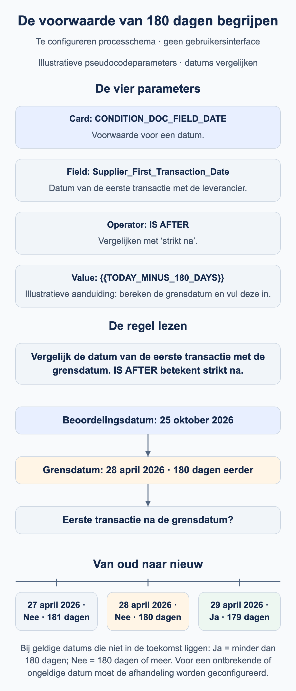<figcaption><p>Vergelijkingsvoorbeeld: op 25 oktober 2026 is de grensdatum 28 april 2026. IS AFTER sluit gelijkheid uit: 29 april geeft Ja, 28 en 27 april geven Nee. De kaart- en veldnamen en de aanduiding {{TODAY_MINUS_180_DAYS}} zijn illustratief: kies het werkelijke veld en bereken de grensdatum of vul deze in. Dit voorbeeld gaat uit van geldige datums die niet in de toekomst liggen; controleer dit afzonderlijk. De afhandeling van een ontbrekende of ongeldige datum moet nog worden geconfigureerd.</p></figcaption></figure>

<details>
<summary>Illustratieve parameters van het voorbeeld kopiëren</summary>

```
Card: CONDITION_DOC_FIELD_DATE
Field: Supplier_First_Transaction_Date
Operator: IS AFTER
Value: {{TODAY_MINUS_180_DAYS}}
```

</details>


**Verwijzing naar de handleiding:** [Volledige handleiding voor voorwaardekaarten](../and/condition-cards-complete-guide.md)

***

### Stap 2: Beslissingsboom opbouwen

**Niveau 1: documenttype**

Visuele uitleg: [documenttypen](#schema-documenttypen).

<details>
<summary>Illustratieve router per documenttype</summary>

```
Workflow: "Invoice Processing"

IF Document_Type = "Invoice":
  → Doorgaan naar niveau 2

ELSE IF Document_Type = "Credit Note":
  → Aftakken naar "Credit Note Processing"

ELSE IF Document_Type = "Receipt":
  → Aftakken naar "Receipt Processing"

ELSE:
  → Routeren naar de afhandeling "Unknown Document Type"
```

</details>

**Niveau 2: bedragdrempels (niet-urgente facturen, geldig bedrag)**

Visuele uitleg: [bedragbanden](#schema-bedragbanden).

<details>
<summary>Vier bedragbanden: pseudocode</summary>

```
IF Amount < €1,000:
  → Aftakken naar "Auto-Approve Path"

ELSE IF Amount < €10,000:
  → Aftakken naar "Manager Approval Path"

ELSE IF Amount < €50,000:
  → Aftakken naar "Director Approval Path"
  → Voorwaarden van niveau 3 controleren

ELSE (Amount ≥ €50,000):
  → Aftakken naar "Executive Approval Path"
  → Dubbele of drievoudige goedkeuring vereist
```

</details>

**Niveau 3: leveranciersanalyse (voor facturen met hoge waarde)**

#### Schema: Leveranciersanalyse

<figure>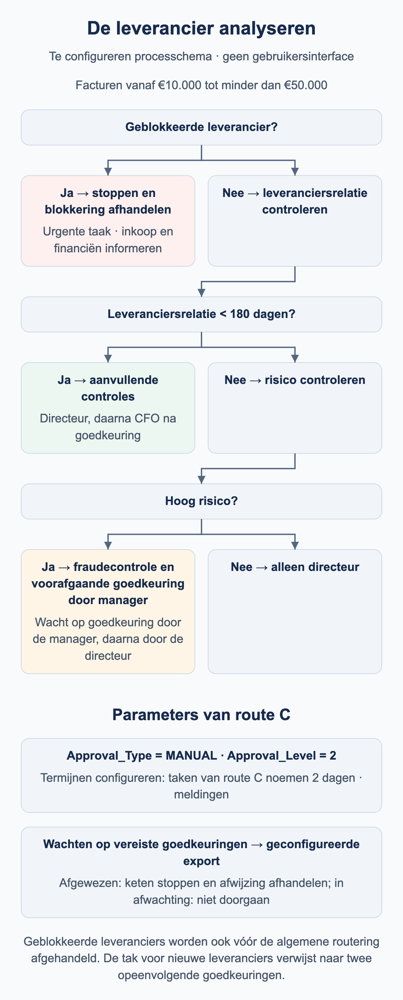<figcaption><p>Detail van de leveranciersroute: behandel blokkering, daarna de duur van de relatie en vervolgens risico. De tak voor relaties korter dan 180 dagen verwijst naar twee opeenvolgende goedkeuringen. Configureer taken, termijnen, meldingen en acties van route C.</p></figcaption></figure>

<details>
<summary>Leveranciersanalyse: blokkering, relatieduur en risico</summary>

```
IF Supplier_Status = "BLOCKED":
  → Verwerking STOPPEN
  → Urgente escalatietaak aanmaken
  → Inkoop en financiën informeren

ELSE IF Supplier_Age < 180 dagen (nieuw):
  → Extra goedkeuring vereist
  → CFO aan de goedkeuringsketen toevoegen
  → Versterkte verificatie

ELSE IF Supplier_Risk_Rating = "HIGH":
  → Extra controles vereist
  → Fraudecontroles beoordelen
  → Voorafgaande goedkeuring door de manager; op positieve goedkeuring wachten
  → Goedkeuring door de directeur; op positieve goedkeuring wachten

ELSE:
  → Gebruikelijke workflow voor hoge bedragen
```

</details>

***

### Stap 3: Routeringsacties aanmaken

**Pad A: automatisch goedkeuren (bedrag < €1.000)**

#### Schema: Automatische route

<figure>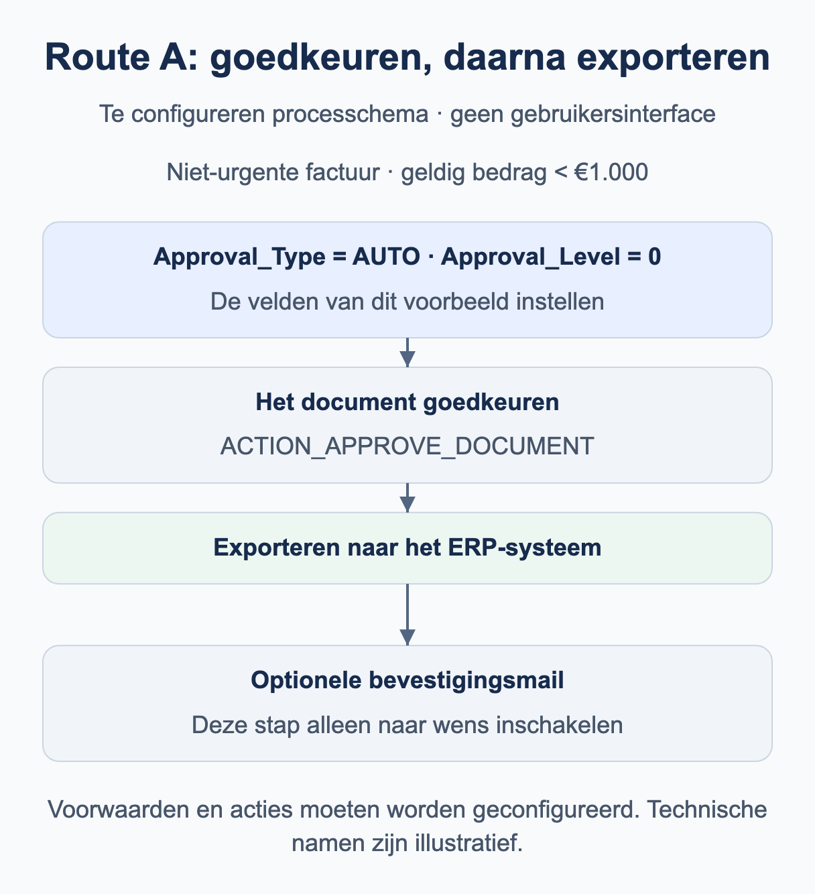<figcaption><p>Voorbeeld van route A: stel goedkeuringsvelden in, keur het document goed en exporteer daarna. De bevestigingsmail is optioneel. Dit schema beschrijft te configureren acties en geen waargenomen uitvoering.</p></figcaption></figure>

<details>
<summary>Acties van route A: automatische goedkeuring</summary>

```
Acties:
1. Veld instellen "Approval_Type" = "AUTO"
2. Veld instellen "Approval_Level" = "0"
3. ACTION_APPROVE_DOCUMENT
4. Exporteren naar ERP
5. Bevestigingsmail versturen (optioneel)
```

</details>

**Route B: goedkeuring door manager (€1.000 ≤ bedrag < €10.000)**

#### Schema: Managertaak

<figure>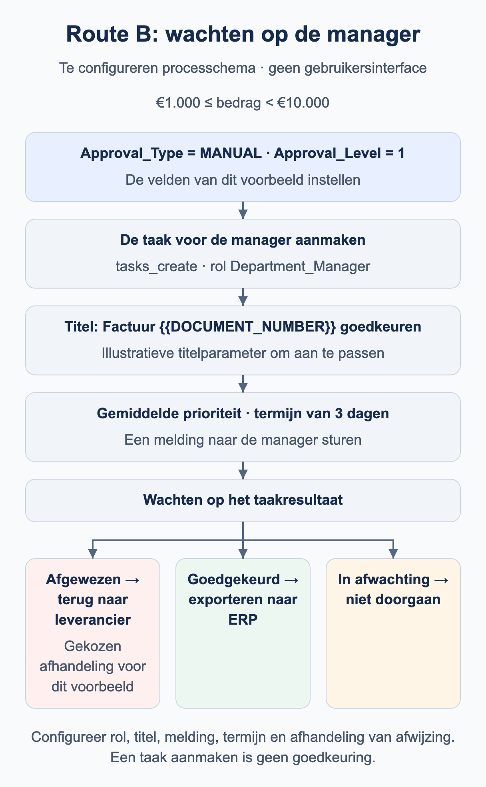<figcaption><p>Voorbeeld van route B: maak een managertaak aan, stuur een melding en wacht op het resultaat. Alleen goedkeuring maakt export mogelijk; afwijzing stuurt het document hier terug naar de leverancier. De termijn van drie dagen en ontvangers zijn configuratiekeuzes.</p></figcaption></figure>

<details>
<summary>Acties van route B: managertaak</summary>

```
Acties:
1. Veld instellen "Approval_Type" = "MANUAL"
2. Veld instellen "Approval_Level" = "1"
3. tasks_create:
   - Title: "Factuur {{DOCUMENT_NUMBER}} goedkeuren"
   - Assign to: Department_Manager
   - Priority: Medium
   - Deadline: 3 dagen
4. E-mailmelding naar de manager versturen
5. Wachten tot de taak is afgerond
6. Indien goedgekeurd: exporteren naar ERP
7. Indien afgewezen: terugsturen naar de leverancier
```

</details>

**Route C: goedkeuring door directeur (€10.000 ≤ bedrag < €50.000)**

Visuele uitleg: [leveranciersanalyse](#schema-leveranciersanalyse), [opeenvolgende goedkeuringen](#schema-opeenvolgende-goedkeuringen).

<details>
<summary>Acties van route C: controles en vereiste goedkeuringen</summary>

```
Acties:
1. Veld instellen "Approval_Type" = "MANUAL"
2. Veld instellen "Approval_Level" = "2"
3. Supplier_Age en Supplier_Risk_Rating controleren:
   IF nieuw (< 180 dagen):
     - Taak 1 aanmaken: goedkeuring door de directeur
     - Wachten op positieve goedkeuring van taak 1 voordat taak 2 wordt aangemaakt: goedkeuring door de CFO
     - Wachten op positieve goedkeuring van taak 2 voordat de verwerking doorgaat
     - In afwachting: niet doorgaan
     - Elke afwijzing: de keten stoppen en de afwijzing volgens de configuratie afhandelen
     - Beide positieve goedkeuringen vereist
   ELSE IF Supplier_Risk_Rating = "HIGH":
     - Extra risicocontroles en voorafgaande goedkeuring door de manager
     - Wachten op positieve goedkeuring door de manager vóór goedkeuring door de directeur
     - Wachten op positieve goedkeuring door de directeur vóór export
     - In afwachting of afgewezen: de voortgang stoppen en het resultaat volgens de configuratie afhandelen
   ELSE:
     - Taak aanmaken: alleen goedkeuring door de directeur
4. Priority: High
5. Deadline: 2 dagen voor goedkeuringstaken van route C; termijnen voor risicocontroles afzonderlijk configureren
6. E-mailmeldingen versturen
7. Wachten op afronding
8. Indien alles is goedgekeurd: exporteren
9. Bij een afwijzing: terugsturen naar de leverancier
```

</details>

#### Schema: Opeenvolgende goedkeuringen

<figure>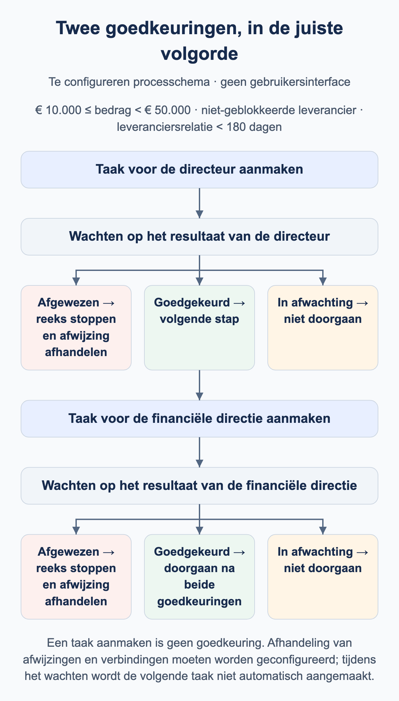<figcaption><p>Voorbeeld van opeenvolgende goedkeuringen: maak de taak voor de financiële directie pas aan na goedkeuring door de directeur. Wacht daarna op de uitkomst van de financiële directie. Ga alleen door na beide goedkeuringen. Bij afwijzing stopt de reeks en volgt de geconfigureerde afhandeling; bij een openstaande goedkeuring gaat de reeks niet verder.</p></figcaption></figure>

Afhankelijk van de configuratie kan afwijzing het document terugsturen naar de leverancier of een andere route volgen. Het schema vereist alleen het stoppen van deze goedkeuringsketen; het schrijft niet in alle gevallen handmatige beoordeling voor.

**Pad D: goedkeuring door het topmanagement (≥ €50.000)**

#### Schema: Directiegoedkeuring

<figure>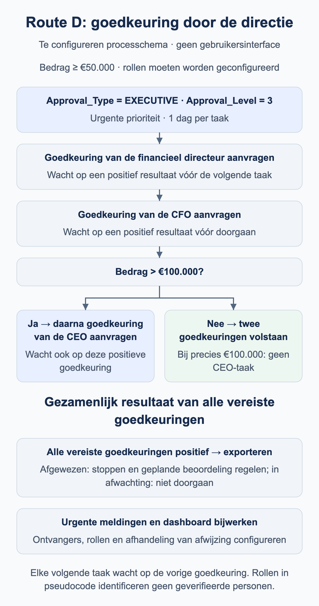<figcaption><p>Voorbeeld van route D: twee opeenvolgende goedkeuringen vanaf €50.000, met een derde uitsluitend boven €100.000. Elke volgende taak wacht op de vorige goedkeuring. Configureer rollen, termijnen, meldingen en afhandeling van afwijzing.</p></figcaption></figure>

<details>
<summary>Acties van route D: directiegoedkeuring</summary>

```
Acties:
1. Veld instellen "Approval_Type" = "EXECUTIVE"
2. Veld instellen "Approval_Level" = "3"
3. Opeenvolgende goedkeuringen:
   - Taak 1: financieel directeur
   - Taak 2: CFO
   - Taak 3: CEO (indien > €100,000)
4. Priority: Urgent
5. Deadline: 1 dag per taak
6. Urgente meldingen versturen
7. Directiedashboard bijwerken
8. Wachten op alle goedkeuringen
9. Indien alles is goedgekeurd: exporteren
10. Bij een afwijzing: beoordelingsvergadering van de directie
```

</details>

***

## Geavanceerde patronen voor beslissingslogica

De volgende patronen zijn onafhankelijke varianten. Scores, afdelingsdrempels en tijdregels worden niet automatisch aan de volledige matrix hierboven toegevoegd; kies en configureer de regels voor uw situatie.

### Patroon 1: routeren op basis van scores

**Bereken in dit voorbeeld een gehele risicoscore en routeer op basis daarvan:**

#### Schema: Risicoscore

<figure>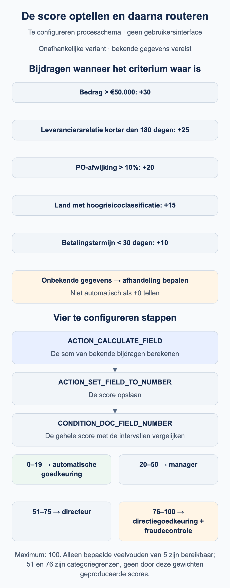<figcaption><p>Onafhankelijke variant: vijf bekende bijdragen leveren een gehele score van 0 tot 100 op, daarna een route. De grenzen 51 en 76 bepalen categorieën; deze vijf gewichten produceren die scores niet. Bepaal afzonderlijk de afhandeling van onbekende gegevens.</p></figcaption></figure>

<details>
<summary>Risicoscore berekenen en intervallen</summary>

```
Berekening van de risicoscore:
  Score = 0

  IF Amount > €50,000: Score += 30
  IF Supplier_Age < 180 dagen: Score += 25
  IF PO_Variance > 10%: Score += 20
  IF Supplier_Country = "High Risk Country": Score += 15
  IF Payment_Terms < 30 dagen: Score += 10

  Totaal bereik van Score: 0-100

Routering:
  IF Score < 20: Automatisch goedkeuren
  IF Score 20-50: Goedkeuring door de manager
  IF Score 51-75: Goedkeuring door de directeur
  IF Score > 75: Goedkeuring door de directie + fraudecontrole
```

</details>

**Implementatie:**

Visuele uitleg: [risicoscore](#schema-risicoscore).

<details>
<summary>Illustratieve score-implementatie</summary>

```
1. ACTION_CALCULATE_FIELD: Risicoscore berekenen
2. ACTION_SET_FIELD_TO_NUMBER: Score opslaan
3. CONDITION_DOC_FIELD_NUMBER: Scoregrenzen controleren
4. Routeren op basis van de score
```

</details>

***

### Patroon 2: matrix per afdeling

**Verschillende goedkeuringsregels per afdeling:**

#### Schema: Afdelingsmatrix

<figure>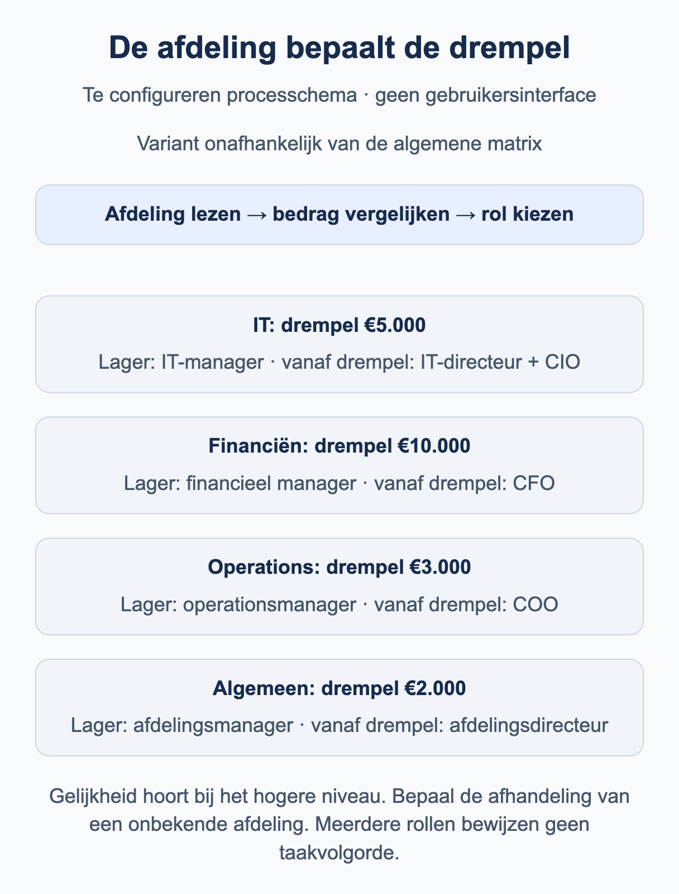<figcaption><p>Onafhankelijke afdelingsmatrix: drempels verschillen voor IT, financiën, operations en de algemene situatie. Gelijkheid kiest de hogere band. Meerdere rollen moeten worden geconfigureerd; hun aanwezigheid bewijst geen opeenvolgende goedkeuring.</p></figcaption></figure>

<details>
<summary>Drempelmatrix per afdeling</summary>

```
Afdelingsmatrix:

  IT-afdeling:
    Amount < €5,000: IT-manager
    Amount ≥ €5,000: IT-directeur + CIO

  Afdeling financiën:
    Amount < €10,000: Financieel manager
    Amount ≥ €10,000: CFO

  Afdeling operations:
    Amount < €3,000: Operationsmanager
    Amount ≥ €3,000: COO

  Algemeen:
    Amount < €2,000: Afdelingsmanager
    Amount ≥ €2,000: Afdelingsdirecteur
```

</details>

**Implementatie:**

Visuele uitleg: [afdelingsmatrix](#schema-afdelingsmatrix).

<details>
<summary>Illustratieve implementatie van de afdelingsmatrix</summary>

```
1. Veld Department controleren
2. Op basis van de afdeling de bedraggrens controleren
3. Routeren naar de juiste goedkeurder
4. Verschillende grenzen per afdeling
```

</details>

***

### Patroon 3: tijdgebaseerde logica

**Verschillende regels op basis van het tijdstip:**

#### Schema: Tijdvarianten

<figure>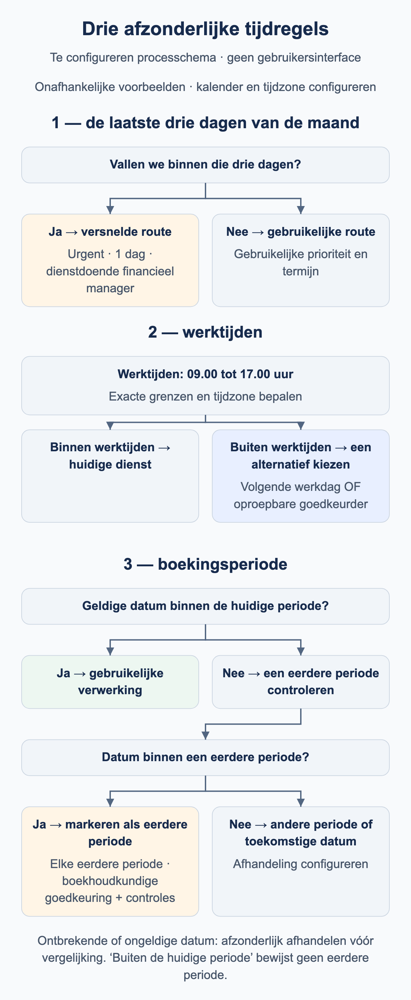<figcaption><p>Drie onafhankelijke varianten: maandultimo, werktijden en boekingsperiode. Wachtrij en oproepbare goedkeurder zijn alternatieven om uit te kiezen. Een datum buiten de huidige periode is niet noodzakelijk eerder; controleer de situatie afzonderlijk.</p></figcaption></figure>

<details>
<summary>Drie onafhankelijke tijdvarianten</summary>

```
Maandeindeverwerking (laatste 3 dagen van de maand):
  IF Today valt in de laatste 3 dagen van de maand:
    - Priority: URGENT
    - Deadline: 1 dag
    - Goedkeurder: dienstdoende financieel manager
    - Versnelde workflow
  ELSE:
    - Gebruikelijke prioriteit
    - Gebruikelijke termijn
    - Gebruikelijke workflow

Binnen en buiten werktijd:
  IF Time ligt tussen 9.00 en 17.00 uur:
    - Toewijzen aan de huidige dienst
  ELSE:
    - In de wachtrij voor de volgende werkdag plaatsen
    - OR routeren naar de oproepbare goedkeurder

Boekingsperiode (onafhankelijk voorbeeldbeleid):
  IF Document_Date ontbreekt of is ongeldig:
    - Ongeldige of onbekende datum volgens de configuratie afhandelen
  ELSE IF Document_Date in Current_Fiscal_Period:
    - Gebruikelijke verwerking
  ELSE IF Document_Date valt in een Fiscal_Period vóór Current_Fiscal_Period:
    - Markeren als "Prior Period"
    - Goedkeuring van de boekhouding vereisen
    - Extra controles
  ELSE:
    - Toekomstige of andere boekingsperiode: afhandelen volgens de configuratie
```

</details>

***

### Patroon 4: routering op basis van uitzonderingen

**Route uitzonderingen afzonderlijk:**

#### Schema: Ernst van uitzonderingen

<figure>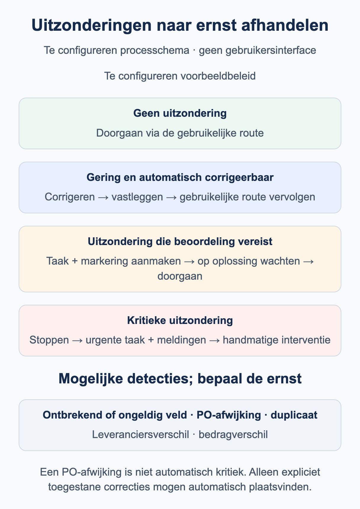<figcaption><p>Voorbeeldbeleid naar ernst: ga pas door na de geconfigureerde correctie of vereiste oplossing. Een kritieke uitzondering stopt de verwerking. Detectievoorbeelden bepalen op zichzelf niet de ernst.</p></figcaption></figure>

<details>
<summary>Beleid naar ernst van uitzonderingen</summary>

```
Detectie van uitzonderingen:

  Geen uitzondering:
    → Gebruikelijke workflow

  Kleine uitzondering (automatisch te corrigeren):
    → Automatisch corrigeren
    → Correctie registreren
    → Doorgaan met de gebruikelijke workflow

  Middelzware uitzondering (beoordeling nodig):
    → Beoordelingstaak aanmaken
    → Document markeren
    → Na oplossing: doorgaan met de workflow

  Ernstige uitzondering (escalatie nodig):
    → Verwerking stoppen
    → Urgente taak aanmaken
    → Meerdere niveaus informeren
    → Handmatig ingrijpen vereist

Typen uitzonderingen:
  - Vereist veld ontbreekt
  - Ongeldige veldwaarde
  - Afwijking van de inkooporder
  - Dubbele factuur
  - Leverancier komt niet overeen
  - Bedragafwijking
```

</details>

***

## Volledig beslissingslogicadiagram

De schema’s tonen de belangrijkste stappen. De gedetailleerde tekstboom hieronder behoudt het technische voorbeeld; de bestemmingen moeten nog worden geconfigureerd.


Visuele uitleg: [overzicht](#schema-overzicht), [bedragbanden](#schema-bedragbanden), [leveranciersanalyse](#schema-leveranciersanalyse), [opeenvolgende goedkeuringen](#schema-opeenvolgende-goedkeuringen), [automatische route](#schema-automatische-route), [managertaak](#schema-managertaak), [directiegoedkeuring](#schema-directiegoedkeuring).

<details>
<summary>Volledig voorbeeld: gedetailleerde tekstboom</summary>

```
FACTUUR KOMT BINNEN
│
├─ NIVEAU 1: UITZONDERINGEN CONTROLEREN
│  │
│  ├─ Kritieke uitzondering of leverancier met status BLOCKED?
│  │  (Ernst configureren; niet elke afwijking van de inkooporder is kritiek.)
│  │  │
│  │  ├─ JA → stoppen en escaleren
│  │  │        Urgente taak aanmaken
│  │  │        Beheerder informeren
│  │  │        → EINDE (afhandeling van uitzonderingen)
│  │  │
│  │  └─ NEE → doorgaan naar niveau 2
│
├─ NIVEAU 2: DOCUMENTTYPE
│  │
│  ├─ Type = Invoice?
│  │  └─ JA → doorgaan naar niveau 3
│  │
│  ├─ Type = Credit Note?
│  │  └─ JA → aftakken naar de creditnotaworkflow
│  │           → EINDE (creditnotaroute)
│  │
│  └─ Ander type?
│     └─ JA → aftakken naar de juiste workflow
│              → EINDE (route voor ander type)
│
├─ NIVEAU 3: URGENTIE CONTROLEREN (voor facturen)
│  │
│  ├─ Urgentiemarkering = TRUE?
│  │  │
│  │  ├─ JA → versnelde workflow
│  │  │        Priority: URGENT
│  │  │        Deadline: 1 dag
│  │  │        Toewijzen aan: hogere goedkeurder
│  │  │        → EINDE (versnelde route)
│  │  │
│  │  └─ NEE → doorgaan naar niveau 4
│
├─ NIVEAU 4: BEDRAGGRENZEN
│  │
│  ├─ Amount ontbreekt of is ongeldig?
│  │  ├─ JA → handmatige beoordeling (expliciet voorbeeldbeleid)
│  │  └─ NEE → doorgaan naar de onderstaande bedraggrenzen
│  │
│  ├─ Amount < €1,000?
│  │  │
│  │  ├─ JA → AUTOMATISCHE GOEDKEURINGSROUTE
│  │  │        Approval_Type instellen = "AUTO"
│  │  │        Onmiddellijk goedkeuren
│  │  │        Exporteren naar ERP
│  │  │        → EINDE (automatisch goedgekeurd)
│  │  │
│  │  └─ NEE → doorgaan
│  │
│  ├─ Amount < €10,000?
│  │  │
│  │  ├─ JA → GOEDKEURINGSROUTE VOOR MANAGER
│  │  │        Taak voor de manager aanmaken
│  │  │        Priority: Medium
│  │  │        Deadline: 3 dagen
│  │  │        → WACHTEN op resultaat; bij een wachtend resultaat niet doorgaan
│  │  │           → Goedgekeurd: doorgaan met de geconfigureerde verwerking
│  │  │           → Afgewezen: de keten stoppen en de afwijzing volgens de configuratie afhandelen
│  │  │
│  │  └─ NEE → doorgaan
│  │
│  ├─ Amount < €50,000?
│  │  │
│  │  ├─ JA → GOEDKEURINGSROUTE VOOR DIRECTEUR
│  │  │        Doorgaan naar niveau 5 (leverancier controleren)
│  │  │
│  │  └─ NEE → doorgaan
│  │
│  └─ Amount ≥ €50,000?
│     │
│     └─ JA → GOEDKEURINGSROUTE VOOR DIRECTIE
│              Opeenvolgende taken aanmaken:
│              - Financieel directeur
│              - CFO
│              - CEO (indien > €100,000)
│              Priority: URGENT
│              Deadline: 1 dag per taak
│              → WACHTEN op alle vereiste resultaten
│                 → Alles goedgekeurd: doorgaan met de geconfigureerde verwerking
│                 → In afwachting: niet doorgaan
│                 → Elke afwijzing: de keten stoppen en de afwijzing volgens de configuratie afhandelen
│
├─ NIVEAU 5: LEVERANCIERANALYSE (€10,000 ≤ Amount < €50,000)
│  │
│  ├─ Supplier Status = "BLOCKED"?
│  │  │
│  │  ├─ JA → BLOKKEREN EN ESCALEREN
│  │  │        Verwerking stoppen
│  │  │        Urgente taak aanmaken
│  │  │        Inkoop en financiën informeren
│  │  │        → EINDE (geblokkeerde leverancier)
│  │  │
│  │  └─ NEE → doorgaan
│  │
│  ├─ Supplier Age < 180 dagen (nieuw)?
│  │  │
│  │  ├─ JA → DUBBELE GOEDKEURING VEREIST
│  │  │        Taak 1: directeur (2 dagen)
│  │  │        → WACHTEN op taak 1
│  │  │           IF taak 1 goedgekeurd:
│  │  │             Taak 2: CFO (2 dagen)
│  │  │             → WACHTEN op taak 2
│  │  │                → In afwachting: niet doorgaan
│  │  │                → Goedgekeurd: pas doorgaan na beide positieve goedkeuringen
│  │  │                → Afgewezen: de keten stoppen en de afwijzing volgens de configuratie afhandelen
│  │  │           IF taak 1 afgewezen:
│  │  │             → De keten stoppen en de afwijzing volgens de configuratie afhandelen
│  │  │           IF taak 1 in afwachting:
│  │  │             → Taak 2 niet aanmaken en niet doorgaan
│  │  │
│  │  └─ NEE → doorgaan
│  │
│  ├─ Supplier Risk Rating = "HIGH"?
│  │  │
│  │  ├─ JA → VERSTERKTE GOEDKEURING
│  │  │        Extra fraudecontroles
│  │  │        Voorafgaande goedkeuring door de manager, daarna goedkeuring door de directeur
│  │  │        Wachten op elk positief resultaat; bij een wachtend resultaat of afwijzing niet doorgaan
│  │  │        Termijnen voor risicocontroles configureren; goedkeuringstaken van route C vermelden 2 dagen
│  │  │        → EINDE (versterkte route)
│  │  │
│  │  └─ NEE → GEBRUIKELIJKE GOEDKEURING DOOR DIRECTEUR
│  │           Taak voor de directeur aanmaken
│  │           Priority: High
│  │           Deadline: 2 dagen
│  │           → WACHTEN op resultaat; bij een wachtend resultaat niet doorgaan
│  │              → Goedgekeurd: doorgaan met de geconfigureerde verwerking
│  │              → Afgewezen: de keten stoppen en de afwijzing volgens de configuratie afhandelen
│  │
│  └─ [Leverancieranalyse afgerond]
│
└─ [Alle beslisniveaus verwerkt]
```

</details>


***

## Best practices voor de configuratie

### 1. Houd de logica duidelijk en onderhoudbaar

De vergelijking hieronder toont een eenvoudige voorwaarde, een samengestelde voorwaarde en ander beleid in fasen. Het schema onderscheidt hun doelen zonder equivalentie te claimen.

#### Schema: Leesbare beslissingen

<figure>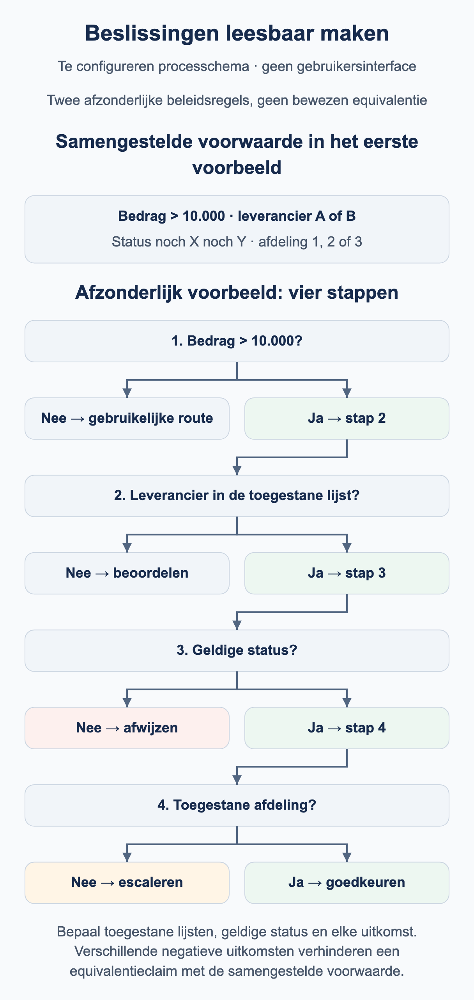<figcaption><p>Het voorbeeld met vier stappen toont ander beleid dan de samengestelde voorwaarde. Elk negatief resultaat is zichtbaar; het is geen bewezen equivalente logische omzetting. Bepaal toegestane lijsten en afhandeling van uitkomsten.</p></figcaption></figure>

✅ **Goed:**

Visuele uitleg: [eenvoudige voorwaarde](#schema-eenvoudige-voorwaarde).

<details>
<summary>Eenvoudig voorbeeld: route voor hoge bedragen</summary>

```
IF Amount > 10000:
  → Route voor hoge bedragen
ELSE:
  → Gebruikelijke route
```

</details>

❌ **Slecht (te complex):**

Visuele uitleg: [leesbare beslissingen](#schema-leesbare-beslissingen).

<details>
<summary>Voorbeeld van een samengestelde voorwaarde</summary>

```
IF (Amount > 10000 AND (Supplier = "A" OR Supplier = "B") AND NOT (Status = "X" OR Status = "Y") AND Department IN [1,2,3]):
  → Complexe route
```

</details>

**Ander voorbeeld: afzonderlijk beleid in vier fasen:**

Dit voorbeeld onderscheidt de uitkomsten per fase. Het is geen logisch equivalente herschrijving van de samengestelde voorwaarde hierboven: leverancierslijsten, geldige statussen, toegestane afdelingen en afhandeling van negatieve resultaten moeten voor dit tweede voorbeeld worden bepaald.

Visuele uitleg: [leesbare beslissingen](#schema-leesbare-beslissingen).

<details>
<summary>Ander voorbeeld: beleid in vier stappen</summary>

```
Stap 1: IF Amount > 10000: Doorgaan, ELSE: Gebruikelijke route
Stap 2: IF Supplier staat op de toegestane lijst: Doorgaan, ELSE: Beoordelen
Stap 3: IF Status is geldig: Doorgaan, ELSE: Afwijzen
Stap 4: IF Department is bevoegd: Goedkeuren, ELSE: Escaleren
```

</details>

***

### 2. Documenteer de beslissingslogica

**Neem altijd op:**

* Doel van elk beslissingspunt
* De bedrijfsregel die wordt geïmplementeerd
* Verwachte uitkomsten
* Afhandeling van uitzonderingen

**Voorbeeld van documentatie:**

#### Schema: Regelregister

<figure>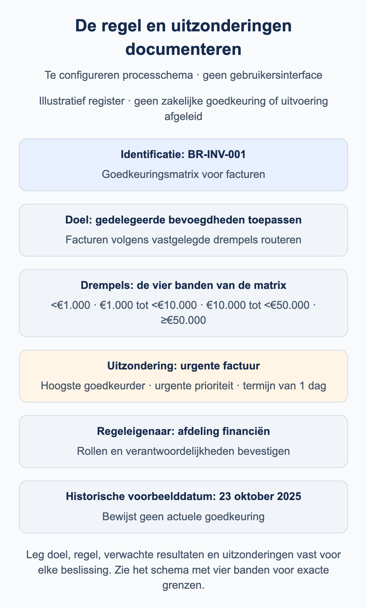<figcaption><p>Illustratieve registratie van regel BR-INV-001: doel, drempels, uitzondering, eigenaar en referentiedatum. Verwijzen naar de vier banden voorkomt dubbele regels; deze registratie bewijst geen goedkeuring of uitvoering.</p></figcaption></figure>

<details>
<summary>Illustratief register van regel BR-INV-001</summary>

```
Beslispunt: bedraggrens controleren
Bedrijfsregel: BR-INV-001 (factuurgoedkeuringsmatrix)
Doel: facturen routeren op basis van bedraggrenzen volgens het bedrijfsbeleid
Grenzen:
  < €1,000: Automatisch goedkeuren (door de CFO goedgekeurde grens in dit voorbeeld)
  €1,000 ≤ Amount < €10,000: Goedkeuring door de manager (delegatiematrix)
  €10,000 ≤ Amount < €50,000: Goedkeuring door de directeur met leverancierscontroles
  Amount ≥ €50,000: Goedkeuring door de directie
Uitzonderingen: urgente facturen gaan direct naar het hoogste niveau
Bijgewerkt: 2025-10-23
Eigenaar: afdeling financiën
```

</details>

***

### 3. Test alle paden

**Voorgestelde testmatrix — verwachte resultaten, geen uitgevoerde tests:**

Controleer deze verwachte resultaten in uw configuratie en leg waarnemingen vast.

| Testgeval | Bedrag | Type | Leverancier | Verwachte route | Verificatie |
| --- | --- | --- | --- | --- | --- |
| TC1 | €500 | Factuur | Bestaand | Automatische goedkeuring | Te testen |
| TC2 | €5.000 | Factuur | Bestaand | Manager | Te testen |
| TC3 | €15.000 | Factuur | Nieuw | Directeur, daarna CFO | Te testen |
| TC4 | €60.000 | Factuur | Bestaand | Directie | Te testen |
| TC5 | €2.000 | Creditnota | Bestaand | Creditnotaworkflow | Te testen |
| TC6 | €100.000 | Factuur | Geblokkeerd | Stoppen en escaleren | Te testen |
| TC7 | €999,99 | Factuur | Bestaand | Automatische goedkeuring | Te testen |
| TC8 | €1.000 | Factuur | Bestaand | Manager | Te testen |
| TC9 | €9.999,99 | Factuur | Bestaand | Manager | Te testen |
| TC10 | €10.000 | Factuur | Bestaand | Directeur + leverancierscontroles | Te testen |
| TC11 | €49.999,99 | Factuur | Bestaand | Directeur + leverancierscontroles | Te testen |
| TC12 | €50.000 | Factuur | Bestaand | Directie | Te testen |
| TC13 | Ontbrekend of ongeldig | Factuur | Bestaand | Gekozen handmatige beoordeling | Te testen |
| TC14 | €15.000 | Factuur | Nieuw | Directeur in afwachting: volgende taak niet aanmaken | Te testen |
| TC15 | €15.000 | Factuur | Nieuw | Directeur of CFO wijst af: keten stoppen en afwijzing afhandelen | Te testen |
| TC16 | €15.000 | Factuur | Nieuw | Beide goedkeuringen positief: geconfigureerde verwerking vervolgen | Te testen |

***

### 4. Bewaak beslissingsstatistieken

**Houd bij:**

* Verdeling over de beslissingspaden
* Percentage automatische goedkeuringen
* Percentage handmatige beoordelingen
* Gemiddelde verwerkingstijd per pad
* Percentage uitzonderingen
* Gebruik per pad

**Fictieve voorbeeldcijfers:** deze waarden illustreren een rapport; ze bewijzen geen huidige prestaties of uitvoering van deze workflow.

#### Schema: Fictieve cijfers

<figure>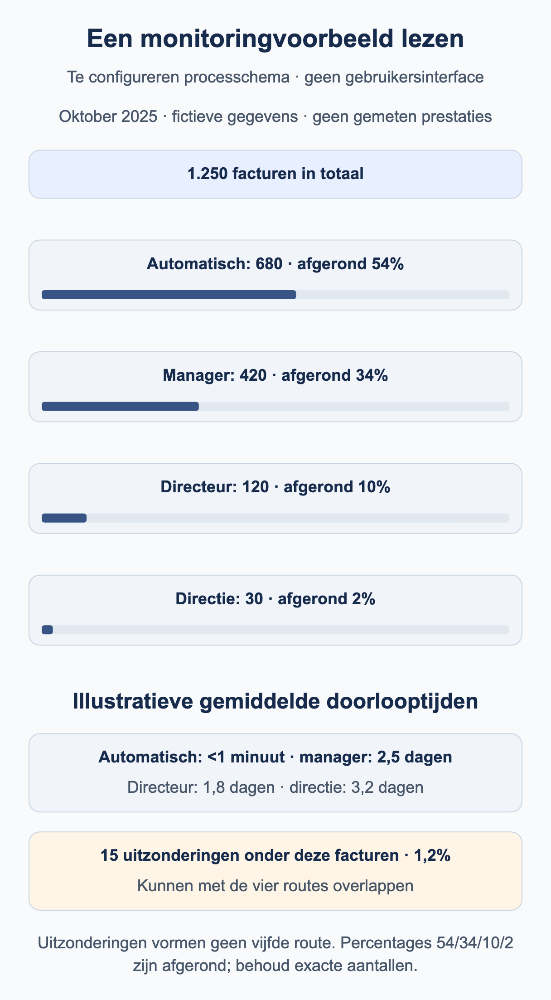<figcaption><p>Fictief voorbeeld: de vier routes tellen samen 1.250 facturen. Routepercentages zijn afgerond. De 15 uitzonderingen, ofwel 1,2%, kunnen dezelfde facturen betreffen; ze vormen geen vijfde route. Doorlooptijden zijn geen gemeten DocBits-prestaties.</p></figcaption></figure>

<details>
<summary>Fictief voorbeeld van verdeling en doorlooptijden</summary>

```
Maand: oktober 2025
Totaal facturen: 1250

Verdeling over beslisroutes:
- Automatisch goedgekeurd (< €1k): 680 (54%)
- Managerroute (€1k ≤ Amount < €10k): 420 (34%)
- Directeursroute (€10k ≤ Amount < €50k): 120 (10%)
- Directieroute (Amount ≥ €50k): 30 (2%)

Verwerkingstijd:
- Automatisch goedkeuren: < 1 minuut
- Managerroute: gemiddeld 2,5 dagen
- Directeursroute: gemiddeld 1,8 dagen
- Directieroute: gemiddeld 3,2 dagen

Uitzonderingen: 15 (1,2%)
```

</details>

***

## Gerelateerde patronen

### Patronen die goed samenwerken:

* [**Patroon voor taakbeheer**](task-management-pattern.md) - Taken aanmaken op basis van beslissingen
* [**API-integratiepatroon**](api-integration-pattern.md) - Gegevens ophalen voor besluitvorming
* [**PO-overeenkomend patroon**](po-matching-pattern.md) - PO-resultaten gebruiken in beslissingen
* [**Patroon voor gegevenstransformatie**](data-transformation-pattern.md) - Gegevens transformeren vóór beslissingen

***

## Gerelateerde handleidingen

### Vereisten

* [Volledige handleiding voor voorwaardekaarten](../and/condition-cards-complete-guide.md) - Alle voorwaardekaarten
* [Handleiding voor veldbewerkingen](../then/document-field/field-manipulation-guide.md) - Veldbewerkingen
* [Gebruikershandleiding toewijzing](../then/assignee/assignment-user-guide.md) - Routeringslogica

### Gerelateerde kaarten

* **CONDITION\_DOC\_FIELD\_AMOUNT** - [Handleiding voor conditiekaarten](../and/condition-cards-complete-guide.md)
* **CONDITION\_DOC\_TYPE\_IS\_ISNOT** - [Handleiding voor conditiekaarten](../and/condition-cards-complete-guide.md)
* **CONDITION\_SUPPLIER\_STATUS\_IS\_ISNOT** - [Handleiding voor conditiekaarten](../and/condition-cards-complete-guide.md)
* **ACTION\_ASSIGN\_TO\_USER** - [Toewijzingsgids](../then/assignee/assignment-user-guide.md)
* **tasks\_create** - [Handleiding voor taaktoewijzing](../then/task/task-assignment-guide.md)

### Volgende stappen

* Taken aanmaken: [Taakbeheerpatroon](task-management-pattern.md)
* Complexe matching toevoegen: [Patroon voor PO-matching](po-matching-pattern.md)
* API's integreren: [API-integratiepatroon](api-integration-pattern.md)

***

**Historische voorbeeldmetadata:**

**Patroonversie:** 1.0 **Laatst bijgewerkt:** 23 oktober 2025 **Moeilijkheid:** gemiddeld **Geschatte tijd:** 30–45 minuten