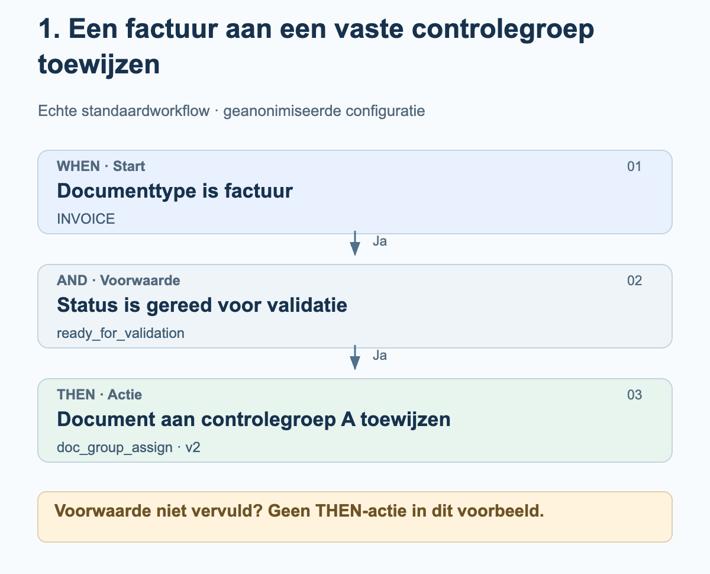
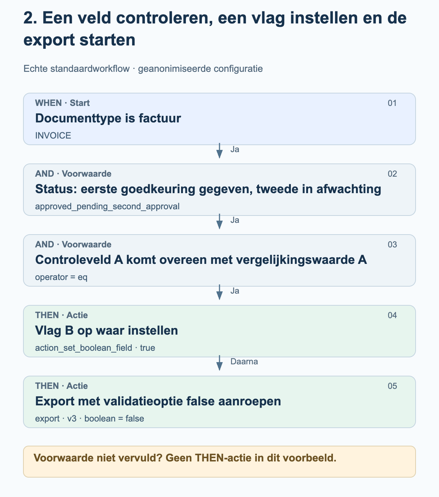
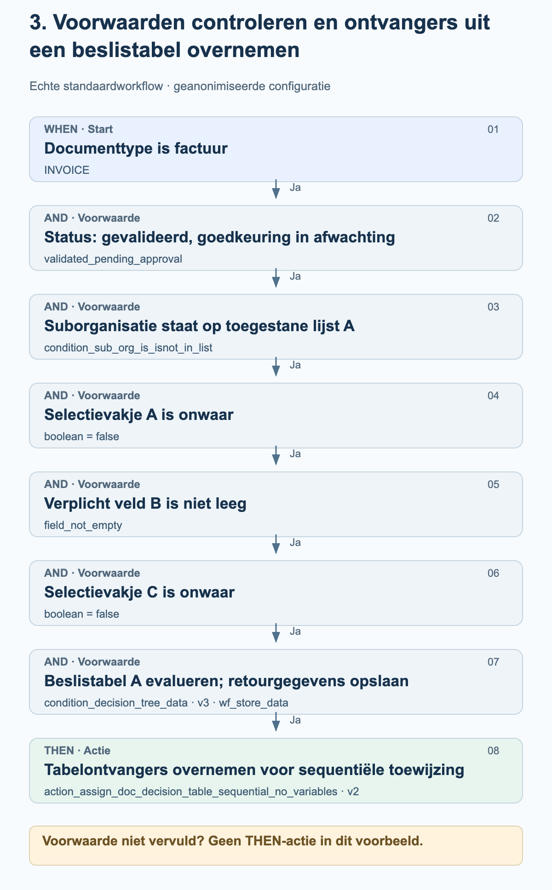

# Echte workflowvoorbeelden uit de praktijk

Deze drie voorbeelden zijn afkomstig uit ingeschakelde standaardworkflows in de productieomgeving. Ze tonen de daadwerkelijk geconfigureerde volgorde van WHEN, AND en THEN. Groepen, organisaties, veldnamen, vergelijkingswaarden en beslistabellen zijn vervangen door neutrale aanduidingen. De diagrammen leggen de configuratie uit; het zijn geen schermafbeeldingen.

Peildatum: 27 oktober 2026. De gebruikte kaarten, versies, parameters en hun volgorde zijn gecontroleerd aan de hand van de opgeslagen configuraties van geslaagde productieruns. Een workflowlogboek met het resultaat success bevestigt noch een menselijke goedkeuring, noch de ontvangst in het ERP. Er zijn geen workflows gewijzigd of voor testdoeleinden uitgevoerd.

## Zo lees je de diagrammen

De voorbeelden gebruiken de standaardmodus. WHEN beperkt het documenttype; aan alle AND-voorwaarden moet zijn voldaan voordat de THEN-acties volgen. Een niet-vervulde voorwaarde leidt in deze voorbeelden tot geen enkele THEN-actie. De pijlen tussen acties tonen hun geconfigureerde volgorde. Ze vormen geen extra succescontrole of goedkeuringsstap. Een uitvoering kan ook met een fout eindigen.

## 1. Een factuur aan een vaste controlegroep toewijzen

Een factuur moet ter controle naar een vast geconfigureerde groep worden gestuurd zodra deze de status ‘gereed voor validatie’ bereikt. Voor dit voorbeeld is geen beslistabel nodig.

<figure><figcaption>Factuur en passende status: het document wordt toegewezen aan de vast geconfigureerde controlegroep A. De toewijzing is nog geen goedkeuring.</figcaption></figure>

Kaarten en instellingen

| Fase / kaart | Instelling in het voorbeeld | Betekenis |
| --- | --- | --- |
| WHEN · condition_doc_type_is_isnot_list · v2 | operator = is; doc_type = INVOICE | Alleen facturen voldoen aan deze voorwaarde. |
| AND · condition_doc_status_is_isnot · v2 | operator = is; status = ready_for_validation | Het document is gereed voor validatie. |
| THEN · doc_group_assign · v2 | groups = Controlegroep A | Versie 2 gebruikt de geconfigureerde groep. De beslistabeloptie is in deze kaartversie niet bepalend. |

### Controleer bij het nabouwen

- Controlegroep A is een geanonimiseerde aanduiding. Kies een groep uit je organisatie en controleer waarvoor deze verantwoordelijk is.
- Controleer het documenttype en de status afzonderlijk: een factuur met een andere status voldoet niet aan dit voorbeeld.
- Documenttoewijzing, taak en goedkeuring zijn verschillende handelingen. Deze configuratie bevat alleen de toewijzing.

## 2. Een veld controleren, een vlag instellen en de export starten

Een factuur met een bepaalde goedkeuringsstatus wordt alleen verder verwerkt als controleveld A exact overeenkomt met vergelijkingswaarde A. Daarna probeert de workflow vlag B op waar in te stellen en roept vervolgens de export aan. De oorspronkelijke veldnamen en vergelijkingswaarde zijn geanonimiseerd.

<figure><figcaption>De veldcontrole maakt de twee acties mogelijk. Eerst wordt het instellen van de vlag aangeroepen; daarna volgt de exportaanroep. De status en de uitgeschakelde validatiecontroles maken deel uit van deze specifieke configuratie.</figcaption></figure>

Kaarten en instellingen

| Fase / kaart | Instelling in het voorbeeld | Betekenis |
| --- | --- | --- |
| WHEN · condition_doc_type_is_isnot_list · v2 | operator = is; doc_type = INVOICE | Alleen facturen voldoen aan deze voorwaarde. |
| AND · condition_doc_status_is_isnot · v2 | operator = is; status = approved_pending_second_approval | De geconfigureerde status betekent ‘eerste goedkeuring gegeven, tweede goedkeuring in afwachting’. Deze wordt hier niet vervangen door een algemenere goedkeuringsstatus. |
| AND · condition_docfield_operator_value · v2 | field_name = Controleveld A; operator = eq; field_value = Vergelijkingswaarde A | De veldinhoud moet overeenkomen met de geconfigureerde waarde; de voorwaarde controleert niet uitsluitend of het veld is gevuld. |
| THEN 1 · action_set_boolean_field · v2 | field_name = Vlag B; boolean = true | Probeert het geconfigureerde booleaanse veld op waar in te stellen. |
| THEN 2 · export · v3 | boolean = false | Start de export met ignore_field_validation_errors = true en validate_po_match = false. false schakelt hier validatiecontroles uit, niet de export. |

### Controleer bij het nabouwen

- De exportoptie false is een klantspecifieke instelling en geen algemene aanbeveling. Controleer vóór het nabouwen met name de veldvalidatie, de PO-matching en de goedkeuringsvereisten.
- Tussen het instellen van de vlag en de export is geen extra voorwaarde geconfigureerd. Alleen de volgorde garandeert niet dat de eerste actie is geslaagd; uitzonderingen en actiefouten moeten afzonderlijk worden gecontroleerd.
- De workflow bevat geen wachtstap voor een tweede menselijke goedkeuring. Een geslaagde workflowuitvoering vervangt geen bewijs van ontvangst in het ERP.

## 3. Voorwaarden controleren en ontvangers uit een beslistabel overnemen

Een factuur mag pas via een beslistabel worden toegewezen als de organisatie, de status, twee selectievakjes en een verplicht veld aan de voorwaarden voldoen. De workflow slaat de retourgegevens van de beslistabel op, zodat de daaropvolgende sequentiële toewijzing deze kan gebruiken.

<figure><figcaption>Aan alle zes AND-voorwaarden moet zijn voldaan. De retourgegevens van de beslistabel worden opgeslagen en vervolgens gebruikt voor de sequentiële documenttoewijzing. Het diagram voegt geen verzonnen ontvangers of goedkeuringsniveaus toe.</figcaption></figure>

Kaarten en instellingen

| Fase / kaart | Instelling in het voorbeeld | Betekenis |
| --- | --- | --- |
| WHEN · condition_doc_type_is_isnot_list · v2 | operator = is; doc_type = INVOICE | Beperkt het voorbeeld tot facturen. |
| AND 1 · condition_doc_status_is_isnot · v2 | operator = is; status = validated_pending_approval | Het document is gevalideerd; er is nog een goedkeuring nodig. |
| AND 2 · condition_sub_org_is_isnot_in_list · v2 | operator = is; sub_org_id = toegestane lijst A | Alleen de geconfigureerde suborganisaties vallen binnen het toepassingsgebied. |
| AND 3 · condition_checkbox_is · v2 | field_name = Selectievakje A; boolean = false | Het eerste geconfigureerde selectievakje moet onwaar zijn. |
| AND 4 · condition_docfield_status · v2 | field_name = Verplicht veld B; field_status = field_not_empty | Het geconfigureerde veld moet gevuld zijn. |
| AND 5 · condition_checkbox_is · v2 | field_name = Selectievakje C; boolean = false | Ook het tweede selectievakje moet onwaar zijn. |
| AND 6 · condition_decision_tree_data · v3 | decision_table = Beslistabel A; store_data = wf_store_data | De tabel wordt voor het document geëvalueerd. De retourgegevens worden opgeslagen voor volgende kaarten. Het aanvullende oudere boolean-veld is leeg en bepaalt het gedrag van deze versie niet. |
| THEN · action_assign_doc_decision_table_sequential_no_variables · v2 | geen eigen kaartvariabelen | Neemt ontvangers uit de opgeslagen tabelretourgegevens over voor de sequentiële toewijzing. Ontvangers en prioriteiten zijn afhankelijk van de tabel. |

### Controleer bij het nabouwen

- Selectievakje A, verplicht veld B en selectievakje C verwijzen naar drie verschillende geconfigureerde velden. De neutrale aanduidingen vervangen de oorspronkelijke namen.
- Een controle op een niet-leeg veld bevestigt nog niet dat de veldinhoud inhoudelijk juist is.
- Controleer de daadwerkelijke beslistabel, inclusief ontvangers en prioriteiten. De regels daarvan worden hier niet gepubliceerd; er worden geen bedraggrenzen of rollen bij verzonnen.
- Een geslaagde tabelevaluatie garandeert nog geen bruikbare ontvangers. De daaropvolgende toewijzing vereist geldige gebruikers of groepen als uitvoer.
- Een sequentiële toewijzing bewijst niet dat een menselijke goedkeuring is afgerond. Deze workflow bevat geen exportaanroep.

## Van voorbeeld naar eigen configuratie

Bepaal de passende velden, groepen en beslistabellen in je eigen organisatie. Neem de neutrale aanduidingen niet over alsof het bestaande productvelden zijn. Controleer zowel situaties waarin elke voorwaarde wel als niet wordt vervuld, en ook actiefouten, in een geschikte testomgeving. Controleer goedkeuringen en exports aan de hand van hun daadwerkelijke resultaten; schakel een workflow pas in na inhoudelijke acceptatie.

[Echte Advanced-workflowvoorbeelden uit productie](advanced-production-workflow-examples.md)
