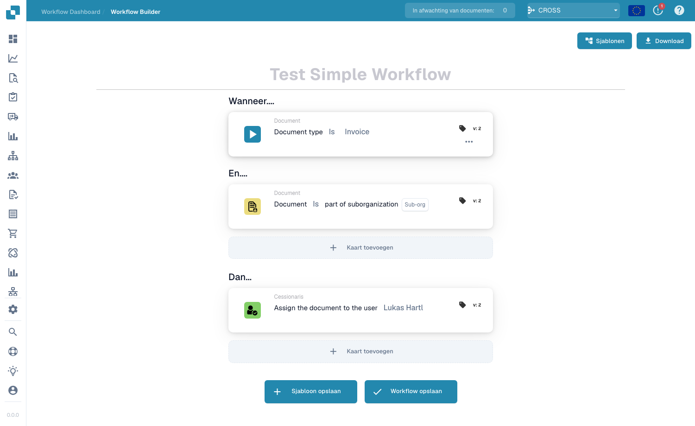

# Standard Workflow

De **Standard Workflow** builder is de lineaire, op kaarten gebaseerde editor voor het automatiseren van documentverwerking. Een workflow bestaat uit drie groepen kaarten — **When** (de trigger), **And** (aanvullende voorwaarden) en **Then** (de acties die worden uitgevoerd). Wanneer een document voldoet aan de When/And-voorwaarden, worden de Then-acties automatisch uitgevoerd.

## Een Standard Workflow maken en testen 

Maak een volledige Standard Workflow in de echte DocBits-interface: selecteer de factuur, controleer het factuurnummer en een bedrag boven 1000, wijs een beoordelaar toe en wijzig de status. Sla de regel op, voer drie testscenario’s uit en controleer het werkelijke resultaat op het document.



[Bekijken met ondertiteling](https://docbits-videos.fra1.cdn.digitaloceanspaces.com/settings-assistant/standard-workflow-admin/v2/nl.html) · [Video openen](https://docbits-videos.fra1.cdn.digitaloceanspaces.com/settings-assistant/standard-workflow-admin/v2/nl.mp4) · [Ondertiteling (WebVTT)](https://docbits-videos.fra1.cdn.digitaloceanspaces.com/settings-assistant/standard-workflow-admin/v2/nl.vtt) · [Transcript](https://docbits-videos.fra1.cdn.digitaloceanspaces.com/settings-assistant/standard-workflow-admin/v2/nl.txt) · 3:55

Hoofdstukken en transcript

| Hoofdstuk | Start |
| --- | --- |
| Wat deze workflow doet | [0:00](https://docbits-videos.fra1.cdn.digitaloceanspaces.com/settings-assistant/standard-workflow-admin/v2/nl.mp4#t=0.000) |
| De workflow een naam geven | [0:15](https://docbits-videos.fra1.cdn.digitaloceanspaces.com/settings-assistant/standard-workflow-admin/v2/nl.mp4#t=15.083) |
| When: documenttype | [0:25](https://docbits-videos.fra1.cdn.digitaloceanspaces.com/settings-assistant/standard-workflow-admin/v2/nl.mp4#t=25.417) |
| And: factuurnummer | [0:38](https://docbits-videos.fra1.cdn.digitaloceanspaces.com/settings-assistant/standard-workflow-admin/v2/nl.mp4#t=38.208) |
| And: bedrag boven 1000 | [0:51](https://docbits-videos.fra1.cdn.digitaloceanspaces.com/settings-assistant/standard-workflow-admin/v2/nl.mp4#t=51.625) |
| Then: beoordelaar toewijzen | [1:06](https://docbits-videos.fra1.cdn.digitaloceanspaces.com/settings-assistant/standard-workflow-admin/v2/nl.mp4#t=66.375) |
| Then: status wijzigen | [1:21](https://docbits-videos.fra1.cdn.digitaloceanspaces.com/settings-assistant/standard-workflow-admin/v2/nl.mp4#t=81.750) |
| Controleren en opslaan | [1:34](https://docbits-videos.fra1.cdn.digitaloceanspaces.com/settings-assistant/standard-workflow-admin/v2/nl.mp4#t=94.167) |
| De opgeslagen regel controleren | [1:50](https://docbits-videos.fra1.cdn.digitaloceanspaces.com/settings-assistant/standard-workflow-admin/v2/nl.mp4#t=110.500) |
| Het testscenario voorbereiden | [2:03](https://docbits-videos.fra1.cdn.digitaloceanspaces.com/settings-assistant/standard-workflow-admin/v2/nl.mp4#t=123.417) |
| De positieve test uitvoeren | [2:24](https://docbits-videos.fra1.cdn.digitaloceanspaces.com/settings-assistant/standard-workflow-admin/v2/nl.mp4#t=144.583) |
| De grenswaarde testen | [2:43](https://docbits-videos.fra1.cdn.digitaloceanspaces.com/settings-assistant/standard-workflow-admin/v2/nl.mp4#t=163.917) |
| Een ander factuurnummer testen | [3:03](https://docbits-videos.fra1.cdn.digitaloceanspaces.com/settings-assistant/standard-workflow-admin/v2/nl.mp4#t=183.083) |
| Het resultaat op het document controleren | [3:22](https://docbits-videos.fra1.cdn.digitaloceanspaces.com/settings-assistant/standard-workflow-admin/v2/nl.mp4#t=202.125) |
| De geteste regel inschakelen | [3:40](https://docbits-videos.fra1.cdn.digitaloceanspaces.com/settings-assistant/standard-workflow-admin/v2/nl.mp4#t=220.917) |

**Wat deze workflow doet**

Goed, ik maak een volledige Standard Workflow voor een trainingsfactuur. Boven duizend moet die naar een beoordelaar en wachten op goedkeuring. Een eigen factuurnummer beperkt dit voorbeeld tot het bedoelde document.

**De workflow een naam geven**

In de lijst klik ik op Nieuwe workflow. Ik geef een duidelijke naam voordat ik kaarten toevoeg. Deze organisatie opent meteen de Standard-designer.

**When: documenttype**

Bij Wanneer open ik de bibliotheek en kies ik de kaart voor het documenttype. Ik stel de operator in op Is en kies Factuur. Daarmee bepaal ik welk documenttype de regel controleert.

**And: factuurnummer**

Bij En voeg ik een voorwaarde voor een documentveld toe. Ik kies invoice_id, stel Gelijk aan in en vul ons trainingsfactuurnummer in. Deze extra voorwaarde beperkt de demonstratie tot de bedoelde factuur.

**And: bedrag boven 1000**

Een tweede En-voorwaarde controleert total_amount. Ik kies Groter dan en vul duizend in. Precies duizend voldoet niet aan deze voorwaarde. Bedrag en valuta moeten bij het trainingsdocument passen.

**Then: beoordelaar toewijzen**

Bij Dan kies ik de actie om het document aan een gebruiker toe te wijzen. Ik selecteer Docs User A2, onze testbeoordelaar voor de documentatie. Deze actie wijst het document toe zonder een e-mailmelding aan te maken.

**Then: status wijzigen**

De tweede actie verandert de status naar Wacht op goedkeuring. Workflows activeren zet ik op onwaar. Dit voorbeeld heeft geen nieuwe uitvoering nodig wanneer de eigen actie de status verandert.

**Controleren en opslaan**

Voor het opslaan lees ik de hele regel opnieuw. Factuur, het exacte nummer en een bedrag boven duizend moeten overeenkomen. Daarna volgen de twee acties in de getoonde volgorde. Ik sla de workflow op en controleer de bevestiging.

**De opgeslagen regel controleren**

In de lijst controleer ik de opgeslagen workflow en de actieve status. Opslaan kan een workflow al inschakelen. Ik schakel deze trainingsregel uit terwijl ik de tests voorbereid.

**Het testscenario voorbereiden**

In Test Manager voeg ik een scenario toe en kies ik onze opgeslagen workflow. Ik geef het een duidelijke naam en upload de JSON-bestanden met invoer en verwacht resultaat. De invoer bevat ons factuurnummer, het bedrag zeventienhonderdvijfentachtig en de status Gereed voor validatie. De verwachte status is Wacht op goedkeuring.

**De positieve test uitvoeren**

Ik verstuur het scenario en kies Test uitvoeren in het menu. Ik open de lijst opnieuw om het opgeslagen resultaat te laden. Geslaagd vergelijkt de verwachte documentstatus. In deze sandbox toont het kaartenpaneel de afzonderlijke meldingen niet betrouwbaar, dus controleer ik ook het echte document.

**De grenswaarde testen**

Daarna test ik precies duizend. Het factuurnummer en het documenttype kloppen nog, maar Groter dan moet onwaar opleveren. In deze testinvoer blijft de verwachte status Gereed voor validatie. Ik sla dit aparte scenario op, voer het uit en controleer het resultaat.

**Een ander factuurnummer testen**

Een ander scenario heeft een ander factuurnummer en een bedrag boven duizend. Alleen het bedrag mag de acties niet starten. Ik sla het scenario op en voer het uit met de oorspronkelijke status als verwacht resultaat. Deze negatieve gevallen controleren de grenzen van de regel.

**Het resultaat op het document controleren**

Op Dashboard vind ik ons trainingsdocument. De echte status is Wacht op goedkeuring en het document is toegewezen aan Docs User A2. Dat bevestigt het zichtbare resultaat van beide acties. Deze wijziging komt uit de handmatige test en bewijst geen automatische verwerking.

**De geteste regel inschakelen**

In de workflowlijst schakel ik de geteste regel in en controleer de schakelaar. Voor ingebruikname controleer ik voorwaarden, ontvangers en testresultaten. Na de demonstratie schakel ik de trainingsregel weer uit.

## Toegang krijgen

Open **Workflow Dashboard → Workflow List** en klik vervolgens op **Add Workflow** om een nieuwe Standard-workflow aan te maken, of klik op een bestaande workflow om deze te bewerken.

<figure><figcaption>
De Workflow List — elke rij is een workflow die u kunt openen, in-/uitschakelen of bewerken.
</figcaption></figure>

## Het When / And / Then-model

<figure><figcaption>
Het Standard Workflow-canvas. Dit voorbeeld triggert op facturen in een suborganisatie en wijst ze toe aan een gebruiker.
</figcaption></figure>

- **When** — de trigger die de workflow start (bijv. *Document type is Invoice*).
- **And** — extra voorwaarden die ook waar moeten zijn (bijv. *Document is part of sub-organization*). Laat leeg om bij elke match van de When-kaart uit te voeren.
- **Then** — de acties die moeten worden uitgevoerd (bijv. *Assign the document to the user*, een taak aanmaken, een API aanroepen, een e-mail verzenden).

## Kaarten toevoegen

Klik in een willekeurige groep op **Add Card** om de kaartbibliotheek te openen. Kaarten zijn per categorie geordend, zodat u de bouwsteen vindt die u nodig hebt:

<figure><figcaption>
De <strong>Add Card</strong>-bibliotheek — voorwaardekaarten, vergelijkingskaarten, actiekaarten en meer, gegroepeerd per categorie.
</figcaption></figure>

Sla op met **Save Workflow**, of sla de lay-out op als herbruikbare template met **Save Template**.

## Volgende stappen

- Bekijk in het **Cards**-gedeelte wat elke kaart doet.
- Combineer kaarten tot beproefde oplossingen met de **Workflow Pattern Guides**.
- Voor vertakkende flows met parallelle paden (Wait ALL / Wait ANY / OR) gebruikt u de **Advanced Workflow** builder.
