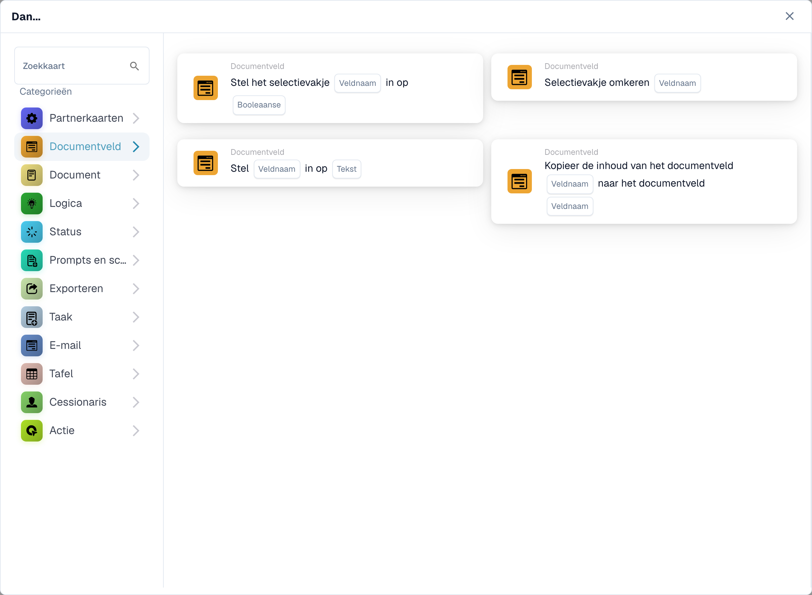
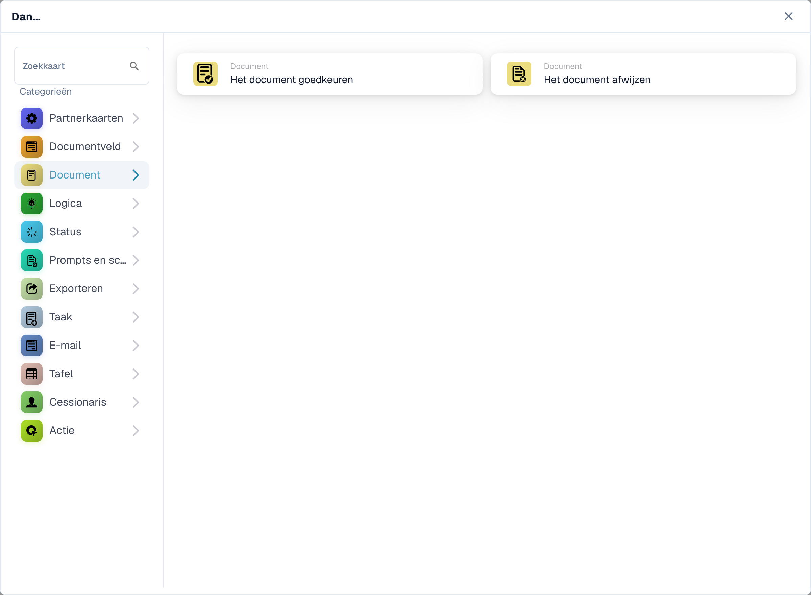
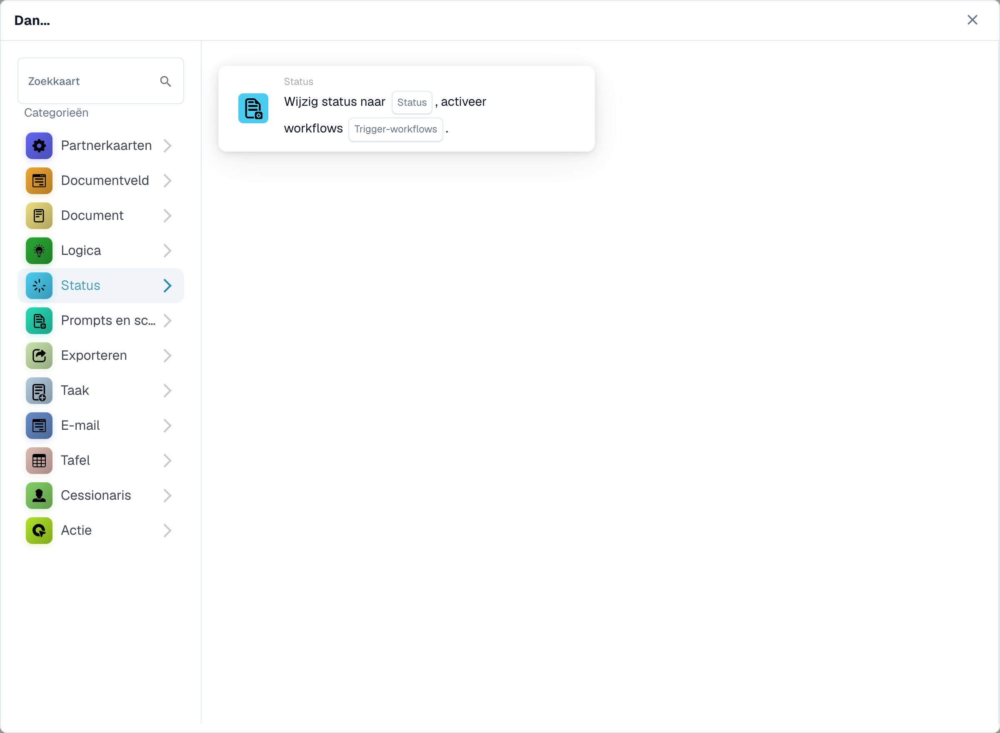
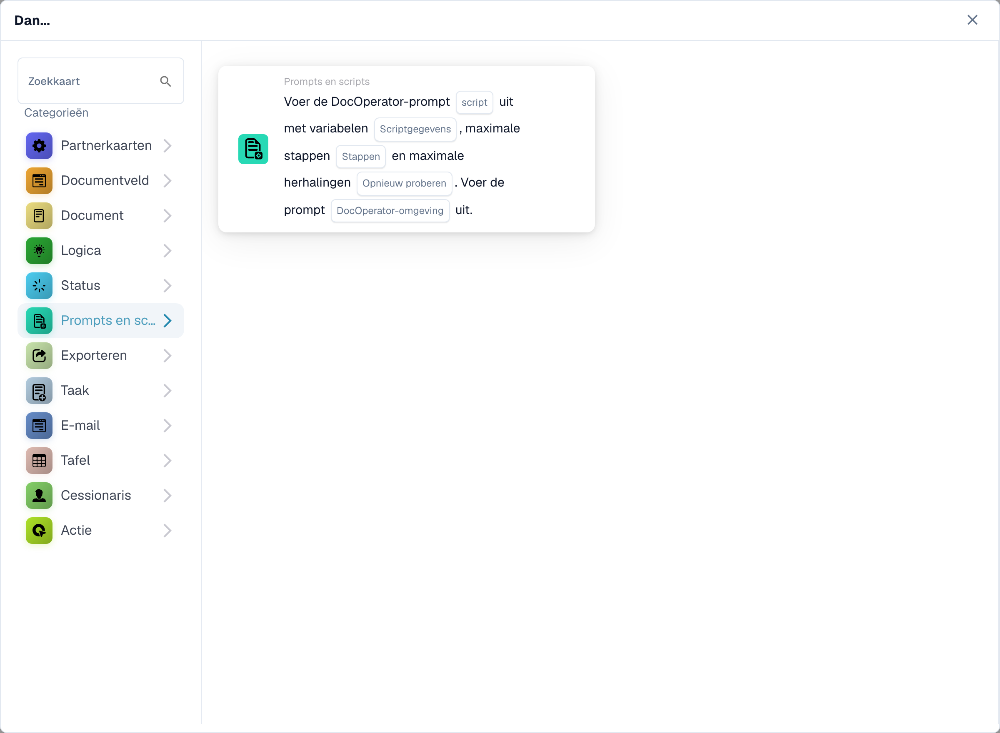
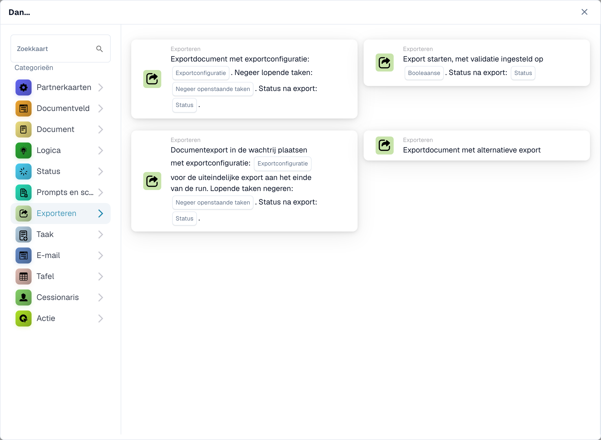
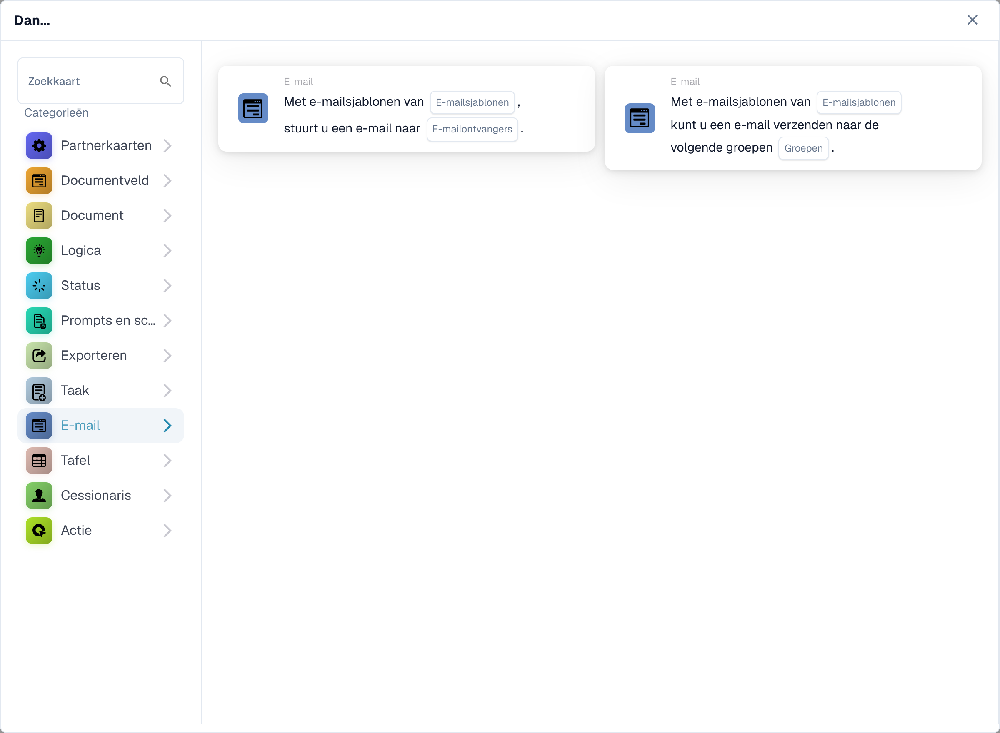
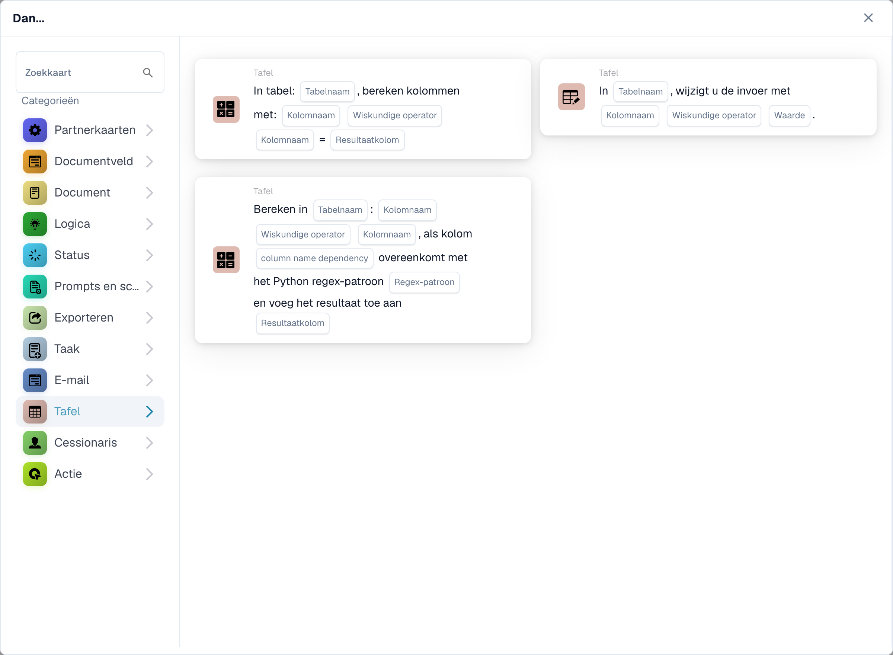
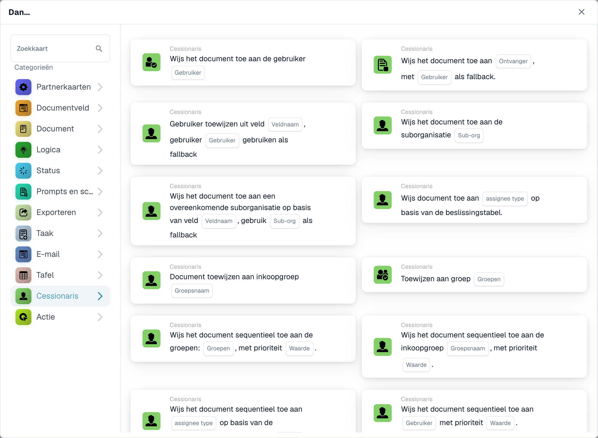
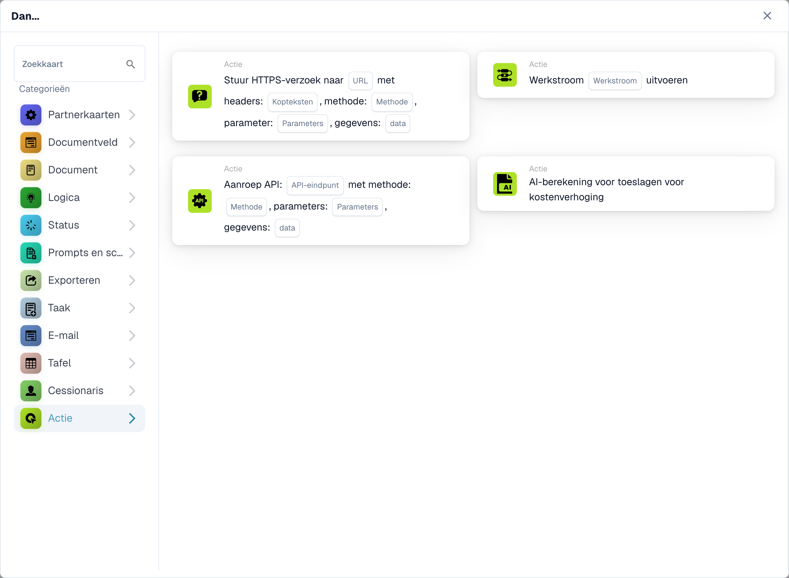

# Dan

Een **Dan**-kaart vertelt een workflow wat er moet gebeuren na de **Wanneer**-trigger en eventuele **En**-voorwaarden. In de **Workflow-bouwer** selecteert u **Kaart toevoegen** onder **Dan...**. Kies een categorie aan de linkerkant of typ een naam in **Zoekkaart**. Selecteer een kaartvoorbeeld om deze toe te voegen, vul de velden in die op de kaart worden weergegeven en sla de workflow op. Scroll binnen de kiezer om meer kaarten te zien. Selecteer **×** om het te sluiten zonder een kaart toe te voegen. Zie [Workflow](..) voor de volledige reeks.

De onderstaande voorbeelden tonen beschikbare acties, niet voltooide instellingen. Kies de actie die overeenkomt met het gewenste resultaat.

## Documentveld

Zet een selectievakje aan of keer het om, plaats tekst in een veld of kopieer het ene veld naar het andere. Kies de veldnamen en de door de kaart gevraagde waarde. Zie [Documentveld](document-field).

<figure><figcaption>
Beschikbare kaarten in de geselecteerde categorie. Vul de velden vóór gebruik in. Sommige labels van deze versie zijn in de interface nog niet of onjuist vertaald. De uitleg op deze pagina gebruikt de juiste termen; de afbeelding toont de werkelijke interface.
</figcaption></figure>

## Document

Kies **Het document goedkeuren** of **Het document afwijzen** wanneer de workflow die beslissing moet nemen. Gebruik eerst een voorwaarde **En** als goedkeuring afhankelijk moet zijn van een controle. Zie [Document](document).

<figure><figcaption>
Beschikbare kaarten in de geselecteerde categorie. Vul de velden vóór gebruik in. Sommige labels van deze versie zijn in de interface nog niet of onjuist vertaald. De uitleg op deze pagina gebruikt de juiste termen; de afbeelding toont de werkelijke interface.
</figcaption></figure>

## Logica

Gebruik deze kaarten om waarden om te zetten tussen getal-, tekst- en Booleaanse notaties, of om een waarde uit JSON te lezen. Kies de invoer- en uitvoervelden op de geselecteerde kaart.

<figure><figcaption>
Beschikbare kaarten in de geselecteerde categorie. Vul de velden vóór gebruik in. Sommige labels van deze versie zijn in de interface nog niet of onjuist vertaald. De uitleg op deze pagina gebruikt de juiste termen; de afbeelding toont de werkelijke interface.
</figcaption></figure>

## Status

Kies **Status wijzigen** om het document naar een geselecteerde status te verplaatsen. De kaart kan ook een andere workflow activeren. Zie [Status](status).

<figure><figcaption>
Beschikbare kaarten in de geselecteerde categorie. Vul de velden vóór gebruik in. Sommige labels van deze versie zijn in de interface nog niet of onjuist vertaald. De uitleg op deze pagina gebruikt de juiste termen; de afbeelding toont de werkelijke interface.
</figcaption></figure>

## Aanwijzingen en scripts

Kies deze categorie om een DocOperator-promptscript uit te voeren. Selecteer het script en de variabelen die door de kaart worden gevraagd. De kaart biedt ook uitvoeringsinstellingen zoals nieuwe pogingen.

<figure><figcaption>
Beschikbare kaarten in de geselecteerde categorie. Vul de velden vóór gebruik in. Sommige labels van deze versie zijn in de interface nog niet of onjuist vertaald. De uitleg op deze pagina gebruikt de juiste termen; de afbeelding toont de werkelijke interface.
</figcaption></figure>

## Exporteren

Start een export, exporteer met een gekozen configuratie of zet een definitieve export in de wachtrij. Kies de exportconfiguratie en openstaande taakoptie die op uw kaart wordt weergegeven. Zie [Exporteren](export).

<figure><figcaption>
Beschikbare kaarten in de geselecteerde categorie. Vul de velden vóór gebruik in. Sommige labels van deze versie zijn in de interface nog niet of onjuist vertaald. De uitleg op deze pagina gebruikt de juiste termen; de afbeelding toont de werkelijke interface.
</figcaption></figure>

## Taak

Maak een taak of melding aan en wijs deze toe aan een gebruiker of groep. Voer de titel, beschrijving, prioriteit en meldingsinstellingen in die door de kaart worden gevraagd. Sommige kaarten worden opeenvolgend toegewezen. Zie [Taak](task).

<figure><figcaption>
Beschikbare kaarten in de geselecteerde categorie. Vul de velden vóór gebruik in. Sommige labels van deze versie zijn in de interface nog niet of onjuist vertaald. De uitleg op deze pagina gebruikt de juiste termen; de afbeelding toont de werkelijke interface.
</figcaption></figure>

## E-mail

Stuur een e-mail met behulp van een geselecteerd sjabloon, naar ontvangers of naar groepen. Kies het sjabloon en de bestemming op de kaart.

<figure><figcaption>
Beschikbare kaarten in de geselecteerde categorie. Vul de velden vóór gebruik in. Sommige labels van deze versie zijn in de interface nog niet of onjuist vertaald. De uitleg op deze pagina gebruikt de juiste termen; de afbeelding toont de werkelijke interface.
</figcaption></figure>

## Tabel

Wijzig gegevens of bereken waarden in een documenttabel. Selecteer de tabel, kolommen, operator en resultaatkolom die door de kaart wordt aangevraagd. Zie [Tabel](table).

<figure><figcaption>
Beschikbare kaarten in de geselecteerde categorie. Vul de velden vóór gebruik in. Sommige labels van deze versie zijn in de interface nog niet of onjuist vertaald. De uitleg op deze pagina gebruikt de juiste termen; de afbeelding toont de werkelijke interface.
</figcaption></figure>

## Toewijzing

Wijs het document toe aan een gebruiker, groep, ontvanger of suborganisatie. Sommige kaarten gebruiken een veld- of beslissingstabel en bieden een terugvalmogelijkheid. Kies de juiste bestemming en val terug op de geselecteerde kaart. Zie [Toegewezene](assignee).

<figure><figcaption>
Beschikbare kaarten in de geselecteerde categorie. Vul de velden vóór gebruik in. Sommige labels van deze versie zijn in de interface nog niet of onjuist vertaald. De uitleg op deze pagina gebruikt de juiste termen; de afbeelding toont de werkelijke interface.
</figcaption></figure>

## Actie

Voer een andere workflow uit, stuur een HTTPS-verzoek, roep een API aan of gebruik de kostenstijgingsberekeningskaart. Deze acties kunnen andere systemen beïnvloeden; Vraag uw beheerder welk eindpunt en welke instellingen u moet gebruiken. Zie [Actie](action).

<figure><figcaption>
Beschikbare kaarten in de geselecteerde categorie. Vul de velden vóór gebruik in. Sommige labels van deze versie zijn in de interface nog niet of onjuist vertaald. De uitleg op deze pagina gebruikt de juiste termen; de afbeelding toont de werkelijke interface.
</figcaption></figure>

[Gedetailleerde logicakaartvelden, JSON-paden, triggers en tests](../cards-overview/logic-cards-guide.md).
