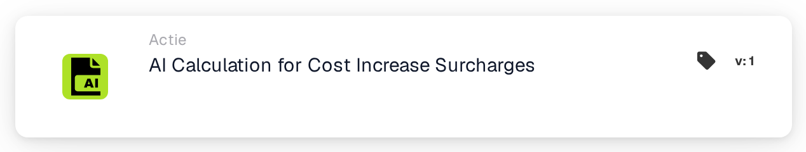
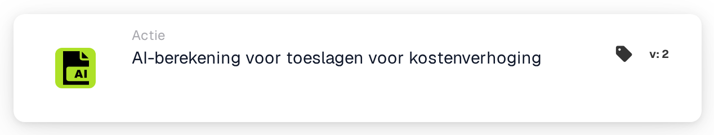

# AI-berekening voor kostenverhogingstoeslagen

<figure><figcaption>
Versie 1
</figcaption></figure>

<figure><figcaption>
Versie 2
</figcaption></figure>

## Wanneer moet u deze kaart gebruiken?

Met deze actie kunt u de geconfigureerde MTZ/ETZ materiaal- en energietoeslagberekening voor het huidige document opvragen. Bereid eerst de documentgegevens en de configuratie van de berekeningsservice voor die uw organisatie nodig heeft.

## Werkelijke configuratie

De weergegeven kaart heeft geen invoer voor Kostenverhogingsfactor, Basiskostenveld of Toeslagveld. Het delegeert de berekening aan de geconfigureerde service. Zoek niet naar deze niet-bestaande kaartcontroles en ga niet uit van een formule met een vast percentage op basis van de kaartnaam.

## Resultaat en verificatie

Een succesvolle servicereactie markeert de kaart als succesvol. Een time-out of een mislukte reactie leidt tot een kaartfout. Inspecteer het kaartlogboek en de daaruit voortvloeiende toeslaggegevens van het document; Het succes van de oproep alleen duidt niet op een bepaald bedrag.

In de kaarttestmodus wordt het aanroep overgeslagen en wordt succes gesimuleerd. Dit is handig voor het testen van de workflow-structuur, maar het bewijst niet dat de service heeft gedraaid of dat er een toeslag is berekend.

<!-- workflow-card-practical-example-20261021 -->

## Praktisch voorbeeld

**Wanneer gebruiken:** Vraag de geconfigureerde materiaal-/energietoeslagberekening op voor een opgemaakte factuur.

**Configuratie:** Gebruik synthetische factuur `DEMO-001` met de gegevens die vereist zijn voor uw geconfigureerde MTZ/ETZ-service. Voeg deze actie toe na de documentvalidatievoorwaarden.

**Verwacht resultaat en tegenvoorbeeld:** Een succesvolle servicereactie markeert de kaart succesvol; een time-out of een mislukte reactie veroorzaakt een kaartfout. Bekijk de documentvelden en het berekeningsresultaat afzonderlijk. De kaarttestmodus simuleert succes en roept de service niet op, zodat er geen echt toeslagresultaat kan worden bewezen.

Dit is een illustratieve configuratie en een verwacht resultaat. Gebruik velden, gebruikers en groepen die in uw testorganisatie zijn geconfigureerd; het is geen bewering dat dit voorbeeld is uitgevoerd.
