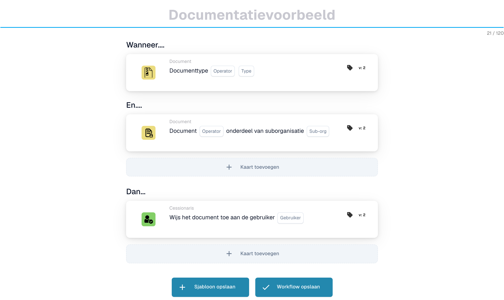

# Externe API aanroepen

***

Voeg deze kaart toe aan de groep **Dan** van de Workflow Builder — de acties die worden uitgevoerd zodra de When/And-voorwaarden overeenkomen:

<figure><figcaption><p>Niet-opgeslagen voorbeeld met Wanneer-, En- en Dan-kaarten. Vul alle velden in vóór uitvoering. Sommige labels van deze versie zijn in de interface nog niet of onjuist vertaald. De uitleg op deze pagina gebruikt de juiste termen; de afbeelding toont de werkelijke interface.</p></figcaption></figure>

***

## 📌 Versie-informatie

**Huidige versie:** v2 (nieuwste en aanbevolen) **Status:** ✅ Actief

**Versiegeschiedenis:**

* v1 → Basis API-aanroep (niet langer aanbevolen)
* **v2 → CURRENT** (meertalige ondersteuning toegevoegd)

**Wat is er veranderd:** v2 heeft ondersteuning voor internationalisering (i18n) toegevoegd met vertaalsleutels. De functionaliteit blijft identiek.

📖 [Versiegeschiedenis en wijzigingen](../../release.md) | [Volledige kaartdatabase](../../cards-overview/export-cards-guide.md)

***

## Doel

Met deze kaart kunt u gegevens naar een externe website of dienst sturen en informatie terugkrijgen. Zie het als het sturen van een vraag naar een externe dienst en het krijgen van een antwoord dat u kunt gebruiken in uw workflow.

**Voorbeeld uit de praktijk:** Uw bedrijf gebruikt een prijssysteem op een andere website. Deze kaart kan dat prijssysteem automatisch om de huidige prijs van een artikel vragen en die prijs in uw document opnemen.

***

## Wanneer moet u deze kaart gebruiken?

Gebruik deze kaart wanneer u:

* Informatie verkrijgen van een externe service (zoals prijzen, validatie of opzoekgegevens)
* Verzend documentinformatie naar een ander systeem voor verwerking
* Integreer met services van derden
* Automatisch gegevens ophalen zonder handmatige zoekopdrachten
* Verbind meerdere bedrijfssystemen met elkaar

**Gemeenschappelijke scenario's:**

* Leveranciersinformatie opzoeken in een database
* Ontvang realtime prijzen van een prijsservice
* Valideer gegevens tegen een extern systeem
* Verzendinformatie ophalen bij een logistiek dienstverlener

***

## Hoe het werkt

1. **Conditiecontrole**: de workflow controleert eerst of aan de voorwaarden in de secties "Wanneer" en "En" is voldaan
2. **Gegevens voorbereiden**: de kaart verzamelt de parameters die u heeft geconfigureerd
3. **Verzoek verzenden**: het verzendt uw gegevens naar de externe API/service
4. **Receive Response**: De externe service antwoordt met gegevens
5. **Continue**: De workflow gebruikt deze gegevens in volgende kaarten

***

## Parameters uitgelegd

### API-eindpunt-URL

**Wat het is:** Het adres van de externe dienst waarmee u wilt communiceren

**Voorbeeld:** `https://api.supplier-system.com/product/pricing`

**Hoe u het kunt vinden:** Vraag uw IT-team of de serviceprovider naar hun API-eindpunt

***

### HTTP-methode

**Wat het is:** Het type verzoek dat moet worden verzonden

**Opties:**

* **GET**: Informatie opvragen (zoals het stellen van een vraag)
* **POST**: Nieuwe gegevens verzenden
* **PUT**: Bestaande gegevens bijwerken
* **DELETE**: Gegevens verwijderen

**Meest voorkomend:** GET (voor het ophalen van informatie)

***

### Kopteksten

**Wat het is:** Aanvullende instructies voor de dienst die u belt

**Voorbeeld:**

```
Authorization: Bearer your-api-key
Content-Type: application/json
```

**Waarom het nodig is:** Services vereisen vaak authenticatie of specifieke formaatinstructies

***

### Parameters (queryparameters)

**Wat het is:** Extra informatie doorgegeven in de URL

**Voorbeeld:**

```
?supplier_id=12345&currency=USD
```

**Reëel voorbeeld:** Als u om prijzen vraagt, kunnen de parameters de leveranciers-ID en valuta omvatten

***

### Gegevens opvragen (body)

**Wat het is:** De informatie die u naar de service verzendt

**Voorbeeld:**

```json
{
  "product_id": "ABC123",
  "quantity": 100,
  "currency": "EUR"
}
```

**Bij gebruik:** Bij gebruik van POST- of PUT-methoden

***

## Stapsgewijs voorbeeld

### Scenario: ontvang realtime leveranciersprijzen

**Instellingen:**

1. **Kaarttype:** API aanroepen
2. **API-eindpunt:** `https://api.suppliers.com/v1/prices`
3. **Methode:** POST
4. **Kopteksten:** `Authorization: Bearer YOUR-API-KEY`
5.  **Gegevens opvragen:**

    ```json
    {
      "product_id": "ABC123",
      "quantity": 100
    }
    ```

**Wat gebeurt er:**

1. Document arriveert met product-ID: ABC123, aantal: 100
2. Kaart stuurt een verzoek naar de API van de leverancier
3. De API van de leverancier antwoordt met: `{"unit_price": 25.50, "total_price": 2550}`
4. De workflow gaat verder met deze prijsinformatie
5. Next card kan deze gegevens gebruiken om de factuurprijs te valideren

***

## Configuratiestappen

### 1. Ontvang API-informatie

Neem contact op met de externe dienstverlener en vraag:

* [ ] API-eindpunt-URL
* [ ] Authenticatiemethode (API-sleutel, gebruikersnaam/wachtwoord, OAuth)
* [ ] Vereiste parameters
* [ ] Verwacht antwoordformaat
* [ ] Tarieflimieten of quota's

### 2. Configureer de kaart

1. Voer de URL van het API-eindpunt in
2. Selecteer de HTTP-methode (meestal GET of POST)
3. Voeg indien nodig authenticatieheaders toe
4. Voeg eventuele vereiste parameters toe
5. Formatteer verzoekgegevens indien nodig als JSON

### 3. Test de kaart

1. Gebruik een testdocument
2. Voer de werkstroom uit
3. Controleer of het antwoord correct is ontvangen
4. Controleer of het gegevensformaat overeenkomt met de verwachtingen

***

## Algemene responsscenario's

### Succesvolle reactie (statuscode 200)

```json
{
  "success": true,
  "data": {
    "price": 150,
    "currency": "EUR",
    "delivery_days": 5
  }
}
```

✅ Gegevens zijn beschikbaar voor de volgende kaarten die kunnen worden gebruikt

### Foutreactie (statuscode 404)

```json
{
  "error": "Product not found"
}
```

⚠️ De API kan niet vinden wat je zoekt

### Time-out

De externe service heeft niet binnen de tijdslimiet gereageerd ⚠️ Controleer of de service beschikbaar is en of de eindpunt-URL correct is

***

## Voorbeeldworkflows

### Voorbeeld 1: Automatische prijsvalidatie

**Scenario:** Valideer factuurprijzen ten opzichte van de huidige prijzen van de leverancier

**Stroom:**

1. Document arriveert met factuurregelitem (Product: A123, prijs: € 50)
2. **Bel API-kaart** → Vraagt API van leverancier: "Wat is de huidige prijs voor A123?"
3. Leverancier reageert: "€48"
4. **Conditiekaart** → Controleert of de factuurprijs (€ 50) binnen 5% van de huidige prijs (€ 48) ligt
5. **Goedkeuringskaart** → Keurt goed indien binnen tolerantie

### Voorbeeld 2: Automatisch opzoeken van leveranciers

**Scenario:** Haal stamgegevens van leveranciers op uit de centrale database

**Stroom:**

1. Factuur wordt geleverd met leverancierscode: SUPP-789
2. **Bel API-kaart** → Vraagt systeem: "Geef mij details voor leverancier SUPP-789"
3. Systeem antwoordt met: Naam, Contact, Voorwaarden, etc.
4. **Veldkaarten instellen** → Documentvelden vullen met deze gegevens
5. **Kaart exporteren** → Exporteren met volledige informatie

### Voorbeeld 3: Realtime verzendkosten

**Scenario:** Ontvang automatische verzendkosten op basis van bestemming

**Stroom:**

1. Document heeft afleveradres
2. **Bel API-kaart** → Vraag verzendprovider: "Wat zijn de kosten voor \[adres]?"
3. Aanbieder reageert met verzendkosten
4. **Bereken kaart** → Voeg verzendkosten toe aan het totale factuurbedrag
5. **Kaart exporteren** → Verzenden met bijgewerkt totaal

***

## Problemen oplossen

### Fout "Verbindingstime-out".

**Oorzaak:** De API-service reageert niet

**Oplossingen:**

* [ ] Controleer of de dienst beschikbaar is (bezoek de website)
* [ ] Controleer of de eindpunt-URL correct is (geen typefouten)
* [ ] Controleer de internetverbinding
* [ ] Neem contact op met de serviceprovider
* [ ] Controleer of de service tarieflimieten heeft (u verzendt te veel verzoeken)

### Fout 'Ongeautoriseerd' of '403 verboden'

**Oorzaak:** Authenticatie mislukt

**Oplossingen:**

* [ ] Controleer of uw API-sleutel correct is
* [ ] Controleer of uw API-sleutel is verlopen
* [ ] Zorg ervoor dat de authenticatieheader correct is opgemaakt
* [ ] Controleer of u machtigingen heeft voor dit eindpunt

### "Slecht verzoek" of "400-fout"

**Oorzaak:** Het gegevensformaat van het verzoek is onjuist

**Oplossingen:**

* [ ] Controleer de JSON-syntaxis (ontbrekende komma's, aanhalingstekens, enz.)
* [ ] Controleer of alle verplichte velden zijn opgenomen
* [ ] Controleer of de parameternamen overeenkomen met wat de service verwacht
* [ ] Raadpleeg de API-documentatie

### "Reactie werkt niet zoals verwacht"

**Oplossingen:**

* [ ] Test de API met een tool als Postman
* [ ] Vergelijk het werkelijke antwoordformaat met het verwachte formaat
* [ ] Controleer of de documentatie van de API is gewijzigd
* [ ] Controleer of de gegevens die u verzendt correct zijn

***

## Gebruik van responsgegevens

Zodra u gegevens terugkrijgt van de API, kunnen de volgende kaarten deze gebruiken:

```
API Response:
{
  "unit_price": 45.00,
  "currency": "USD",
  "available": true
}

Next Card (Set Field):
- Set "Unit_Price" field to 45.00
- Set "Currency" field to USD
- Set "In_Stock" checkbox to true
```

***

## Beveiligingsopmerkingen

⚠️ **Belangrijk:** Plaats nooit gevoelige informatie in de kaartconfiguratie die mogelijk zichtbaar is voor andere gebruikers

* Codeer wachtwoorden niet hard
* Gebruik API-sleutels veilig
* Neem geen persoonlijke gegevens op in logboeken
* Gebruik HTTPS-eindpunten (niet HTTP)

***

## Tips en beste praktijken

✅ **Doe:**

* Test eerst met een klein aantal documenten
* Houd API-aanroepen eenvoudig en doelgericht
* Voeg foutafhandeling toe met Conditiekaarten
* Monitor API-gebruik/kosten
* Documenteer de API-vereisten voor uw team

❌ **Niet doen:**

* Roep API's aan voor elk afzonderlijk verzoek als u gegevens in de cache kunt opslaan
* Negeer responsfoutcodes
* Gebruik test-API's in productie
* Vergeet authenticatieheaders toe te voegen
* Ga ervan uit dat de API altijd beschikbaar zal zijn

***

## Gerelateerde kaarten

* **ACTION\_HTTPS\_REQUEST** - Soortgelijke maar eenvoudigere HTTPS-verzoeken
* **CONDITION\_HTTPS\_REQUEST\_STATUS** - Controleer of de API-oproep succesvol was
* **ACTION\_SEND\_EMAIL** - Gegevens verzenden via e-mail in plaats van API
* **CALL\_API** (andere versie) - Alternatieve API-aanroepmethode

***

## Hulp nodig?

* Vraag uw IT-/integratieteam om API-documentatie
* Gebruik de Postman-tool om eerst API-eindpunten te testen
* Controleer het ondersteuningsportaal van de serviceprovider
* Bekijk de API-documentatie voor de vereiste formaten
