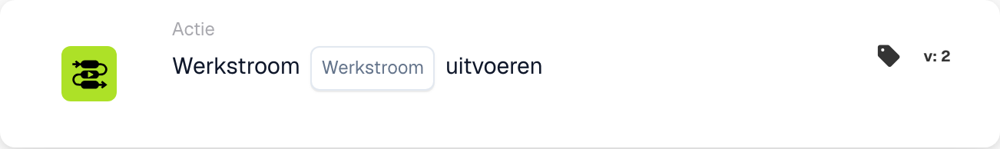

# Werkstroom uitvoeren

<figure><figcaption>
Kaartvelden in de getoonde versie. De velden zijn nog niet ingevuld.
</figcaption></figure>

## Doel:

Met de kaart **"Werkstroom uitvoeren"** kunnen gebruikers dynamisch een geselecteerde workflow uitvoeren uit een lijst van beschikbare workflows. Deze kaart is nuttig voor het automatiseren van processen waarbij meerdere workflows met elkaar verbonden zijn, wat gestroomlijnde bewerkingen mogelijk maakt.

## Onderdelen van de kaart:

1. **Werkstroom**
   * **Beschrijving:** Geeft de workflow op die wordt uitgevoerd wanneer de voorwaarden als true worden geëvalueerd.
   * **Details:** Er wordt een dropdownlijst van alle beschikbare workflows geboden om uit te selecteren.

## Functionaliteit:

* **Voorwaarde-evaluatie:** De kaart voert de geselecteerde workflow alleen uit als zowel de **"Wanneer"**- als de **"En"**-secties als true worden geëvalueerd.
  * Als een van beide voorwaarden false is, wordt er geen actie ondernomen en blijft de workflow ongetriggerd.
* **Workflow-uitvoering:**
  * Wanneer aan de voorwaarden wordt voldaan, wordt de opgegeven workflow automatisch getriggerd.
  * Als niet aan de voorwaarden wordt voldaan, wordt er geen workflow uitgevoerd.

## Opzet en configuratie:

1. **Workflow selecteren:** Kies de te triggeren workflow uit de **dropdownlijst** van beschikbare workflows.
2. **Voorwaarden definiëren:** Configureer de **"Wanneer"**- en **"En"**-secties om de criteria op te geven waaraan moet worden voldaan om de workflow uit te voeren.

## Conclusie:

De kaart **"Werkstroom uitvoeren"** biedt een handige en efficiënte manier om workflows aan elkaar te koppelen en zo meerstapsprocessen eenvoudig te automatiseren. Door ervoor te zorgen dat aan de voorwaarden in de **"Wanneer"**- en **"En"**-secties wordt voldaan, kunnen gebruikers workflows dynamisch uitvoeren en handmatige interventie verminderen.

<!-- workflow-card-practical-example-20261021 -->

## Praktisch voorbeeld

**Wanneer gebruiken:** Hergebruik een bestaande validatieworkflow.

**Configuratie:** Selecteer een geconfigureerde onderliggende demo-workflow die `routing_result` instelt op `checked`.

**Verwacht resultaat en tegenvoorbeeld:** De geselecteerde werkstroom wordt aangeroepen in de ondersteunde uitvoeringscontext. Controleer het eigen log- en veldresultaat; koppel het niet in een lus terug aan de ouder.

Dit is een illustratieve configuratie en een verwacht resultaat. Gebruik velden, gebruikers en groepen die in uw testorganisatie zijn geconfigureerd; het is geen bewering dat dit voorbeeld is uitgevoerd.
